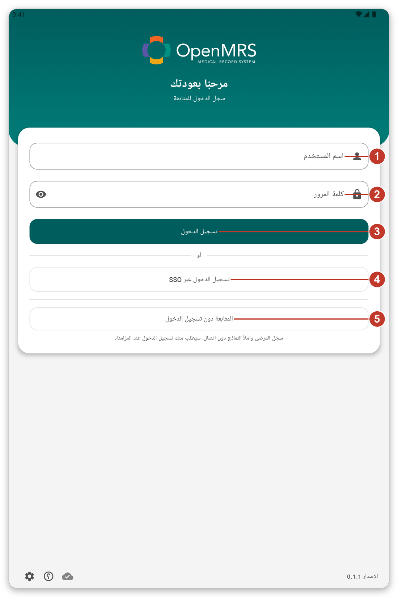
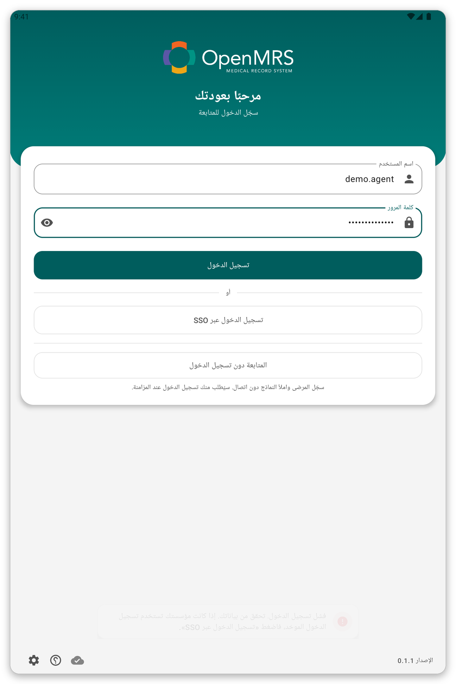
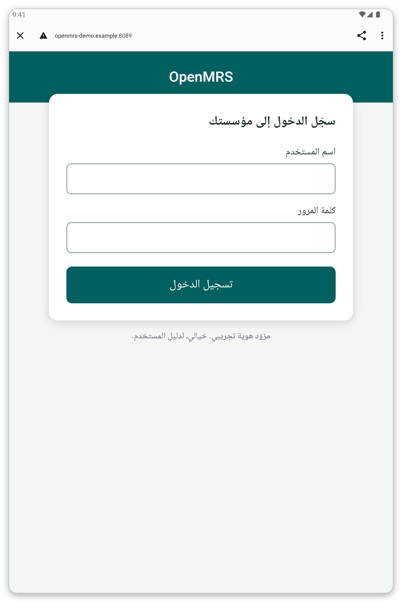
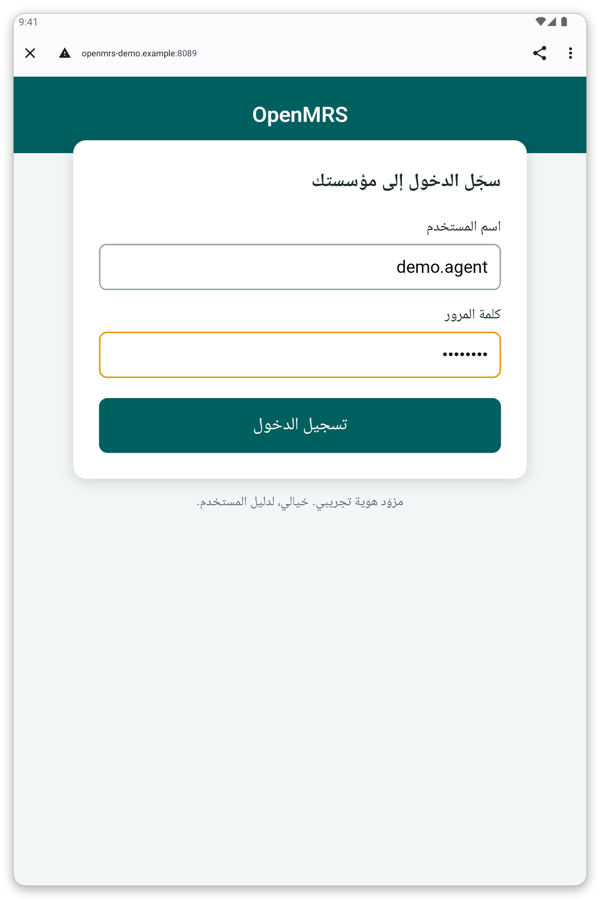
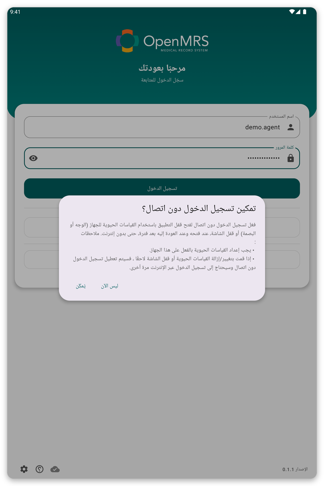
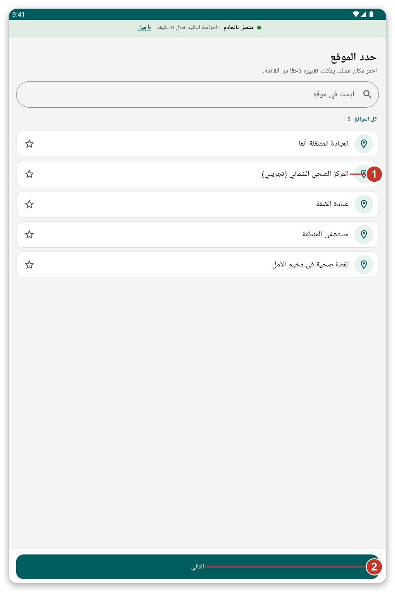
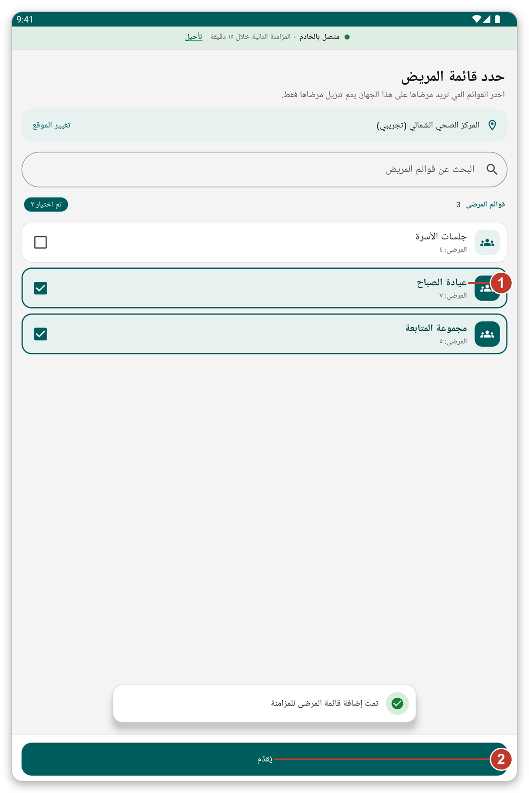
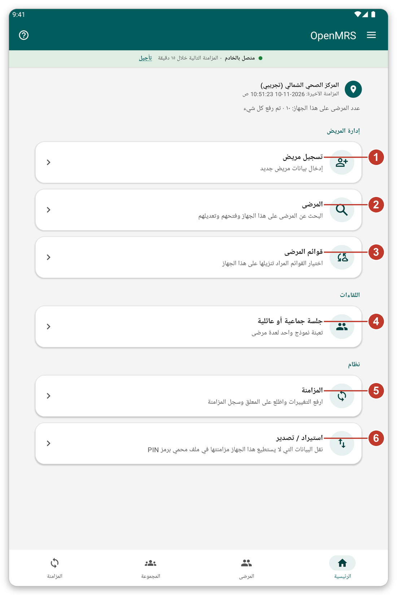

# البدء {#getting-started}

## تثبيت التطبيق وفتحه {#install}

**الغرض منه:** وضع التطبيق على الجهاز اللوحي وفتحه للمرة الأولى.

**قبل أن تبدأ:** تزوّدك مؤسستك بالتطبيق. <!-- TODO: verify how the app is distributed (app file or store) -->

1. ثبّت التطبيق على الجهاز اللوحي كما أخبرتك مؤسستك.
2. افتح التطبيق. ستظهر صفحة تسجيل الدخول.
3. إذا طلب Android السماح بإرسال الإشعارات، اضغط **السماح**. يستخدم التطبيق الإشعارات ليخبرك بأن مزامنة قيد التنفيذ.

> **نصيحة:** الأيقونات الصغيرة في أسفل صفحة تسجيل الدخول تفتح إعدادات الصفحة (اللغة والمظهر والخادم) وتبدأ جولة قصيرة.

## تسجيل الدخول {#sign-in}

**الغرض منه:** إثبات هويتك ليتمكن التطبيق من تنزيل مرضاك.

**قبل أن تبدأ:** تحتاج إلى اتصال بالإنترنت.

*الشكل 1: صفحة تسجيل الدخول.*

1. اكتب اسم المستخدم في {{username}} (1).
2. اكتب كلمة المرور في {{password}} (2).
3. اضغط {{button_login}} (3).

إذا كانت مؤسستك تستخدم تسجيل الدخول الموحّد، أو تسمح لك بالعمل بدون حساب، فسترى أيضاً {{sign_in_with_sso}} (4) و{{continue_without_login}} (5).

> **تحذير:** إذا كانت كلمة المرور خاطئة تظهر رسالة وتبقى في الصفحة نفسها. تحقّق من كلمة المرور وحاول مرة أخرى. وبعد عدة محاولات خاطئة اطلب من مؤسستك إعادة تعيينها.

*الشكل 2: بعد كلمة مرور خاطئة تبقى في صفحة تسجيل الدخول ويمكنك المحاولة مرة أخرى.*

### تسجيل الدخول الموحّد {#sso}

يتيح لك تسجيل الدخول الموحّد استخدام الحساب الذي أعطتك إياه مؤسستك أصلاً.

1. اضغط {{sign_in_with_sso}}. تُفتح صفحة تسجيل الدخول الخاصة بمؤسستك في المتصفح.
2. اكتب اسم المستخدم وكلمة المرور في تلك الصفحة.
3. اضغط **تسجيل الدخول**. يُفتح التطبيق من جديد تلقائياً.

*الشكل 3: صفحة تسجيل الدخول الخاصة بمؤسستك. وتبدو مختلفة في كل مؤسسة.*

*الشكل 4: اكتب اسم المستخدم وكلمة المرور ثم اضغط الزر الأخضر.*

> **ملاحظة:** الصفحة التي تظهر في المتصفح تخص مؤسستك وليست جزءاً من التطبيق. إذا لم تُفتح فتحقق من اتصالك وحاول مرة أخرى.

### العمل بدون حساب {#guest}

إذا سمحت مؤسستك بذلك، اضغط {{continue_without_login}}. يمكنك تسجيل المرضى وملء النماذج بدون اتصال. ويطلب منك التطبيق تسجيل الدخول عند المزامنة، ويحتفظ بما دوّنته.

## تسجيل الدخول بدون اتصال {#offline-login-prompt}

بعد أول تسجيل دخول يسألك التطبيق إن كنت تريد فتحه ببصمتك أو بوجهك أو بقفل الشاشة، حتى بدون اتصال.

*الشكل 5: السؤال عن تسجيل الدخول بدون اتصال.*

- اضغط {{enable_offline_login_positive}} لتشغيله. يجب أن تكون في جهازك بصمة أو وجه أو قفل شاشة معدّ مسبقاً.
- اضغط {{enable_offline_login_negative}} لتخطّيه. يمكنك تغيير ذلك لاحقاً من الإعدادات.

## اختيار مكان عملك {#choose-location}

*الشكل 6: اختر المكان الذي تعمل فيه.*

1. اضغط مكانك في القائمة (1). تتيح لك النجمة إبقاء أماكنك المفضلة في الأعلى.
2. اضغط {{next}} (2).

> **ملاحظة:** ما تسجّله وتدوّنه يُحفظ في هذا المكان. ويمكنك تغييره لاحقاً من القائمة.

## اختيار قوائم المرضى {#choose-lists}

*الشكل 7: حدّد القوائم التي تحتاج إلى مرضاها.*

1. حدّد القوائم التي تحتاجها (1). يوضح الرقم عدد المرضى في كل قائمة.
2. اضغط {{submit}} (2).

ينزّل التطبيق الآن هؤلاء المرضى. **انتظر حتى ينتهي.** لا يمكن تخطي هذا التنزيل الأول، وقد يستغرق عدة دقائق. ابقَ متصلاً بشبكة Wi-Fi أو ببيانات الجوال، واترك الجهاز اللوحي حيث تكون الإشارة جيدة.

## الشاشة الرئيسية {#first-home}

عندما ينتهي التنزيل تظهر الشاشة الرئيسية. وفي المرة الأولى تعرض لك جولة قصيرة معالم التطبيق. اضغط {{tutorial_skip}} إن كنت لا تريدها. ويمكنك بدء جولة من جديد في أي وقت بالزر **؟**.

*الشكل 8: الشاشة الرئيسية. يُشرح كل رقم في الفصل التالي.*

## إذا حدث خطأ {#getting-started-problems}

- تقول صفحة تسجيل الدخول إنها تعذّر عليها الاتصال: راجع [استكشاف الأخطاء وإصلاحها](#cannot-connect).
- لا تُحمَّل قوائم المرضى: اضغط {{patient_lists_try_again}}، أو راجع [استكشاف الأخطاء وإصلاحها](#lists-fail).
