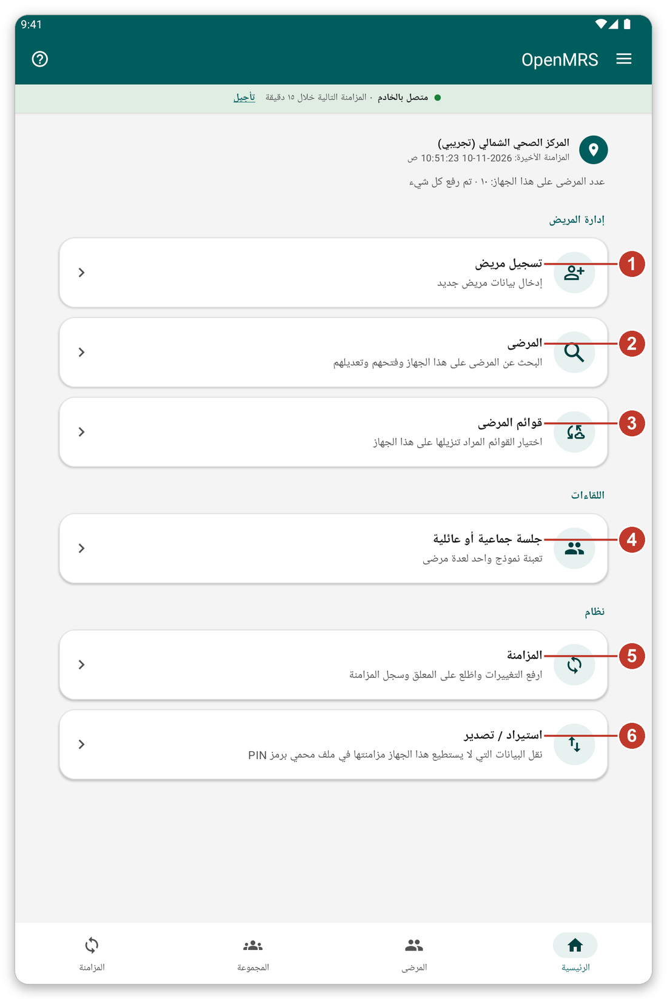
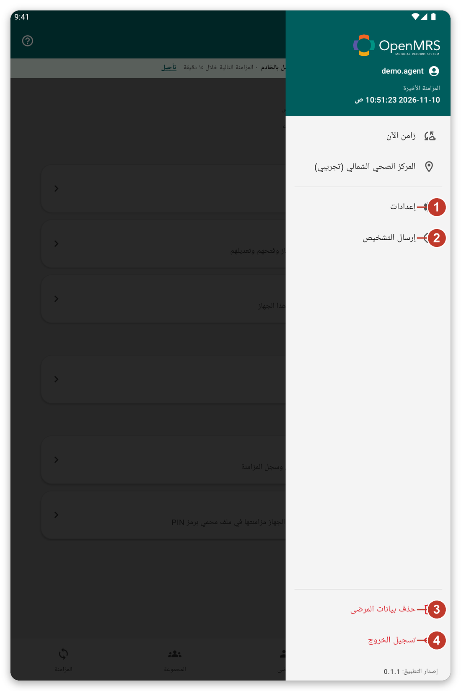

# التنقل داخل التطبيق {#navigation}

## الغرض منه {#nav-purpose}

يعرض هذا الفصل الأجزاء الرئيسية من الشاشة لتعرف دائماً أين أنت وكيف تعود.

## الشاشة الرئيسية {#home-screen}

*الشكل 1: الشاشة الرئيسية.*

في الأعلى ترى المكان الذي تعمل فيه ووقت آخر مزامنة للبيانات وعدد المرضى على الجهاز اللوحي. وتحتها الأزرار:

1. {{title_add_patient}}: إدخال بيانات مريض جديد.
2. {{nav_patients}}: البحث عن المرضى الموجودين على الجهاز اللوحي وفتحهم وتعديلهم.
3. {{patient_lists_header}}: اختيار قوائم المرضى التي تحتفظ بها على الجهاز اللوحي.
4. {{title_group_encounter}}: ملء نموذج واحد لعدة مرضى.
5. {{nav_sync}}: إرسال عملك وتنزيل أحدث البيانات.
6. {{title_import_export}}: تمرير بيانات لا يمكن مزامنتها في ملف محمي.

## الشريط السفلي {#bottom-bar}

تنقلك الأزرار الأربعة في أسفل الشاشات الرئيسية مباشرة إلى {{nav_home}} و{{nav_patients}} و{{nav_group_session}} و{{nav_sync}}. ويظهر الزر الذي أنت فيه مميّزاً.

## القائمة {#menu}

اضغط الخطوط الثلاثة في أعلى الشاشة لفتح القائمة.

*الشكل 2: القائمة.*

1. {{settings}}: تغيير اللغة والمظهر والأمان والنماذج وخيارات المزامنة.
2. {{send_diagnostics}}: إعداد تقرير لفريق الدعم.
3. {{delete_patient_data_menu}}: إزالة مرضى حسابك من الجهاز اللوحي. ويطلب منك التأكيد أولاً.
4. {{logout}}: الخروج من حسابك.

وموقع عملك موجود أيضاً في القائمة. اضغط عليه لاختيار مكان آخر.

## الشريط تحت العنوان {#connection-strip}

الشريط الملوّن تحت العنوان يخبرك بحالة الاتصال: {{network_status_connected_to_server}} يعني أن الجهاز اللوحي يستطيع الوصول إلى الخادم. وإذا قال إنه لا يمكن الوصول إلى الخادم فما زال بإمكانك العمل. يُحفظ عملك على الجهاز اللوحي ويُرسل لاحقاً.

## مساعدة في كل شاشة {#help-tour}

يبدأ الزر **؟** في أعلى الشاشة جولة قصيرة في الشاشة التي أنت فيها. وكل خطوة تشرح زراً واحداً. اضغط {{tutorial_skip}} لإيقافها.

> **نصيحة:** لا يمكنك بدء جولة أثناء تنفيذ مزامنة. انتظر حتى تنتهي المزامنة.

## إذا حدث خطأ {#nav-problems}

- ضللت طريقك: اضغط سهم الرجوع في أعلى الشاشة، أو اضغط {{nav_home}} في الشريط السفلي.
- زر باللون الرمادي: غير متاح الآن. فمثلاً يكون {{nav_sync}} في القائمة رمادياً عندما لا يمكن الوصول إلى الخادم.
