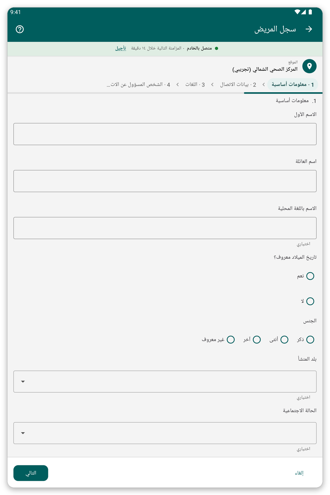

# تسجيل مريض {#register-patient}

## الغرض منه {#register-purpose}

إضافة مريض جديد إلى التطبيق مع اسمه وعمره وجنسه وبيانات الاتصال به.

## قبل أن تبدأ {#register-before}

- تأكد من أن المريض ليس موجوداً في التطبيق: ابحث أولاً (راجع [البحث عن مريض وفتح ملفه](#find-patient)).
- اختر موقعك أولاً، لأن المريض يُحفظ فيه.

## خطوة بخطوة {#register-steps}

*الشكل 1: الصفحة الأولى من نموذج التسجيل.*

1. في الشاشة الرئيسية اضغط {{title_add_patient}}.
2. أجب عن الأسئلة صفحة بعد صفحة. يجب الإجابة عن الأسئلة الإلزامية قبل المتابعة.
3. اضغط {{button_pagination_next}} للانتقال إلى الصفحة التالية، و{{button_pagination_previous}} للرجوع. ويمكنك أيضاً الضغط على اسم صفحة في الأعلى للانتقال إليها مباشرة.
4. في النهاية اضغط {{button_review}} وراجع إجاباتك.
5. اضغط {{submit}} لحفظ المريض.

بعد الحفظ يفتح التطبيق ملف المريض.

> **تحذير:** لا يمكن حفظ مريض ما دامت هناك إجابات إلزامية ناقصة. وتظهر الإجابات الناقصة باللون الأحمر.

## نصائح {#register-tips}

- إذا كنت لا تعرف تاريخ الميلاد فإن النموذج يتيح لك إدخال العمر بدلاً منه.
- عند عدم وجود اتصال يُحفظ المريض على الجهاز اللوحي ويُرسل في المزامنة التالية.
- إذا كان المريض على الأرجح موجوداً في الخادم لكنه ليس على جهازك اللوحي فلا تسجّله مرة أخرى: استخدم {{identify_later_action}} (راجع [التعرّف لاحقاً](#identify-later)).

## إذا حدث خطأ {#register-problems}

- لا تستطيع الانتقال إلى الصفحة التالية: توجد إجابة إلزامية ناقصة. ابحث عن العلامة الحمراء.
- أخطأت بعد الحفظ: افتح المريض واضغط {{edit_patient}} (راجع [ملف المريض](#patient-file)).
