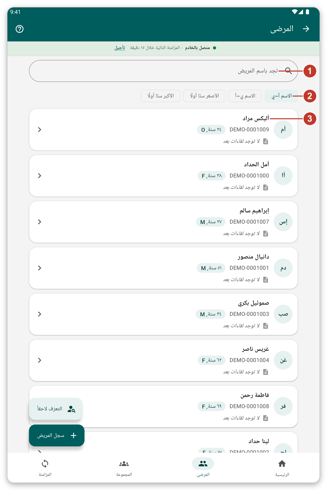
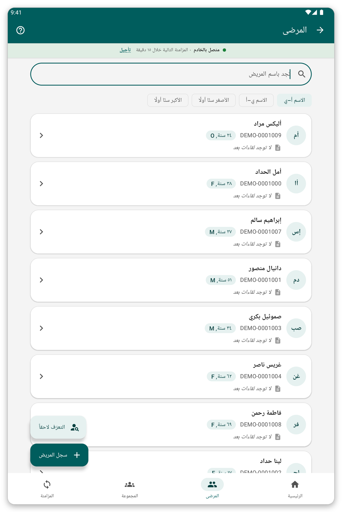
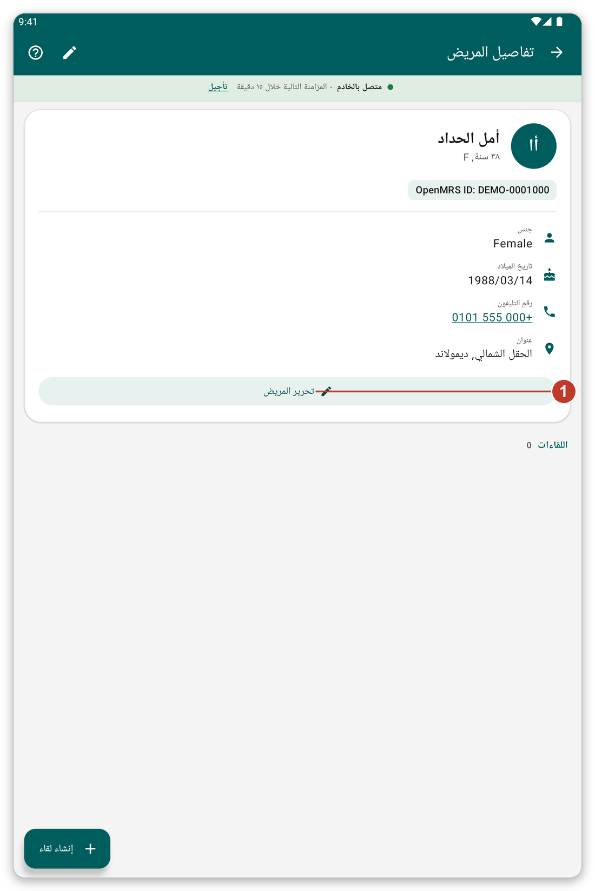

# البحث عن مريض وفتح ملفه {#find-patient}

## الغرض منه {#find-purpose}

البحث عن مريض على الجهاز اللوحي، وفتح ملفه، وتصحيح بياناته.

## قبل أن تبدأ {#find-before}

يجب أن يكون المريض في قائمة مرضى اخترتها، أو أن تكون قد سجّلته على هذا الجهاز اللوحي.

## خطوة بخطوة {#find-steps}

*الشكل 1: قائمة المرضى.*

1. اضغط {{nav_patients}} في الشريط السفلي.
2. اكتب اسماً أو رقم معرّف أو رقم هاتف في خانة البحث (1).
3. اختر الترتيب بالأزرار التي تحتها (2): {{patient_sort_name_asc}} أو {{patient_sort_name_desc}} أو {{patient_sort_age_youngest}} أو {{patient_sort_age_oldest}}.
4. اضغط على مريض (3) لفتح ملفه.

*الشكل 2: كتابة جزء من الاسم تُظهر المرضى المطابقين فقط.*

تعرض القائمة 100 مريض في كل مرة. اضغط الزر في نهاية القائمة لرؤية المزيد. ويظهر المرضى الذين عملت معهم أخيراً في المقدمة تحت {{recent_patients_title}}.

## ملف المريض {#patient-file}

*الشكل 3: ملف مريض.*

يعرض الملف الاسم والعمر والمعرّف وبيانات الاتصال. وتحته {{header_encounters}} تسرد كل ما دُوّن للمريض.

1. اضغط {{edit_patient}} (1) لتغيير بيانات التسجيل.
2. اسحب الصفحة إلى الأسفل لإعادة قراءة السجل من الخادم (عندما تكون متصلاً).
3. اضغط رقم هاتف للاتصال به.
4. استخدم الزر الأخضر في الأسفل لتدوين شيء جديد (راجع [تدوين لقاء](#record-encounter)).

## التعرّف لاحقاً {#identify-later}

أحياناً يكون المريض موجوداً في الخادم لكنه ليس على جهازك اللوحي، ولا يوجد لديك اتصال. لا تسجّله مرة أخرى: فهذا سينشئ نسخة مكررة.

1. في قائمة المرضى اضغط {{identify_later_action}}.
2. اكتب ملاحظة تساعد على إيجاد المريض لاحقاً (الاسم أو القرية أو الهاتف).
3. دوّن الزيارة كالمعتاد.
4. لاحقاً، عندما تتصل، افتح المريض واضغط {{identify_banner_identify}} لإيجاد المريض الحقيقي في الخادم. وينتقل كل ما دوّنته إليه.

> **تحذير:** لا تُرسل بيانات مريض ينتظر التعرّف عليه أثناء المزامنة حتى تتعرّف عليه. ويسألك التطبيق عنهم قبل المزامنة.

## نصائح {#find-tips}

- علامة سحابة صغيرة على مريض تعني أن آخر تغييراته لم تُرسل بعد.
- عند تشغيل الوضع المباشر يمكنك أيضاً البحث في الخادم (راجع [المزامنة والوضع المباشر](#live-mode)).

## إذا حدث خطأ {#find-problems}

- مريض غير موجود: تحقق من أن قائمة مرضاه محددة (راجع [قوائم المرضى](#patient-lists)).
- البيانات قديمة: اسحب الصفحة إلى الأسفل للتحديث، أو قم بالمزامنة.
