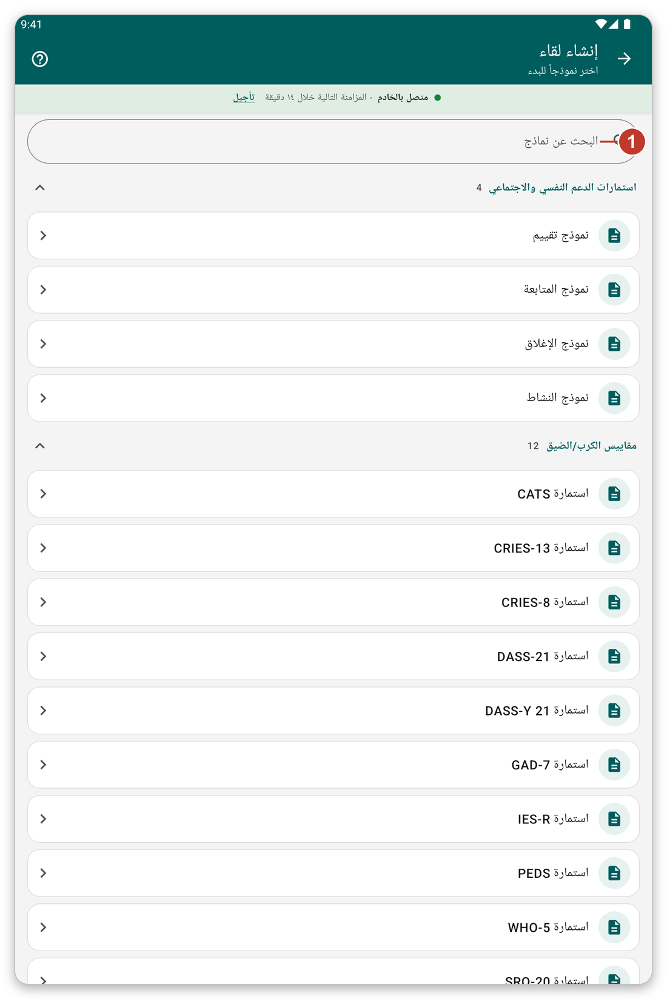

# تدوين لقاء باستخدام نموذج {#record-encounter}

## الغرض منه {#encounter-purpose}

تدوين ما قمت به لمريض بملء نموذج، مثل مقياس فحص أو تقييم.

## قبل أن تبدأ {#encounter-before}

افتح ملف المريض (راجع [البحث عن مريض وفتح ملفه](#find-patient)).

## خطوة بخطوة {#encounter-steps}

1. في ملف المريض اضغط {{create_encounter}} (الزر الأخضر في الأسفل).
2. تُفتح قائمة النماذج. تُجمَّع النماذج في **أقسام**، مثل **استمارات الدعم النفسي والاجتماعي** و**مقاييس الكرب/الضيق** و**مقاييس الأداء/الوظيفة**. اضغط اسم قسم لطيّه أو فتحه.
3. للعثور على نموذج بسرعة اكتب جزءاً من اسمه في {{search_forms}}.
4. اضغط النموذج الذي تريده.

*الشكل 1: اختر نموذجاً. الأقسام هي المحددة في إعدادات التطبيق.*

5. أجب عن الأسئلة. قد يتكون النموذج من عدة صفحات. استخدم {{button_pagination_next}} و{{button_pagination_previous}}، أو اضغط اسم صفحة في الأعلى.
6. عندما تنتهي اضغط {{button_review}} وراجع إجاباتك.
7. اضغط {{submit}}.

ما تحفظه يبقى على الجهاز اللوحي ويُرسل في المزامنة التالية. وعند تشغيل الوضع المباشر يُرسل بعد لحظة.

> **تحذير:** يجب ملء الإجابات المعلّمة بأنها **إلزامية** قبل المتابعة.

## عرض لقاء أو تغييره {#edit-encounter}

في ملف المريض اضغط عنوان لقاء لقراءته. واضغط القلم لتغييره.

## اختيار الأقسام التي تراها {#form-sections}

تأتي الأقسام من إعدادات مؤسستك. ويمكنك إنشاء أقسامك الخاصة: افتح {{settings}} وانتقل إلى {{settings_section_forms_visits}} واضغط {{form_sections_customize}} (راجع [الإعدادات](#settings)).

## إذا حدث خطأ {#encounter-problems}

- نموذج تحتاج إليه غير موجود في القائمة: ابحث في الأقسام الأخرى، أو ابحث عنه بالاسم. وإذا بقي غير موجود فاسأل مؤسستك.
- يقول النموذج إن إجابة إلزامية: مرّر إلى الرسالة الحمراء وأجب عنها.
