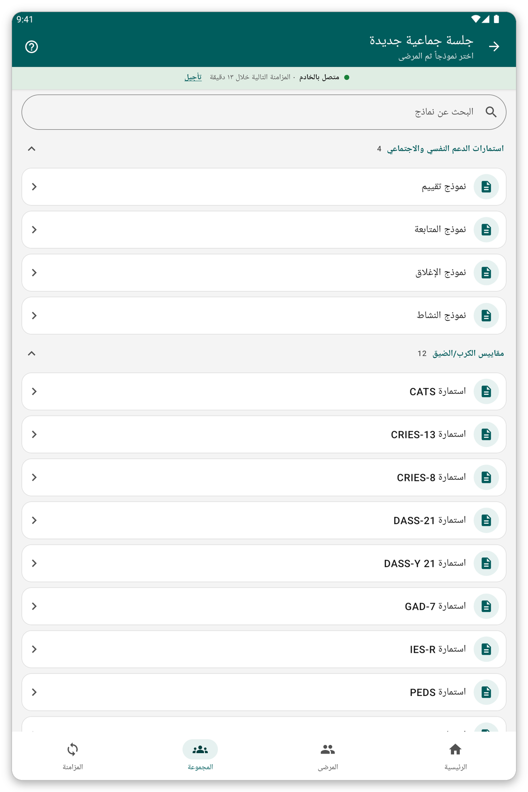

# الجلسات الجماعية والزيارات {#group-and-visits}

## جلسة جماعية أو عائلية {#group-session}

**الغرض منها:** ملء نموذج واحد لعدة مرضى في وقت واحد، مثل أسرة أو مجموعة.

**قبل أن تبدأ:** يجب أن يكون المرضى على الجهاز اللوحي.

*الشكل 1: ابدأ جلسة جماعية باختيار النموذج.*

1. اضغط {{title_group_encounter}} في الشاشة الرئيسية، أو {{nav_group_session}} في الشريط السفلي.
2. اختر النموذج.
3. اختر مرضى الجلسة.
4. أجب عن الأسئلة. لكل مريض تبويبه الخاص في الأعلى مع إجاباته الخاصة.
5. راجع واحفظ.

> **نصيحة:** الجلسة التي بدأتها ولم تنهِها تُحفظ لتتمكن من متابعتها.

## الزيارات {#visits}

الزيارة هي فترة رعاية تضم لقاءً واحداً أو أكثر.

افتراضياً ينشئ التطبيق زيارة لكل لقاء من تلقاء نفسه. ولا ترى الزيارات أبداً، ويكون ملف المريض قائمة بسيطة من اللقاءات.

إذا كانت مؤسستك تفضّل أن تدير الزيارات بنفسك (إعداد {{settings_automatic_visits}} متوقف):

1. في ملف المريض اضغط {{start_visit}} لفتح زيارة. يسألك التطبيق متى بدأت.
2. دوّن لقاءات الزيارة.
3. اضغط {{end_visit}} عندما تنتهي الزيارة. واضغط {{reopen_visit}} لفتحها من جديد.

> **ملاحظة:** يمكن أن تكون زيارة واحدة فقط مفتوحة في الوقت نفسه. ويجب أن يقع اللقاء ضمن زيارته.

## إذا حدث خطأ {#group-problems}

- مريض غير موجود في الجلسة: ليس على الجهاز اللوحي. اختر قائمة مرضاه أولاً (راجع [قوائم المرضى](#patient-lists)).
- يرفض التطبيق حفظ لقاء في زيارة: تاريخه خارج الزيارة. غيّر التاريخ أو الزيارة.
