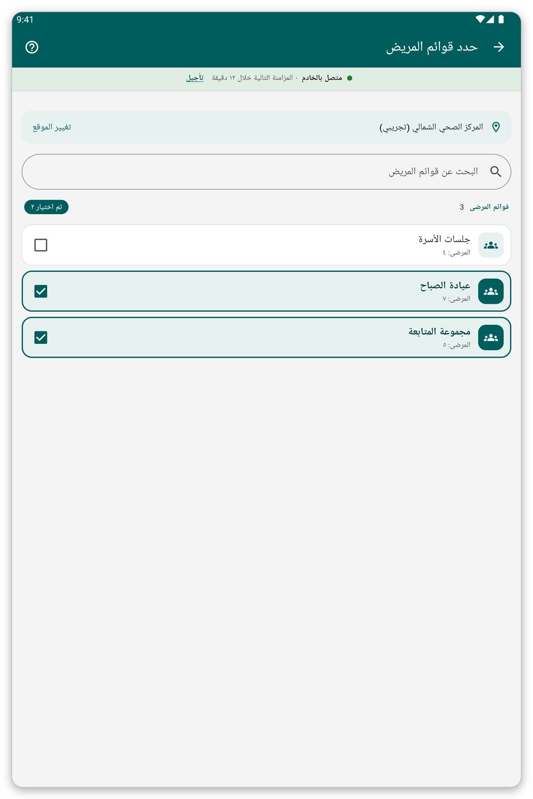

# الموقع وقوائم المرضى {#location-and-lists}

## الغرض منه {#lists-purpose}

اختيار المكان الذي تعمل فيه وقوائم المرضى التي تحتفظ بمرضاها على الجهاز اللوحي.

## تغيير الموقع {#change-location}

1. افتح القائمة واضغط اسم موقعك.
2. اكتب جزءاً من اسم في {{search_a_location}}، أو مرّر.
3. اضغط المكان الذي تريده.

الأماكن المعلّمة بنجمة تظهر أولاً.

## تغيير قوائم المرضى {#patient-lists}

*الشكل 1: حدّد القوائم التي تريدها على الجهاز اللوحي.*

1. في الشاشة الرئيسية اضغط {{patient_lists_header}}.
2. اكتب جزءاً من اسم في {{search_patient_lists}} للعثور على قائمة.
3. حدّد القوائم التي تريدها. يُنزَّل مرضاها فوراً.
4. اضغط {{submit}}.

> **تحذير:** إذا لم تحدد أي قائمة فلن يُنزَّل أي مريض.

## إذا حدث خطأ {#lists-load-problems}

- لا تُحمَّل القوائم: تحقق من الاتصال واضغط {{patient_lists_try_again}}. ويمكنك أيضاً الضغط على {{patient_lists_continue_without}} واختيار القوائم لاحقاً.
- لا ترى أماكن لتختار منها: لم تربط مؤسستك أماكن بحسابك. اسألها.
