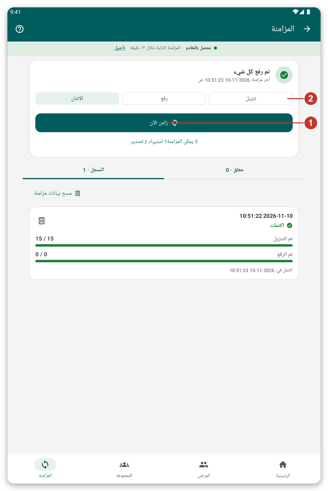

# المزامنة والوضع المباشر {#sync}

## الغرض منها {#sync-purpose}

**المزامنة** ترسل إلى الخادم ما دوّنته على الجهاز اللوحي وتجلب أحدث البيانات. وإلى أن تزامن يبقى عملك محفوظاً بأمان على الجهاز اللوحي فقط.

## قبل أن تبدأ {#sync-before}

تحتاج إلى اتصال بالخادم. وإذا كنت تعمل كضيف فإن التطبيق يطلب منك تسجيل الدخول أولاً.

## خطوة بخطوة {#sync-steps}

*الشكل 1: صفحة المزامنة.*

1. اضغط {{nav_sync}} في الشريط السفلي.
2. في الأعلى ترى إن كان شيء ينتظر الإرسال ووقت آخر مزامنة للبيانات.
3. اختر ما تريد فعله هذه المرة بالأزرار الثلاثة (2): {{sync_page_mode_download}} أو {{sync_page_mode_upload}} أو {{sync_page_mode_both}}. وهذا الاختيار لهذه المزامنة فقط.
4. اضغط {{sync_now}} (1). يمكنك متابعة استخدام التطبيق أثناء تنفيذها.
5. لإيقافها اضغط {{sync_cancel}}.

وتحتها تسرد {{sync_tab_pending}} ما لم يُرسل بعد، وتسرد {{sync_tab_history}} المزامنات السابقة وكيف انتهت.

> **تحذير:** إن أمكنك، لا تحذف بيانات المرضى ولا تسجّل الخروج قبل إرسال كل شيء. تأكد من أن الشاشة الرئيسية تعرض {{home_summary_uploaded}}.

## المزامنة التلقائية {#automatic-sync}

يستطيع التطبيق أن يزامن من تلقاء نفسه من وقت لآخر. وهو ينتظر وقتاً مناسباً، مثلاً عندما يكون الجهاز اللوحي على Wi-Fi وليست البطارية منخفضة. ويمكنك تغيير ذلك في {{settings}} (راجع [الإعدادات](#settings)). ويبيّن الشريط تحت العنوان متى تبدأ المزامنة التالية. اضغط {{auto_sync_delay_link}} لتأجيلها.

## الوضع المباشر {#live-mode}

عند تشغيل {{settings_live_mode}} يُرسل ما تحفظه إلى الخادم فوراً، ويمكنك البحث في الخادم عن مرضى ليسوا على الجهاز اللوحي. وبدون اتصال لا يضيع شيء: يُحفظ عملك ويُرسل لاحقاً.

شغّله في {{settings}}، في القسم {{settings_section_live}}.

## انتهاء الجلسة {#session-expired}

إذا لم يعد الخادم يقبل تسجيل دخولك يظهر شريط تحت حالة الاتصال. اضغط {{sign_in}}. وما فعلته في هذه الأثناء يبقى على الجهاز اللوحي ويُرسل بعد ذلك.

## إذا حدث خطأ {#sync-problems}

- لا تبدأ المزامنة: لا يمكن الوصول إلى الخادم. تحقق من الاتصال (راجع [استكشاف الأخطاء وإصلاحها](#cannot-connect)).
- تفشل المزامنة: افتح {{sync_tab_history}} لترى كيف انتهت ثم حاول مرة أخرى. عملك لم يضع.
- يسألك التطبيق عن مرضى ينتظرون التعرّف عليهم: اختر التعرّف عليهم الآن، أو المزامنة على أي حال (راجع [التعرّف لاحقاً](#identify-later)).
