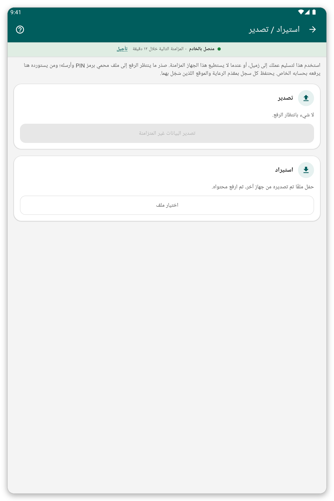

# الاستيراد والتصدير {#import-export}

## الغرض منهما {#ie-purpose}

عندما لا يستطيع جهاز لوحي المزامنة يمكنك تمرير بياناته التي لم تُرسل إلى زميل في ملف محمي برمز PIN. يستورد الزميل الملف ويرسله بحسابه الخاص.

## قبل أن تبدأ {#ie-before}

- يجب أن تكون على الجهاز اللوحي الذي يصدّر بيانات تنتظر الإرسال.
- يجب أن يتفق الشخصان على رمز PIN من أربعة أرقام.

*الشكل 1: صفحة الاستيراد والتصدير.*

## تصدير ملف {#export}

1. في الشاشة الرئيسية اضغط {{title_import_export}}.
2. اضغط {{export_title}}.
3. أدخل أو اختر رمز PIN من أربعة أرقام. <!-- TODO: verify whether the app asks for the PIN or generates it -->
4. احفظ الملف أو شاركه كما يقترح التطبيق.

## استيراد ملف {#import}

1. في الشاشة الرئيسية اضغط {{title_import_export}}.
2. اضغط {{import_title}} واختر الملف.
3. اكتب رمز PIN.
4. يحفظ التطبيق السجلات. ثم زامن لإرسالها.

> **تحذير:** استيراد الملف نفسه مرتين لا يفعل شيئاً، فلا يمكنك إنشاء نسخ مكررة. وإذا كان الوضع المباشر مشغّلاً فقد أُرسل العمل أصلاً، وقد لا يكون هناك ما يُصدَّر.

## إذا حدث خطأ {#ie-problems}

- رُفض رمز PIN: اطلب من المرسل تأكيد الأرقام الأربعة.
- لم تُحفظ بعض السجلات: يبيّن التقرير أيّها ولماذا. ولا يمكن حفظ تعديل على مريض إلا إذا كان هذا المريض موجوداً أصلاً على جهازك اللوحي.
