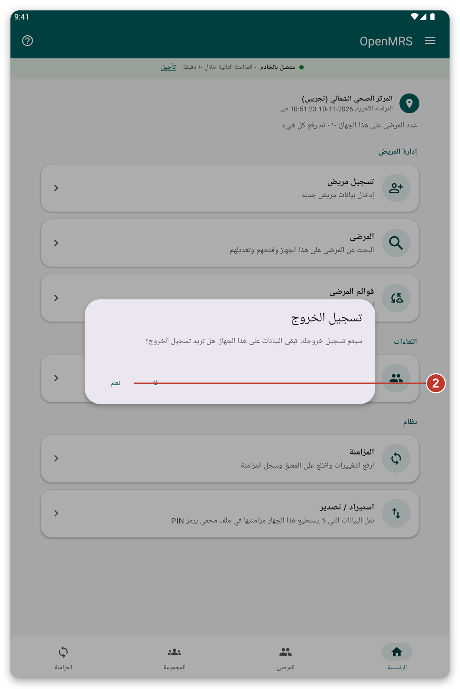
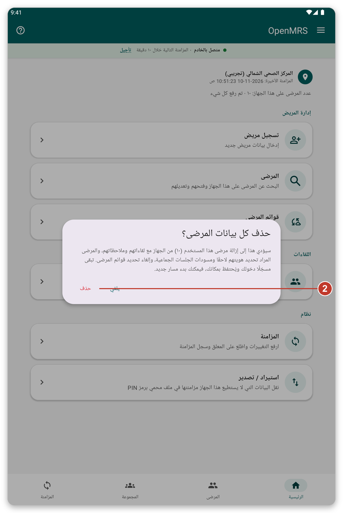
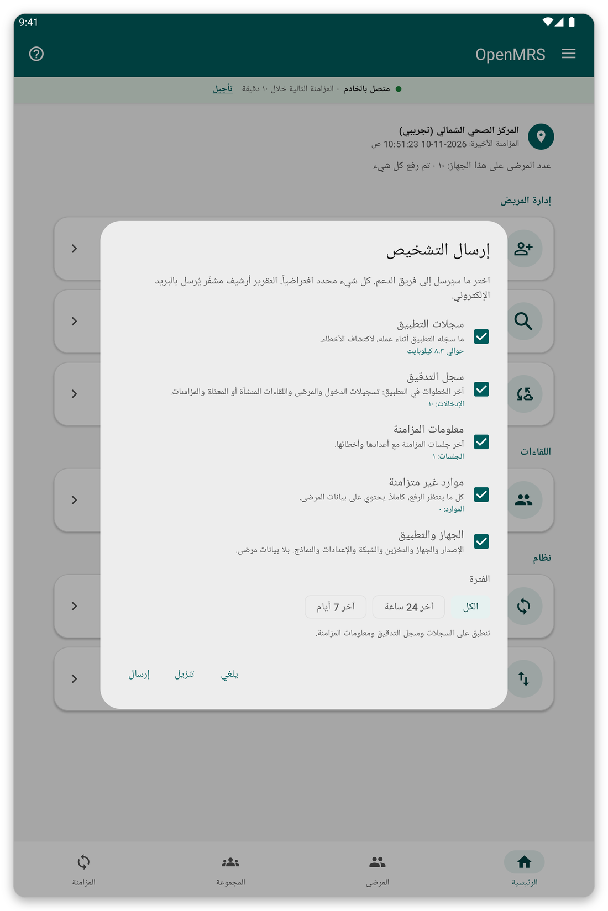

# الأمان والمستخدمون وبياناتك {#security}

## تسجيل الدخول بدون اتصال وشاشة القفل {#lock-screen}

إذا شغّلت {{offline_login_title}} فإن التطبيق يقفل نفسه عندما تعود إليه بعد مدة. وتفتحه ببصمتك أو بوجهك أو بقفل الشاشة، حتى بدون اتصال. ويمكنك اختيار المدة التي ينتظرها التطبيق قبل أن يطلب ذلك مجدداً في {{settings}}.

> **تحذير:** إذا غيّرت بصمة الجهاز اللوحي أو قفل شاشته أو أزلتهما يتوقف تسجيل الدخول بدون اتصال وعليك تسجيل الدخول بحسابك من جديد.

## عدة أشخاص على جهاز لوحي واحد {#several-users}

افتراضياً تبقى بياناتك على الجهاز اللوحي عند تسجيل الخروج، فيجدها الشخص التالي الذي يسجّل الدخول.

- ترى فقط المرضى الذين سجّلتهم أو نزّلتهم. ولا يراهم المستخدمون الآخرون إلا إذا سمحت بذلك في {{settings}} ({{settings_share_my_data}}).
- لكل مستخدم قوائم المرضى الخاصة به وموقعه الخاص.
- في صفحة تسجيل الدخول تبيّن أيقونة السحابة الصغيرة ما إذا كان لدى بعض المستخدمين بيانات تنتظر الإرسال. اضغط عليها لرؤيتهم ثم اضغط {{login_pending_use_user}} لملء اسم المستخدم.

## تسجيل الخروج {#log-out}

*الشكل 1: يطلب تسجيل الخروج منك التأكيد.*

1. افتح القائمة واضغط {{logout}}.
2. اقرأ الرسالة. فهي تخبرك بما يحدث لبياناتك.
3. اضغط {{yes}} لتسجيل الخروج، أو {{no}} للبقاء.

## حذف بيانات المرضى {#delete-data}

يزيل هذا مرضى حسابك من الجهاز اللوحي مع لقاءاتهم لتتمكن من البدء من جديد. وتبقى مسجّلاً الدخول وتحتفظ بموقعك.

*الشكل 2: تبيّن الرسالة عدد المرضى الذين سيُحذفون وكم من البيانات لم يُرسل قط.*

> **تحذير:** البيانات التي لم تُرسل قط تضيع إلى الأبد. زامن أولاً وتأكد من ظهور {{home_summary_uploaded}}.

1. افتح القائمة واضغط {{delete_patient_data_menu}}.
2. اقرأ عدد المرضى والبيانات غير المرسلة المعنيّة.
3. اضغط {{delete}} للتأكيد، أو {{cancel}} للتوقف. وإذا كان تسجيل الدخول بدون اتصال مشغّلاً فسيُطلب منك بصمتك أو قفل الشاشة.

## إرسال التشخيصات {#diagnostics}

إذا طلب فريق الدعم ذلك يستطيع التطبيق إعداد تقرير يساعد على إيجاد مشكلة. وأنت تختار ما يتضمنه التقرير، والتقرير محمي.

*الشكل 3: اختر ما تريد تضمينه في التقرير.*

1. افتح القائمة واضغط {{send_diagnostics}}.
2. اختر ما تريد تضمينه ولأي مدة.
3. اتبع الخطوات لإرسال التقرير بالبريد الإلكتروني. <!-- TODO: verify the exact steps of the e-mail screen -->

> **ملاحظة:** لا يحتوي التقرير على كلمات مرور ولا على بيانات المرضى.

## إذا حدث خطأ {#security-problems}

- لا تستطيع فتح التطبيق: اضغط الزر لتسجيل الدخول بحسابك بدلاً من ذلك.
- نسيت كلمة المرور: اطلب من مؤسستك إعادة تعيينها.
