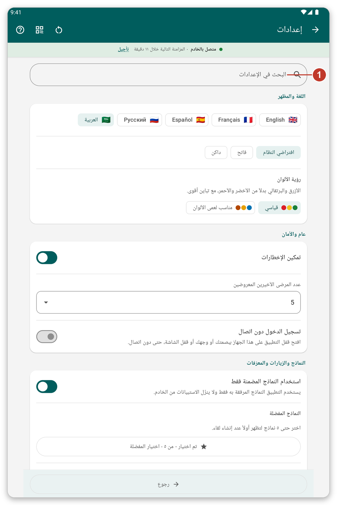
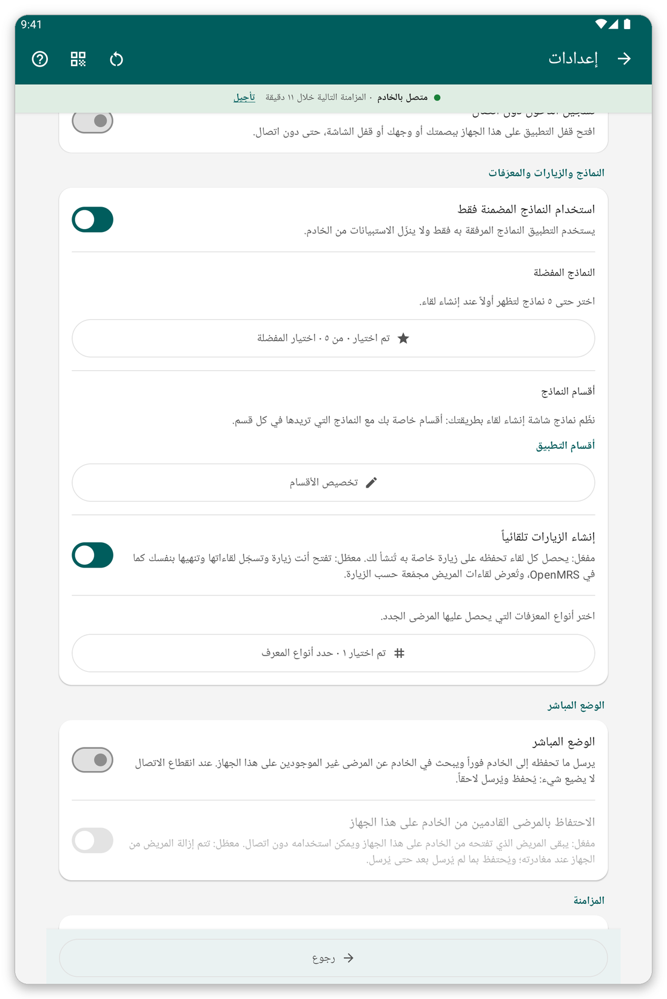
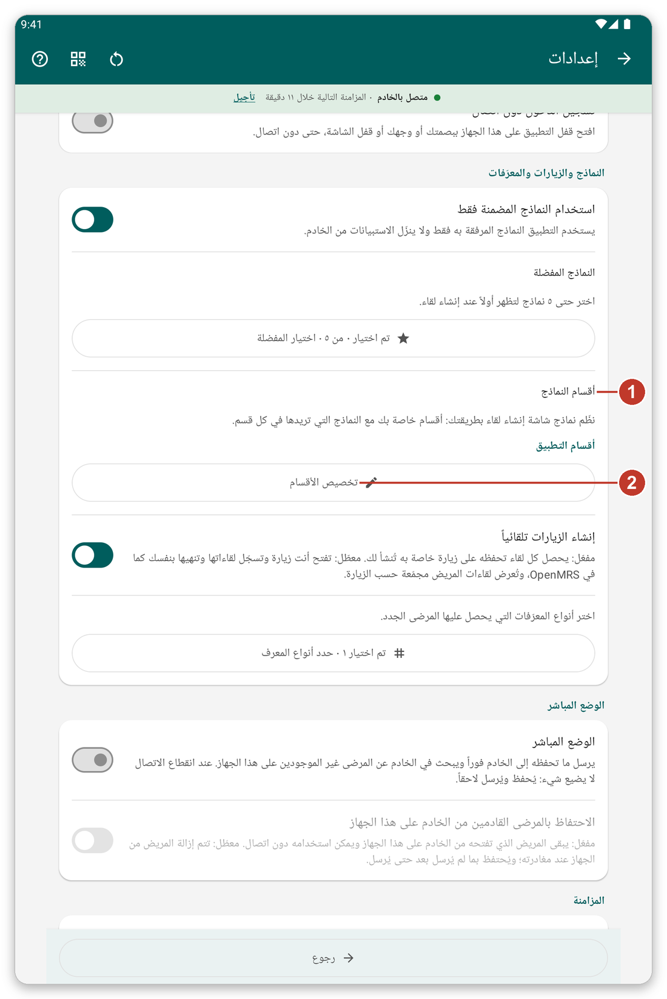
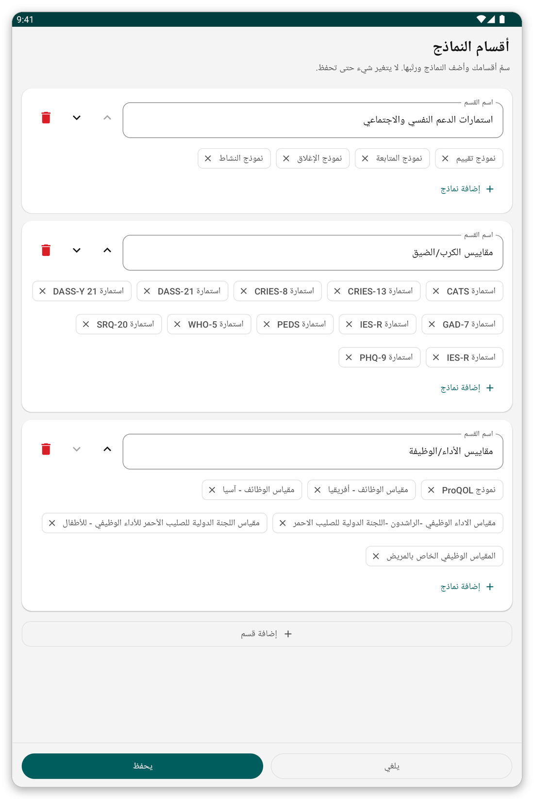

# الإعدادات {#settings}

افتح القائمة واضغط {{settings}}. تُحفظ التغييرات بمجرد إجرائها.

*الشكل 1: صفحة الإعدادات. اكتب كلمة في خانة البحث (1) لإظهار الأقسام التي تذكرها فقط.*

## اللغة والمظهر {#settings-language}

- {{settings_language}}: الإنجليزية أو الفرنسية أو الإسبانية أو الروسية أو العربية. وتنقلب الشاشات من اليمين إلى اليسار في العربية.
- {{settings_section_appearance}}: فاتح أو داكن أو سمة النظام. وتتوفر أيضاً لوحة ألوان لعمى الألوان.

## عام وأمان {#settings-general}

- تشغيل الإشعارات أو إيقافها.
- عدد **المرضى الأخيرين** المعروضين في أعلى قائمة المرضى (الصفر يخفي القسم).
- هل يستطيع المستخدمون الآخرون لهذا الجهاز اللوحي رؤية المرضى الذين سجّلتهم (متوقف افتراضياً).
- هل يتذكر التطبيق آخر موقع لك بعد تسجيل الدخول.
- {{offline_login_title}}: الفتح بالبصمة أو الوجه أو قفل الشاشة، والمدة التي ينتظرها التطبيق قبل أن يطلب ذلك مجدداً، وإخفاء التطبيق في قائمة التطبيقات الأخيرة، وما يحدث للبيانات عند تسجيل الخروج.

*الشكل 2: منتصف صفحة الإعدادات مع الخيارات العامة وخيارات الأمان.*

## النماذج والزيارات والمعرّفات {#settings-forms}

*الشكل 3: أقسام النماذج (1) والزر المخصص لتغييرها (2).*

- {{favorite_forms}}: اختر حتى خمسة نماذج لتظهر أولاً.
- {{form_sections_title}}: أقسام قائمة النماذج. اضغط {{form_sections_customize}} لإنشاء أقسامك الخاصة.
- {{settings_automatic_visits}}: عند التشغيل ينشئ التطبيق زيارة لكل لقاء؛ وعند الإيقاف تفتح الزيارات وتنهيها بنفسك.
- **أنواع المعرّفات:** أنواع المعرّفات التي يحصل عليها المرضى الجدد.

### إنشاء أقسام النماذج الخاصة بك {#own-sections}

*الشكل 4: سمِّ الأقسام وضع النماذج فيها. لا يتغير شيء حتى تحفظ.*

1. اضغط {{form_sections_customize}}.
2. غيّر اسم قسم، أو انقله لأعلى أو لأسفل، أو احذفه.
3. اضغط {{form_section_add_forms}} لوضع نماذج في قسم، و{{form_section_add}} لقسم جديد.
4. اضغط {{save}}.

## {{settings_section_live}} {#settings-live}

أرسل ما تحفظه إلى الخادم فوراً، وابحث في الخادم عن مرضى ليسوا على الجهاز اللوحي.

## {{settings_section_sync}} {#settings-sync}

- عنوان الخادم وزر لاختبار الاتصال.
- {{settings_auto_sync}}، وما يفعله (الإرسال فقط، أو الإرسال والتنزيل) ومتى ينتظر (Wi-Fi فقط، بطارية منخفضة).

## مشاركة الإعدادات مع جهاز لوحي آخر {#share-settings}

تعرض الأيقونة المجاورة للعنوان رمز QR لإعداداتك. وعلى جهاز لوحي آخر اختر الاستيراد وامسحه ضوئياً. سترى ما الذي سيتغير وتوافق عليه. ولا تُشارَك أبداً بيانات المرضى ولا كلمات المرور ولا حسابك. <!-- TODO: verify the exact labels of the share and import buttons -->

> **نصيحة:** إذا غيّرت إعدادات كثيرة وتريد البدء من جديد فاستخدم زر إعادة التعيين المجاور للعنوان.
