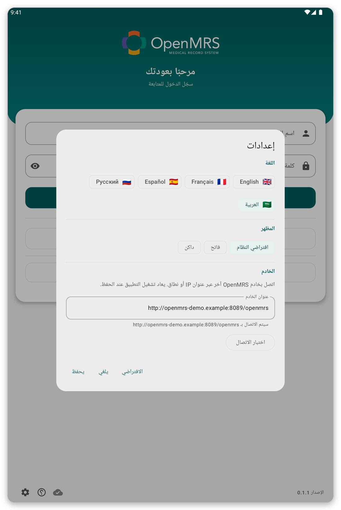

# استكشاف الأخطاء وإصلاحها {#troubleshooting}

ستجد لكل مشكلة سبب حدوثها وما يجب فعله.

## لا أستطيع الاتصال بالخادم {#cannot-connect}

**السبب:** ليس لدى الجهاز اللوحي إنترنت، أو أن الخادم متوقف، أو أن عنوان الخادم في الإعدادات خاطئ.

*الشكل 1: إعدادات صفحة تسجيل الدخول: اللغة والمظهر وعنوان الخادم.*

**ما العمل:**

1. تحقق من أن Wi-Fi أو بيانات الجوال مشغّلة، وافتح صفحة ويب للاختبار.
2. في إعدادات صفحة تسجيل الدخول، أو في {{settings}}، اضغط {{test_connection}}.
3. إذا فشل الاختبار فاسأل مؤسستك هل الخادم يعمل وهل العنوان صحيح.

يمكنك متابعة العمل بدون اتصال: يُحفظ عملك ويُرسل لاحقاً.

## تُرفض كلمة المرور {#password-refused}

**السبب:** كلمة المرور خاطئة، أو أن حسابك يستخدم تسجيل الدخول الموحّد فقط.

**ما العمل:** اكتبها مرة أخرى ببطء. وإذا كانت الصفحة تعرض {{sign_in_with_sso}} فجرّبه. وإذا استمر الفشل فاطلب من مؤسستك إعادة تعيينها.

## لا تُفتح صفحة تسجيل الدخول الموحّد أو لا تعود إلى التطبيق {#sso-fails}

**السبب:** لا يوجد اتصال، أو أُغلق المتصفح قبل أن تنتهي.

**ما العمل:** اضغط {{sign_in_with_sso}} مرة أخرى وأكمل تسجيل الدخول دون إغلاق علامة تبويب المتصفح.

## لا تُحمَّل قوائم المرضى {#lists-fail}

**السبب:** لا يوجد اتصال، أو لا توجد قائمة مرتبطة بموقعك.

**ما العمل:** اضغط {{patient_lists_try_again}}. أو اضغط {{patient_lists_continue_without}} واختر القوائم لاحقاً (راجع [الموقع وقوائم المرضى](#location-and-lists)).

## مريض غير موجود {#patient-missing}

**السبب:** قائمة مرضاه غير محددة، أو سجّله مستخدم آخر للجهاز اللوحي.

**ما العمل:** اختر قائمته (راجع [الموقع وقوائم المرضى](#location-and-lists)). وعند تشغيل الوضع المباشر ابحث في الخادم (راجع [المزامنة والوضع المباشر](#sync)).

## تفشل المزامنة أو لا تنتهي {#sync-fails}

**السبب:** الاتصال ضعيف أو انقطع، أو انتهت الجلسة.

**ما العمل:** افتح صفحة المزامنة والسجل لترى كيف انتهت. انتقل إلى مكان إشارته أفضل واضغط {{sync_now}}. وإذا طلب منك شريط تسجيل الدخول من جديد فاضغط {{sign_in}}. لا يضيع عملك أبداً بسبب مزامنة فاشلة.

## يطلب الجهاز اللوحي بصمتي ويفشل {#unlock-fails}

**السبب:** تغيّرت البصمة أو قفل الشاشة، فتوقف تسجيل الدخول بدون اتصال.

**ما العمل:** سجّل الدخول بحسابك ثم شغّل تسجيل الدخول بدون اتصال من جديد في {{settings}}.

## هناك خطأ ويطلب الدعم تفاصيل {#send-report}

افتح القائمة واضغط {{send_diagnostics}} واتبع الخطوات (راجع [الأمان والمستخدمون وبياناتك](#diagnostics)).
