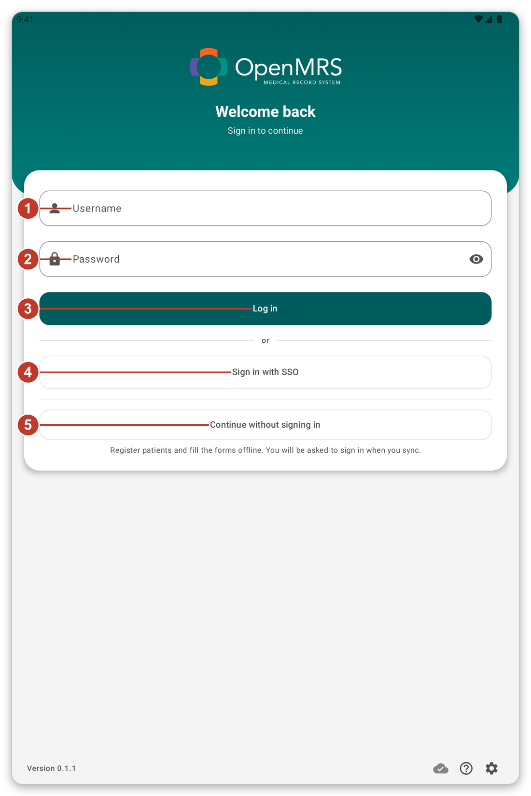
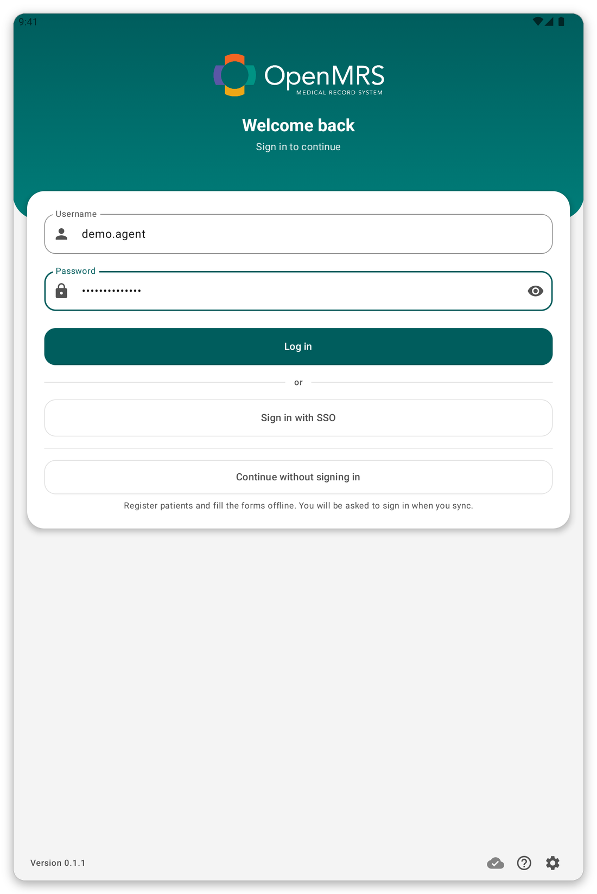
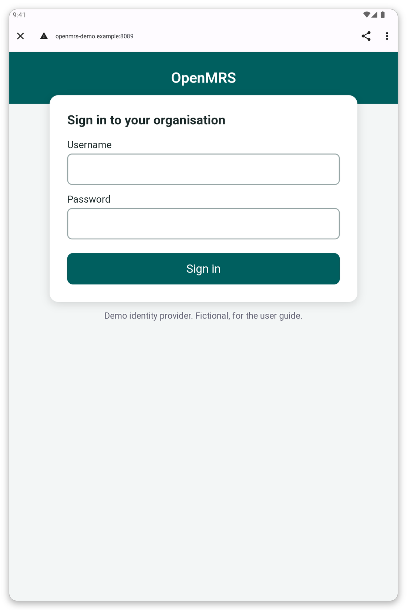
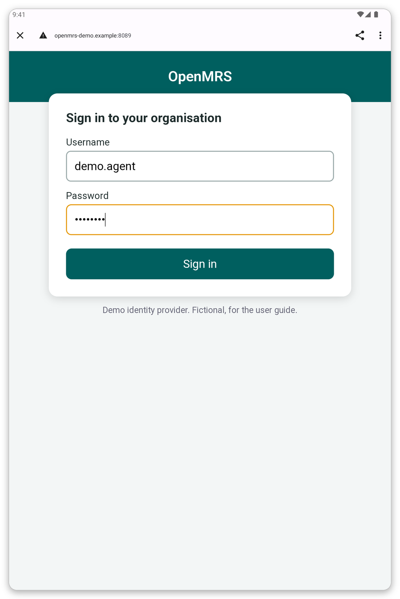
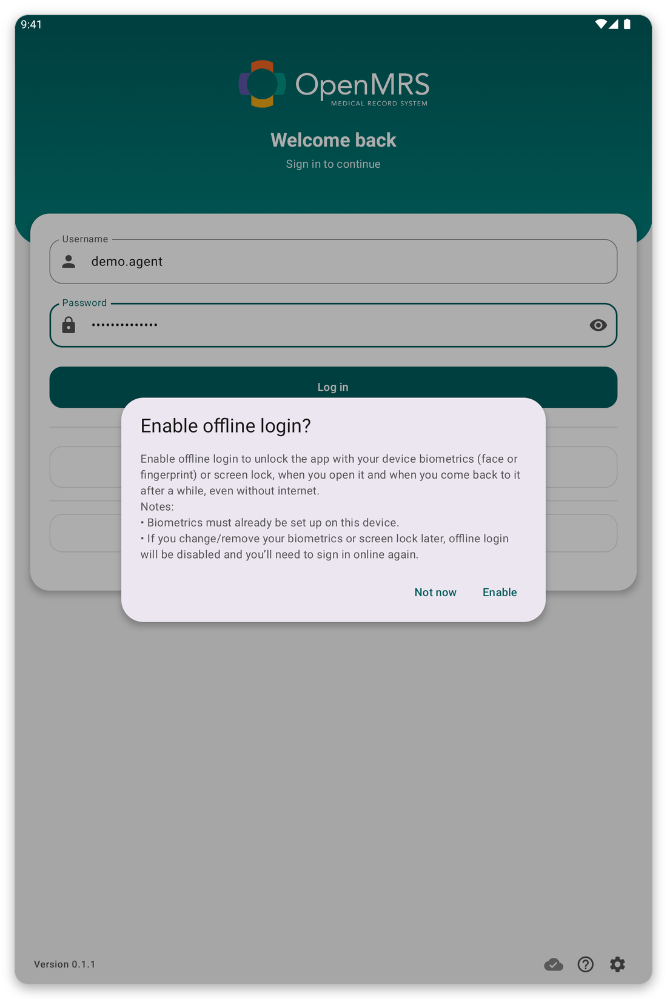
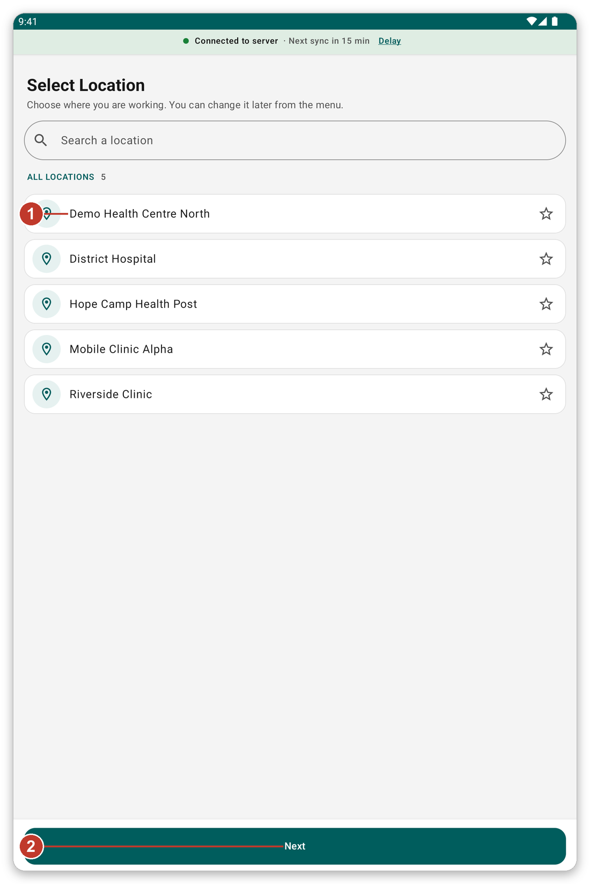
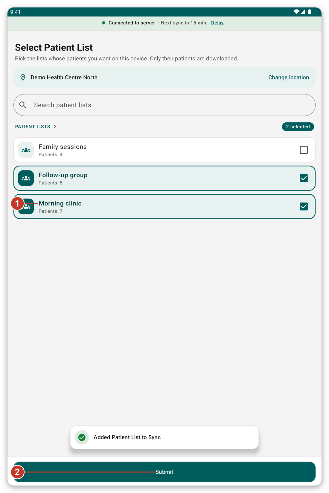
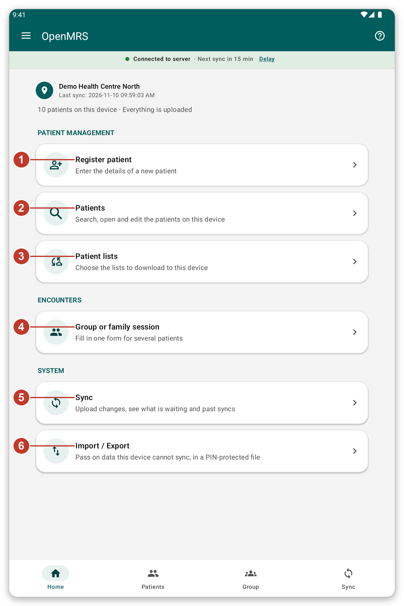

# Getting started {#getting-started}

## Install and open the app {#install}

**What it is for:** put the app on the tablet and open it for the first time.

**Before you start:** your organisation gives you the app. <!-- TODO: verify how the app is distributed (app file or store) -->

1. Install the app on the tablet, as your organisation told you.
2. Open the app. A login page appears.
3. If Android asks to send notifications, tap **Allow**. The app uses notifications to tell you when
   a sync is running.

> **Tip:** the little icons at the bottom of the login page open the settings of the page (language,
> appearance and server), and start a short tour.

## Sign in {#sign-in}

**What it is for:** prove who you are, so that the app can download your patients.

**Before you start:** you need a connection to the internet.

*Figure 1: The login page.*

1. Type your user name in {{username}} (1).
2. Type your password in {{password}} (2).
3. Tap {{button_login}} (3).

If your organisation uses single sign-on, or lets you work without an account, you will also see
{{sign_in_with_sso}} (4) and {{continue_without_login}} (5).

> **Warning:** if the password is wrong, a message appears and you stay on the page. Check the
> password and try again. After several wrong tries, ask your organisation to reset it.

*Figure 2: After a wrong password you stay on the login page and can try again.*

### Sign in with single sign-on {#sso}

Single sign-on lets you use the account that your organisation already gave you.

1. Tap {{sign_in_with_sso}}. Your organisation's own sign-in page opens in the browser.
2. Type your user name and password on that page.
3. Tap **Sign in**. The app opens again by itself.

*Figure 3: The sign-in page of your organisation. It looks different in every organisation.*

*Figure 4: Type your user name and password, then tap the green button.*

> **Note:** the page in the browser belongs to your organisation, not to the app. If it does not
> open, check your connection and try again.

### Work without an account {#guest}

If your organisation allows it, tap {{continue_without_login}}. You can register patients and fill
in forms offline. The app asks you to sign in when you sync, and keeps what you recorded.

## Offline login {#offline-login-prompt}

After the first sign-in the app asks if you want to unlock it with your fingerprint, face or screen
lock, even without a connection.

*Figure 5: Offline login question.*

- Tap {{enable_offline_login_positive}} to turn it on. Your device must already have a fingerprint,
  face or screen lock.
- Tap {{enable_offline_login_negative}} to skip. You can change it later in the settings.

## Choose where you work {#choose-location}

*Figure 6: Choose the place where you work.*

1. Tap your place in the list (1). The star lets you keep favourite places at the top.
2. Tap {{next}} (2).

> **Note:** what you register and record is saved under this place. You can change it later from the menu.

## Choose your patient lists {#choose-lists}

*Figure 7: Tick the lists whose patients you need.*

1. Tick the lists you need (1). The number shows how many patients each list has.
2. Tap {{submit}} (2).

The app now downloads these patients. **Wait until it finishes.** This first download cannot be
skipped, and it can take several minutes. Stay connected to Wi-Fi or data and keep the tablet where
the signal is good.

## The home screen {#first-home}

When the download ends, the home screen appears. The first time, a short tour shows you around.
Tap {{tutorial_skip}} if you do not want it. You can start a tour again at any time with the **?**
button.

*Figure 8: The home screen. Each number is explained in the next chapter.*

## If something goes wrong {#getting-started-problems}

- The login page says it could not connect: see [Troubleshooting](#cannot-connect).
- The patient lists do not load: tap {{patient_lists_try_again}}, or see [Troubleshooting](#lists-fail).
