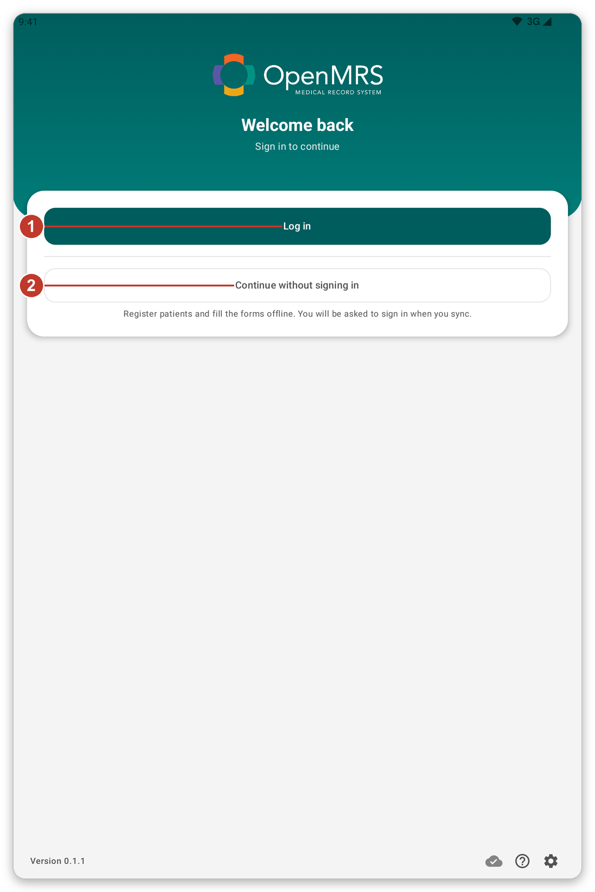
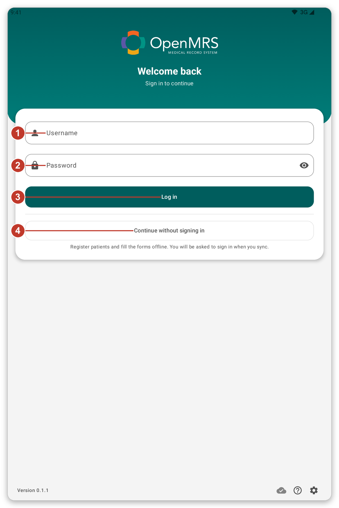
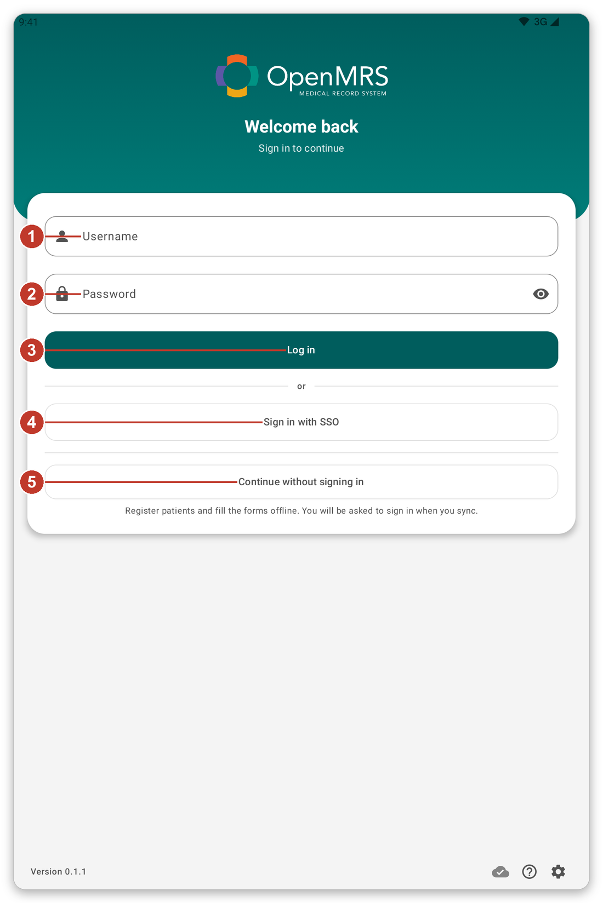
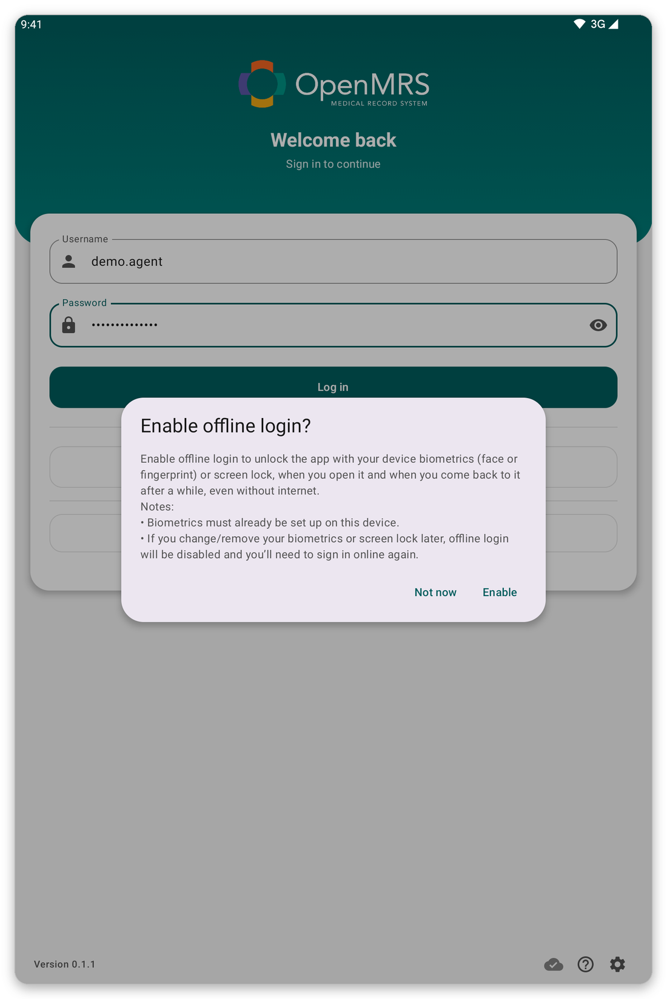
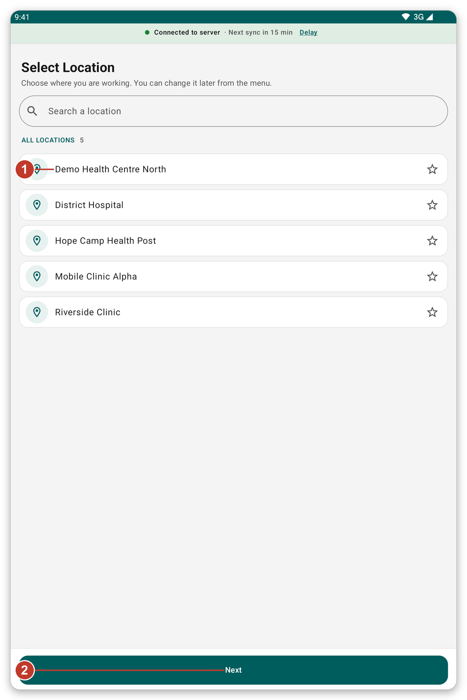
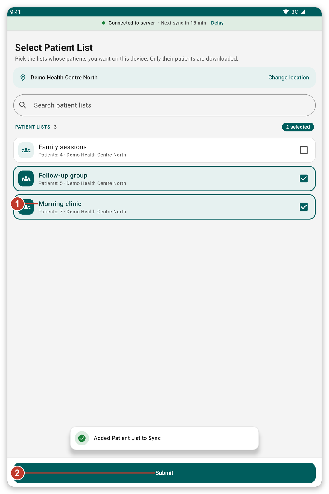

# Getting started {#getting-started}

## Install and open the app {#install}

**What it is for:** put the app on the tablet and open it for the first time.

1. Install the app on the tablet, as your organisation told you.
2. Open the app. A login page appears.
3. If Android asks to send notifications, tap **Allow**. The app uses notifications to tell you when
   a sync is running.

> **Tip:** the little icons at the bottom of the login page open the settings of the page (language,
> appearance and server), and start a short tour.

## Sign in {#sign-in}

**What it is for:** prove who you are, so that the app can download your patients.

**Before you start:** you need a connection to the internet.

<!-- auth: sso -->
1. Tap {{button_login}} (1). The sign-in page of your organisation opens in the browser.
2. Sign in on that page with your organisation account.
3. The app opens again by itself.

*Figure 1: The login page.*

> **Warning:** the page in the browser belongs to your organisation, not to the app. Do not close the
> browser tab before you have finished, or the app is not opened again. If it does not open, check
> your connection and tap {{button_login}} again.

> **Tip:** if you cannot sign in on your organisation's page, ask your organisation. The app cannot
> help with your account.
<!-- /auth -->
<!-- auth: basic -->
1. Type your user name in {{username}} (1).
2. Type your password in {{password}} (2).
3. Tap {{button_login}} (3).

*Figure 1: The login page.*

> **Warning:** if the password is wrong, a message appears and you stay on the page. Check the
> password and try again. After several wrong tries, ask your organisation to reset it.
<!-- /auth -->
<!-- auth: both -->
Use the way your organisation told you:

- **User name and password:** type them in {{username}} (1) and {{password}} (2), then tap {{button_login}} (3).
- **Single sign-on:** tap {{sign_in_with_sso}} (4). The sign-in page of your organisation opens in the
  browser. Sign in there, and the app opens again by itself.

*Figure 1: The login page.*

> **Warning:** do not close the browser tab before you have finished the single sign-on, or the app
> is not opened again. If a password is wrong, you stay on the login page: check it and try again.
<!-- /auth -->

### Work without an account {#guest}

If your organisation allows it, you also see {{continue_without_login}} <!-- auth: sso -->(2)<!-- /auth --><!-- auth: basic -->(4)<!-- /auth --><!-- auth: both -->(5)<!-- /auth -->. You can register
patients and fill in forms offline. The app asks you to sign in when you sync, and keeps what you
recorded.

## Offline login {#offline-login-prompt}

After the first sign-in the app asks if you want to unlock it with your fingerprint, face or screen
lock, even without a connection.

- Tap {{enable_offline_login_positive}} to turn it on. Your device must already have a fingerprint,
  face or screen lock.
- Tap {{enable_offline_login_negative}} to skip. You can change it later in the settings.

*Figure 2: Offline login question.*

## Choose where you work {#choose-location}

1. Tap your place in the list (1). The star lets you keep favourite places at the top.
2. Tap {{next}} (2).

> **Note:** what you register and record is saved under this place, and the patient lists you see
> depend on it. You can change it later from the menu.

*Figure 3: Choose the place where you work.*

## Choose your patient lists {#choose-lists}

1. Tick the lists you need (1). The number shows how many patients each list has.
2. Tap {{submit}} (2).

The app now downloads these patients. **Wait until it finishes.** This first download cannot be
skipped, and it can take several minutes. Stay connected to Wi-Fi or data and keep the tablet where
the signal is good.

*Figure 4: Tick the lists whose patients you need.*

## The home screen {#first-home}

When the download ends, the home screen appears. The first time, a short tour shows you around.
Tap {{tutorial_skip}} if you do not want it. You can start a tour again at any time with the **?**
button.

## If something goes wrong {#getting-started-problems}

- The login page says it could not connect: see [Troubleshooting](#cannot-connect).
- The patient lists do not load: tap {{patient_lists_try_again}}, or see [Troubleshooting](#lists-fail).
