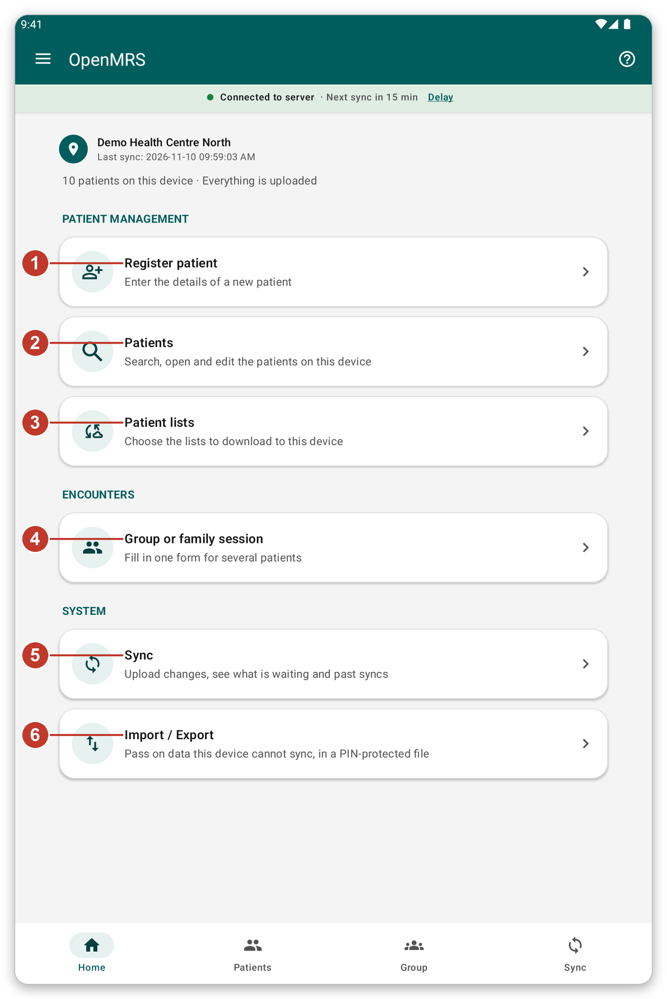
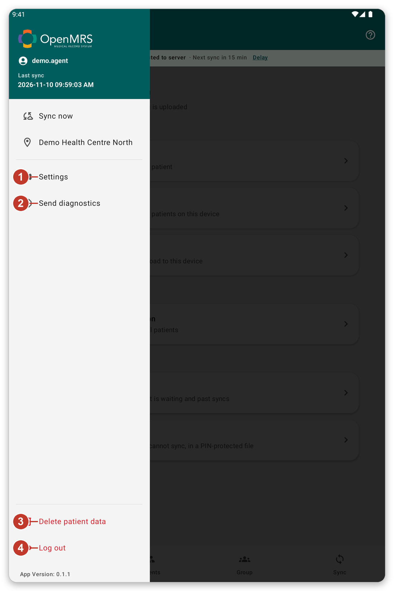

# Finding your way around {#navigation}

## What it is for {#nav-purpose}

This chapter shows the main parts of the screen, so you always know where you are and how to get back.

## The home screen {#home-screen}

*Figure 1: The home screen.*

At the top you see where you work, when the data was last synchronised, and how many patients are on
the tablet. Below are the buttons:

1. {{title_add_patient}}: enter the details of a new patient.
2. {{nav_patients}}: search, open and edit the patients on the tablet.
3. {{patient_lists_header}}: choose which patient lists to keep on the tablet.
4. {{title_group_encounter}}: fill in one form for several patients.
5. {{nav_sync}}: send your work and download the latest data.
6. {{title_import_export}}: pass on data that cannot be synchronised, in a protected file.

## The bottom bar {#bottom-bar}

The four buttons at the bottom of the main screens take you straight to {{nav_home}}, {{nav_patients}},
{{nav_group_session}} and {{nav_sync}}. The one you are on is highlighted.

## The menu {#menu}

Tap the three lines at the top left to open the menu.

*Figure 2: The menu.*

1. {{settings}}: change the language, the appearance, security, forms and sync options.
2. {{send_diagnostics}}: prepare a report for the support team.
3. {{delete_patient_data_menu}}: remove the patients of your account from the tablet. It asks you to confirm first.
4. {{logout}}: leave your account.

The location you work at is also in the menu. Tap it to choose another place.

## The strip under the title {#connection-strip}

The coloured strip under the title tells you about the connection: {{network_status_connected_to_server}} means the
tablet can reach the server. If it says the server cannot be reached, you can still work. Your work is
kept on the tablet and sent later.

## Help on every screen {#help-tour}

The **?** button at the top right starts a short tour of the screen you are on. Each step explains
one button. Tap {{tutorial_skip}} to stop.

> **Tip:** you cannot start a tour while a sync is running. Wait for the sync to finish.

## If something goes wrong {#nav-problems}

- You are lost: tap the back arrow at the top left, or tap {{nav_home}} in the bottom bar.
- A button is grey: it is not available now. For example, {{nav_sync}} in the menu is grey when the server cannot be reached.
