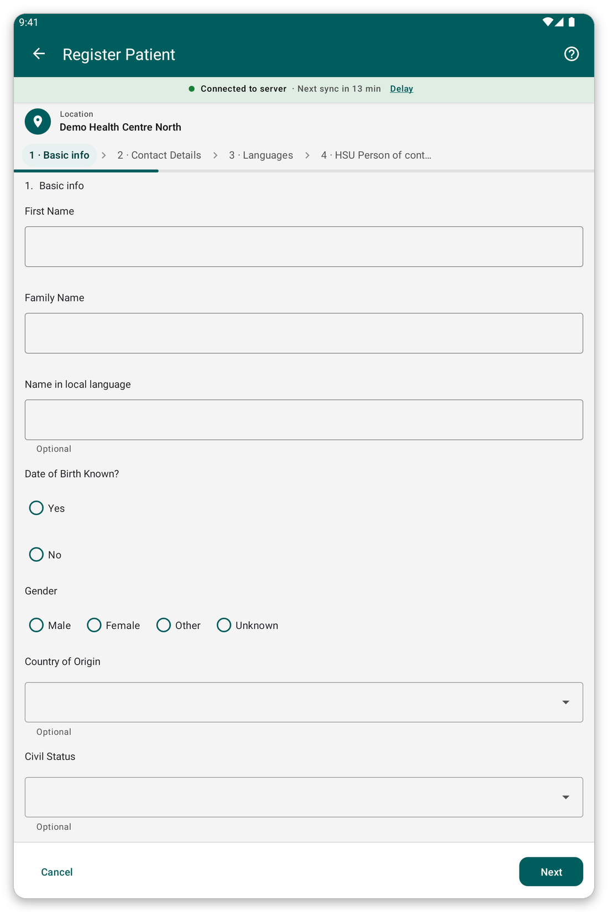

# Register a patient {#register-patient}

## What it is for {#register-purpose}

Add a new patient to the app, with their name, age, gender and contact details.

## Before you start {#register-before}

- Make sure the patient is not already in the app: search first (see [Find and open a patient](#find-patient)).
- Choose your location first, because the patient is saved at it.

## Step by step {#register-steps}

*Figure 1: The first page of the registration form.*

1. On the home screen, tap {{title_add_patient}}.
2. Answer the questions page by page. Questions marked as required must be answered before you can go on.
3. Tap {{button_pagination_next}} to go to the next page, and {{button_pagination_previous}} to go back. You can also tap a page name at the top to jump straight to it.
4. At the end, tap {{button_review}} and check your answers.
5. Tap {{submit}} to save the patient.

After you save, the app opens the patient's file.

> **Warning:** a patient cannot be saved while required answers are missing. The missing answers are marked in red.

## Tips {#register-tips}

- If you do not know the date of birth, the form lets you enter an age instead.
- When you are offline, the patient is saved on the tablet and sent at the next sync.
- If the patient is probably already on the server but not on your tablet, do not register them again: use {{identify_later_action}} (see [Identify later](#identify-later)).

## If something goes wrong {#register-problems}

- You cannot go to the next page: a required answer is missing. Look for the red mark.
- You made a mistake after saving: open the patient and tap {{edit_patient}} (see [The patient file](#patient-file)).
