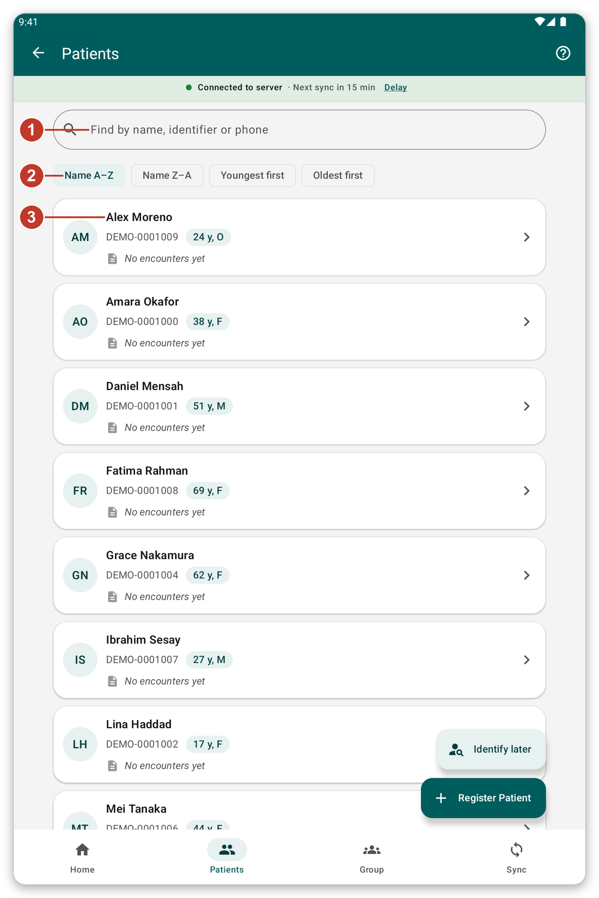
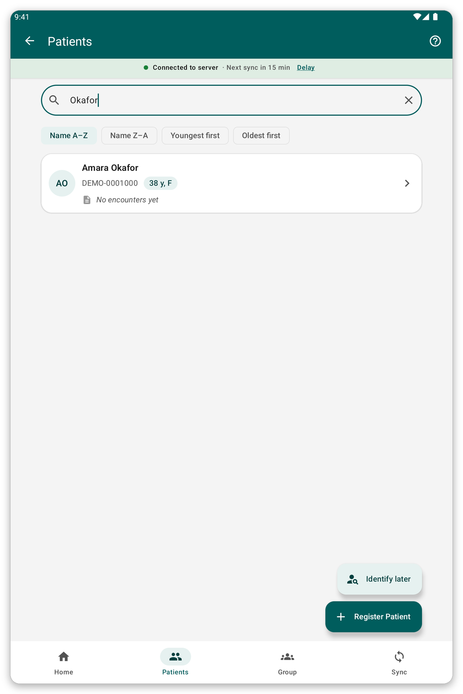
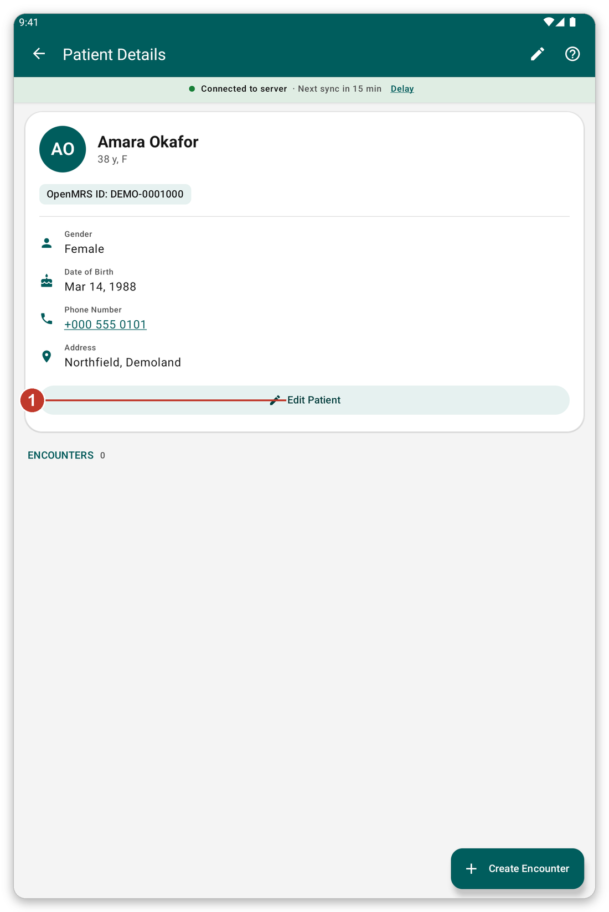

# Find and open a patient {#find-patient}

## What it is for {#find-purpose}

Look for a patient on the tablet, open their file, and fix their details.

## Before you start {#find-before}

The patient must be in a patient list that you chose, or you must have registered them on this tablet.

## Step by step {#find-steps}

*Figure 1: The list of patients.*

1. Tap {{nav_patients}} in the bottom bar.
2. Type a name, an identifier number or a phone number in the search box (1).
3. Choose the order with the buttons below it (2): {{patient_sort_name_asc}}, {{patient_sort_name_desc}}, {{patient_sort_age_youngest}} or {{patient_sort_age_oldest}}.
4. Tap a patient (3) to open their file.

*Figure 2: Typing part of a name shows only the patients that match.*

The list shows 100 patients at a time. Tap the button at the end of the list to see more. The patients you worked with last are listed first under {{recent_patients_title}}.

## The patient's file {#patient-file}

*Figure 3: The file of a patient.*

The file shows the name, age, identifier and contact details. Below, {{header_encounters}} lists everything
recorded for the patient.

1. Tap {{edit_patient}} (1) to change the registration details.
2. Pull the page down to read the record again from the server (when you are connected).
3. Tap a phone number to call it.
4. Use the green button at the bottom to record something new (see [Record an encounter](#record-encounter)).

## Identify later {#identify-later}

Sometimes the patient is already on the server but not on your tablet, and you have no connection.
Do not register them again: that would create a duplicate.

1. On the patient list, tap {{identify_later_action}}.
2. Type a note that will help to find the patient later (name, village, phone).
3. Record the visit as usual.
4. Later, when you are connected, open the patient and tap {{identify_banner_identify}} to find the real patient on the server. Everything you recorded moves to them.

> **Warning:** the data of a patient to identify later is not sent when you sync, until you identify them. The app asks you about them before a sync.

## Tips {#find-tips}

- A small cloud mark on a patient means their latest changes are not sent yet.
- With live mode on, you can also search the server (see [Live mode](#live-mode)).

## If something goes wrong {#find-problems}

- A patient is missing: check that their patient list is selected (see [Patient lists](#patient-lists)).
- The details are out of date: pull the page down to refresh, or sync.
