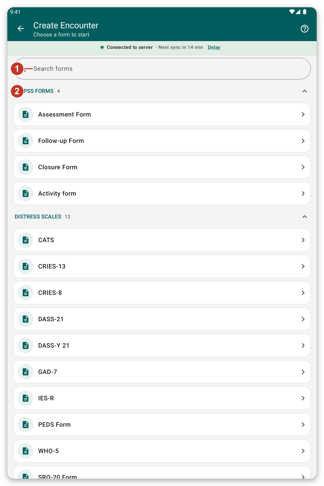

# Record an encounter with a form {#record-encounter}

## What it is for {#encounter-purpose}

Record what you did for a patient by filling in a form, for example a screening scale or an assessment.

## Before you start {#encounter-before}

Open the patient's file (see [Find and open a patient](#find-patient)).

## Step by step {#encounter-steps}

1. In the patient's file, tap {{create_encounter}} (the green button at the bottom).
2. The list of forms opens. Forms are grouped in **sections**, for example **MHPSS Forms**, **Distress Scales** and **Functioning Scales**. Tap a section name to fold or open it.
3. To find a form quickly, type part of its name in {{search_forms}}.
4. Tap the form you want.

*Figure 1: Choose a form. The sections are the ones set in the app settings.*

5. Answer the questions. A form can have several pages. Use {{button_pagination_next}} and {{button_pagination_previous}}, or tap a page name at the top.
6. When you have finished, tap {{button_review}} and check your answers.
7. Tap {{submit}}.

What you save stays on the tablet and is sent at the next sync. With live mode on, it is sent a moment later.

> **Warning:** answers marked **required** must be filled in before you can go on.

## See or change an encounter {#edit-encounter}

In the patient's file, tap the title of an encounter to read it. Tap the pencil to change it.

## Choose which sections you see {#form-sections}

The sections come from your organisation's settings. You can make your own: open {{settings}}, go to {{settings_section_forms_visits}}, and tap {{form_sections_customize}} (see [Settings](#settings)).

## If something goes wrong {#encounter-problems}

- A form you need is not in the list: look in the other sections, or search for it. If it is still missing, ask your organisation.
- The form says an answer is required: scroll to the red message and answer it.
