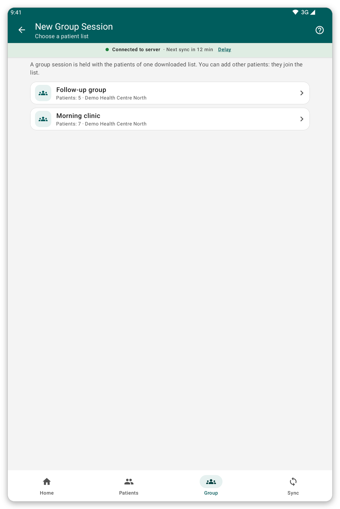

# Group sessions and visits {#group-and-visits}

## Group or family session {#group-session}

**What it is for:** fill in one form for several patients at once, for example a family or a group.

**Before you start:** the patients must be on the tablet, in a patient list that you ticked.

*Figure 1: A group session starts from a patient list.*

1. Tap {{title_group_encounter}} on the home screen, or {{nav_group_session}} in the bottom bar.
2. Choose the patient list of the session. Only the lists kept on the tablet are offered. On the page of a list you can also tap {{plist_start_session}}.
3. Choose the form and answer the session questions.
4. Untick the patients who are absent. To add someone, tap {{plist_add_patients}}.
5. Start. Each patient has their own tab at the top, with their own answers.
6. Review and save.

> **Tip:** a session that you started and did not finish is kept, so that you can continue it.

> **Note:** a patient you add to the session joins the patient list when the session starts. A patient who was registered on the tablet and not uploaded yet takes part in the session, but joins the list only after the upload.

## Visits {#visits}

A visit is a period of care that holds one or more encounters. By default the app creates a visit for each encounter by itself, and you never see the visits.

If your organisation prefers that you manage visits yourself (the setting {{settings_automatic_visits}} is off), tap {{start_visit}} in the patient's file before you record, and {{end_visit}} when the visit is over.

## If something goes wrong {#group-problems}

- A patient is missing in the session: they are not on the tablet. Choose their patient list first (see [Location and patient lists](#location-and-lists)), or register them.
- The app refuses to save an encounter in a visit: its date is outside the visit. Change the date or the visit.
