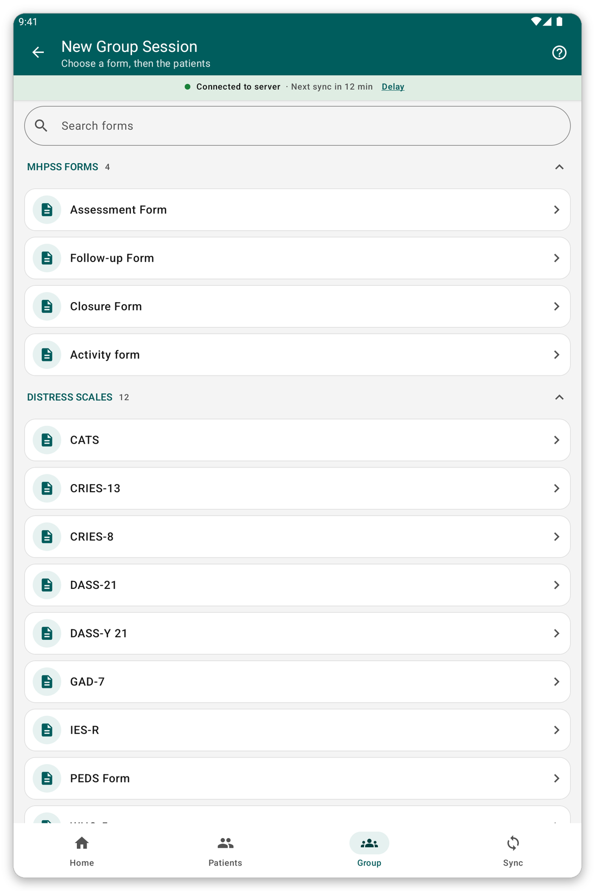

# Group sessions and visits {#group-and-visits}

## Group or family session {#group-session}

**What it is for:** fill in one form for several patients at once, for example a family or a group.

**Before you start:** the patients must be on the tablet.

*Figure 1: Start a group session by choosing the form.*

1. Tap {{title_group_encounter}} on the home screen, or {{nav_group_session}} in the bottom bar.
2. Choose the form.
3. Choose the patients of the session.
4. Answer the questions. Each patient has their own tab at the top, with their own answers.
5. Review and save.

> **Tip:** a session that you started and did not finish is kept, so that you can continue it.

## Visits {#visits}

A visit is a period of care that holds one or more encounters.

By default the app creates a visit for each encounter by itself. You never see the visits, and the patient's file is a simple list of encounters.

If your organisation prefers that you manage visits yourself (setting {{settings_automatic_visits}} is off):

1. In the patient's file, tap {{start_visit}} to open a visit. The app asks when it started.
2. Record the encounters of the visit.
3. Tap {{end_visit}} when the visit is over. Tap {{reopen_visit}} to open it again.

> **Note:** only one visit can be open at a time. An encounter must fall inside its visit.

## If something goes wrong {#group-problems}

- A patient is missing in the session: they are not on the tablet. Choose their patient list first (see [Patient lists](#patient-lists)).
- The app refuses to save an encounter in a visit: its date is outside the visit. Change the date or the visit.
