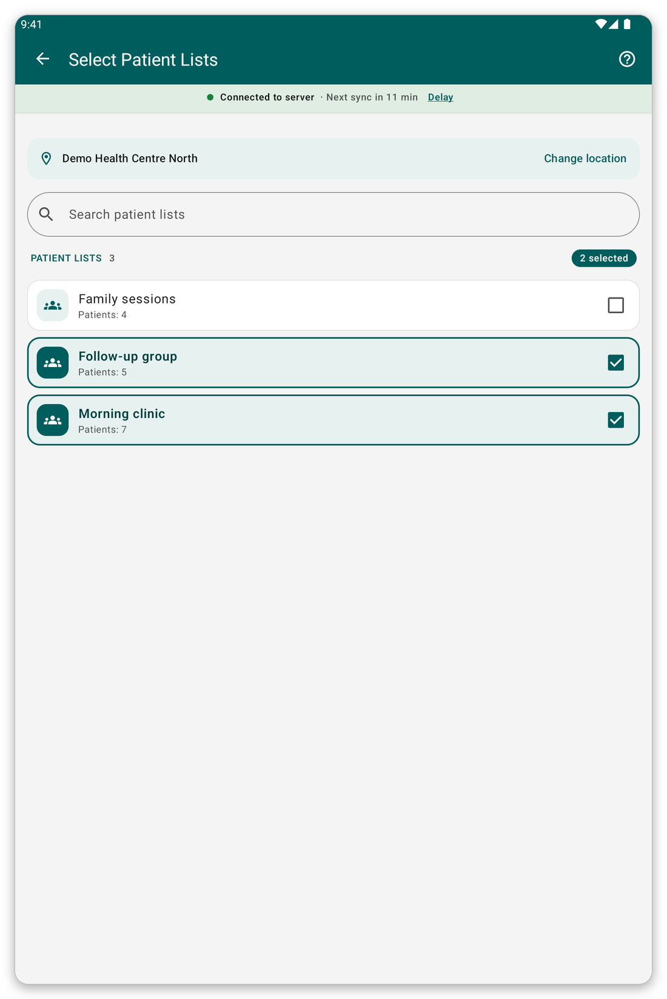

# Location and patient lists {#location-and-lists}

## What it is for {#lists-purpose}

Choose the place where you work, and the patient lists whose patients you keep on the tablet.

## Change the location {#change-location}

1. Open the menu and tap the name of your location.
2. Type part of a name in {{search_a_location}}, or scroll.
3. Tap the place you want.

Places marked with a star come first.

## Change the patient lists {#patient-lists}

*Figure 1: Tick the lists you want on the tablet.*

1. On the home screen, tap {{patient_lists_header}}.
2. Type part of a name in {{search_patient_lists}} to find a list.
3. Tick the lists you want. Their patients are downloaded at once.
4. Tap {{submit}}.

> **Warning:** with no list ticked, no patient is downloaded.

## If something goes wrong {#lists-load-problems}

- The lists do not load: check the connection and tap {{patient_lists_try_again}}. You can also tap {{patient_lists_continue_without}} and choose the lists later.
- You see no places to choose: your organisation has not linked places to your account. Ask them.
