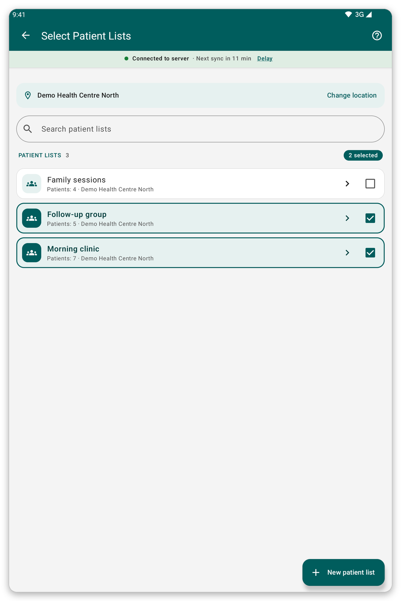

# Location and patient lists {#location-and-lists}

## What it is for {#lists-purpose}

Choose the place where you work, and the patient lists whose patients you keep on the tablet. You can
also make your own lists.

## Change the location {#change-location}

1. Open the menu and tap the name of your location.
2. Type part of a name in {{search_a_location}}, or scroll.
3. Tap the place you want.

> **Note:** the patient lists you see depend on your location. After you change it, check your lists.

## Choose the patient lists {#patient-lists}

*Figure 1: Tick the lists you want on the tablet. The arrow opens a list.*

1. On the home screen, tap {{patient_lists_header}}.
2. Type part of a name in {{search_patient_lists}} to find a list.
3. Tick the lists you want. Their patients are downloaded at once.
4. Tap {{submit}}.

> **Warning:** with no list ticked, no patient is downloaded.

## Make and change your own list {#own-lists}

Tap {{plists_new}} under the lists, give it a name, and save. Tap the arrow of a list to open it: you
can read who is in it, add patients with {{plist_add_patients}}, remove them, rename the list, or
delete it. {{plist_download}} is the same choice as the tick.

Everything you change is saved on the tablet and marked, for example **Not sent yet**. It goes to the
server at the next sync, or at once when you tap {{plists_send_now}}. You can undo a deletion until it
is sent.

## If something goes wrong {#lists-load-problems}

- The lists do not load: check the connection and tap {{patient_lists_try_again}}. You can also tap {{patient_lists_continue_without}} and choose the lists later.
- You see no places to choose: your organisation has not linked places to your account. Ask them.
- A list is marked **Not accepted by the server**: the server refused the change. Tap {{plist_action_discard}} to drop it, or ask your organisation.
