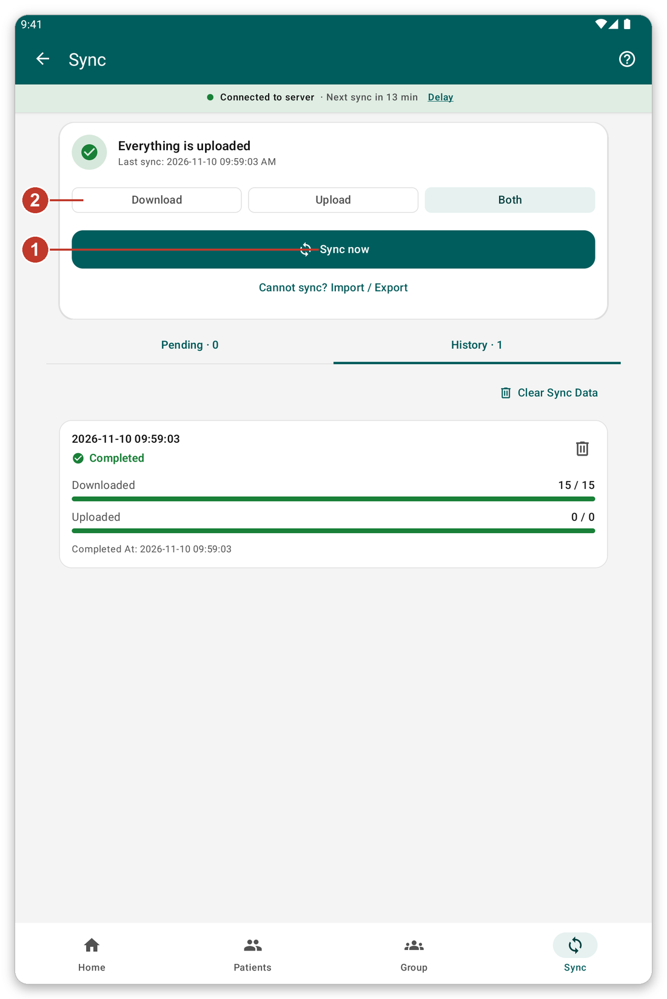

# Sync and live mode {#sync}

## What it is for {#sync-purpose}

**Sync** sends what you recorded on the tablet to the server, and brings the latest data back. Until you sync, your work stays safely on the tablet only.

## Before you start {#sync-before}

You need a connection to the server. If you work as a guest, the app asks you to sign in first.

## Step by step {#sync-steps}

*Figure 1: The sync page.*

1. Tap {{nav_sync}} in the bottom bar.
2. At the top you see if something is waiting to be sent, and when the data was last synchronised.
3. Choose what to do this time with the three buttons (2): {{sync_page_mode_download}}, {{sync_page_mode_upload}} or {{sync_page_mode_both}}. This choice is for this sync only.
4. Tap {{sync_now}} (1). You can keep using the app while it runs.
5. To stop it, tap {{sync_cancel}}.

Below, {{sync_tab_pending}} lists what has not been sent yet, and {{sync_tab_history}} lists past syncs and how they ended.

> **Warning:** do not delete patient data or log out before everything is sent, if you can avoid it. Check that the home screen says {{home_summary_uploaded}}.

## Automatic sync {#automatic-sync}

The app can sync by itself from time to time. It waits for a good moment, for example when the tablet is on Wi-Fi and the battery is not low. You can change this in {{settings}} (see [Settings](#settings)). The strip under the title shows when the next sync will start. Tap {{auto_sync_delay_link}} to postpone it.

## Live mode {#live-mode}

With {{settings_live_mode}} on, what you save is sent to the server right away, and you can search the server for patients that are not on the tablet. With no connection nothing is lost: your work is kept and sent later.

Turn it on in {{settings}}, in the section {{settings_section_live}}.

## Session expired {#session-expired}

If the server no longer accepts your login, a strip appears under the connection status. Tap {{sign_in}}. What you did meanwhile stays on the tablet and is sent after.

## If something goes wrong {#sync-problems}

- The sync does not start: the server cannot be reached. Check the connection (see [Troubleshooting](#cannot-connect)).
- The sync fails: open {{sync_tab_history}} to see how it ended, then try again. Your work is not lost.
- The app asks about patients to identify: choose to identify them now, or sync anyway (see [Identify later](#identify-later)).
