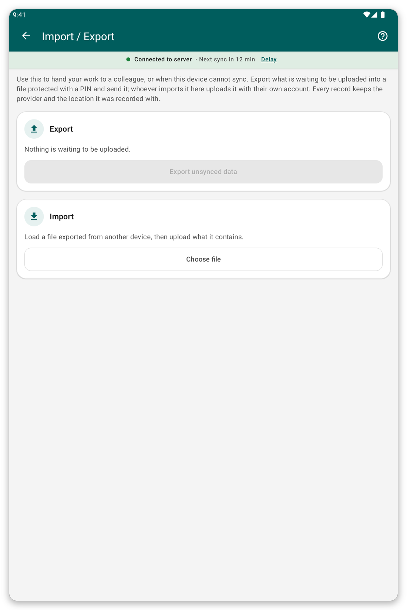

# Import and export {#import-export}

## What it is for {#ie-purpose}

When a tablet cannot sync, you can pass its unsent data to a colleague in a file protected by a PIN. The colleague imports the file and sends it with their own account.

## Before you start {#ie-before}

- The tablet that exports must have data waiting to be sent.
- Both people must agree on a PIN of four digits.

*Figure 1: The import and export page.*

## Export a file {#export}

1. On the home screen, tap {{title_import_export}}.
2. Tap {{export_title}}.
3. Enter or choose the PIN of four digits. <!-- TODO: verify whether the app asks for the PIN or generates it -->
4. Save or share the file, as the app suggests.

## Import a file {#import}

1. On the home screen, tap {{title_import_export}}.
2. Tap {{import_title}} and choose the file.
3. Type the PIN.
4. The app stores the records. Then sync to send them.

> **Warning:** importing the same file twice does nothing, so you cannot create duplicates. If live mode is on, work is already sent, so there may be nothing to export.

## If something goes wrong {#ie-problems}

- The PIN is refused: ask the sender to confirm the four digits.
- Some records are not stored: the report says which, and why. A change to a patient can only be stored if that patient is already on your tablet.
