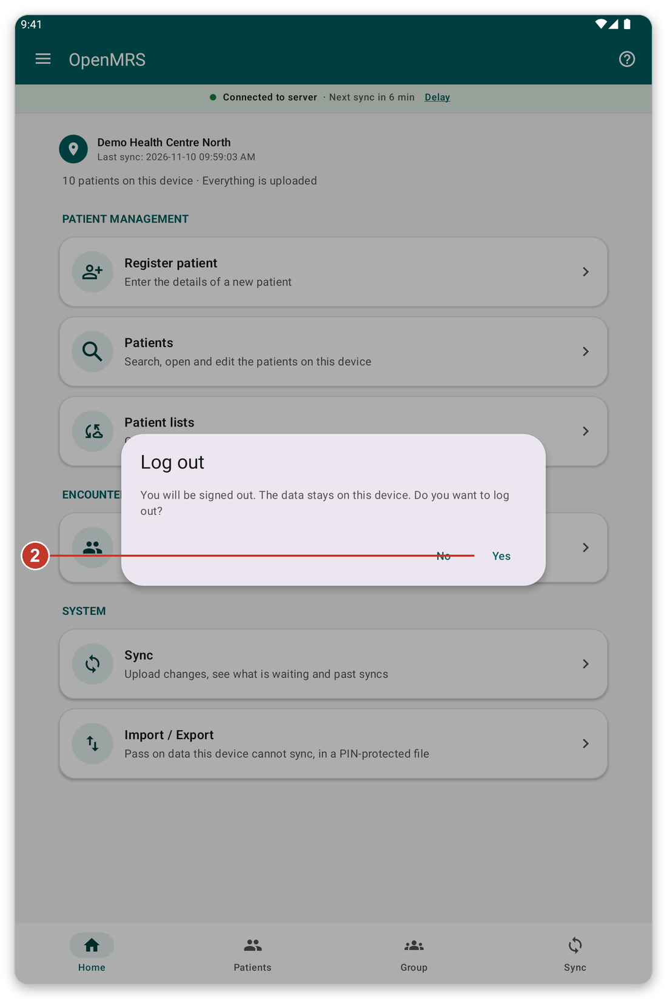
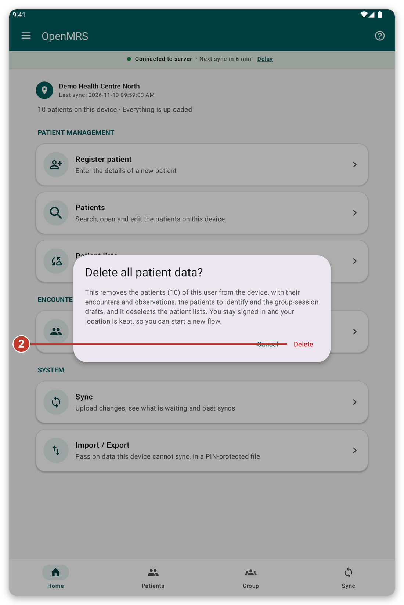
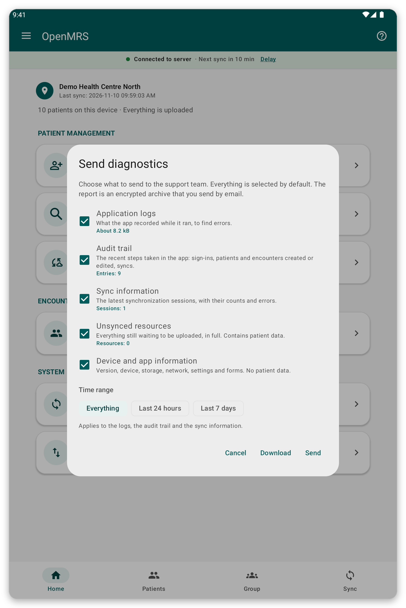

# Security, users and your data {#security}

## Offline login and the lock screen {#lock-screen}

If you turned on {{offline_login_title}}, the app locks itself when you come back to it after a while. You unlock it with your fingerprint, face or screen lock, even without a connection. You can choose how long the app waits before it asks again, in {{settings}}.

> **Warning:** if you change or remove the fingerprint or screen lock of the tablet, offline login is turned off and you must sign in with your account again.

## Several people on one tablet {#several-users}

By default your data stays on the tablet when you log out, so the next person to sign in finds it.

- You only see the patients you registered or downloaded. Other users do not see them, unless you allow it in {{settings}} ({{settings_share_my_data}}).
- Each user has their own patient lists and location.
- On the login page, the small cloud icon shows if some users still have data waiting to be sent. Tap it to see them, then tap {{login_pending_use_user}} to fill in the user name.

## Log out {#log-out}

*Figure 1: Log out asks you to confirm.*

1. Open the menu and tap {{logout}}.
2. Read the message. It tells you what happens to your data.
3. Tap {{yes}} to log out, or {{no}} to stay.

## Delete patient data {#delete-data}

This removes the patients of your account from the tablet, with their encounters, so that you can start again. You stay signed in and keep your location.

*Figure 2: The message says how many patients go, and how much was never sent.*

> **Warning:** data that was never sent is lost for good. Sync first and check that {{home_summary_uploaded}} is shown.

1. Open the menu and tap {{delete_patient_data_menu}}.
2. Read how many patients and how much unsent data are concerned.
3. Tap {{delete}} to confirm, or {{cancel}} to stop. If offline login is on, you are asked for your fingerprint or screen lock.

## Send diagnostics {#diagnostics}

If the support team asks for it, the app can prepare a report that helps to find a problem. You choose what goes in it, and the report is protected.

*Figure 3: Choose what to include in the report.*

1. Open the menu and tap {{send_diagnostics}}.
2. Choose what to include and how far back.
3. Follow the steps to send the report by e-mail. <!-- TODO: verify the exact steps of the e-mail screen -->

> **Note:** the report contains no passwords and no patient details.

## If something goes wrong {#security-problems}

- You cannot unlock the app: tap the button to log in with your account instead.
- You forgot your password: ask your organisation to reset it.
