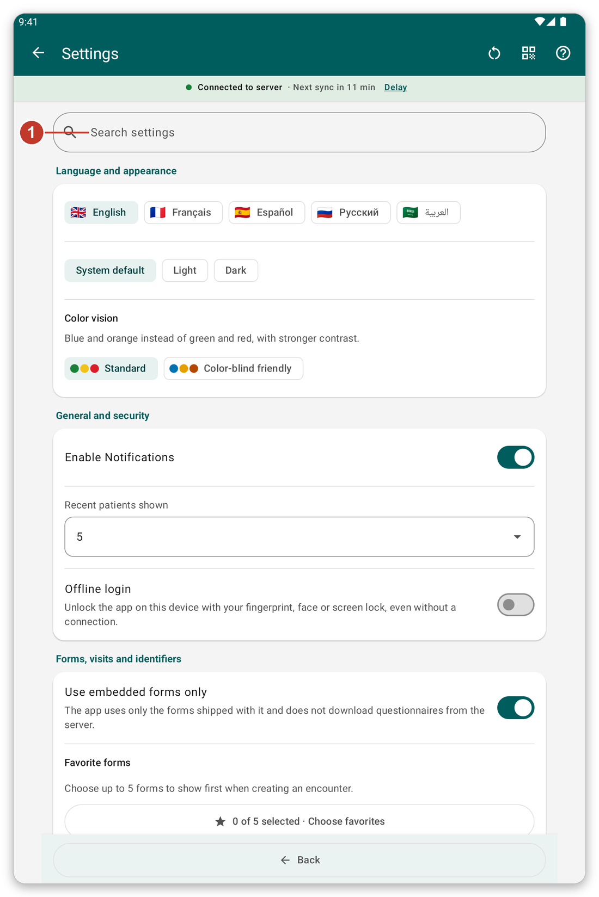
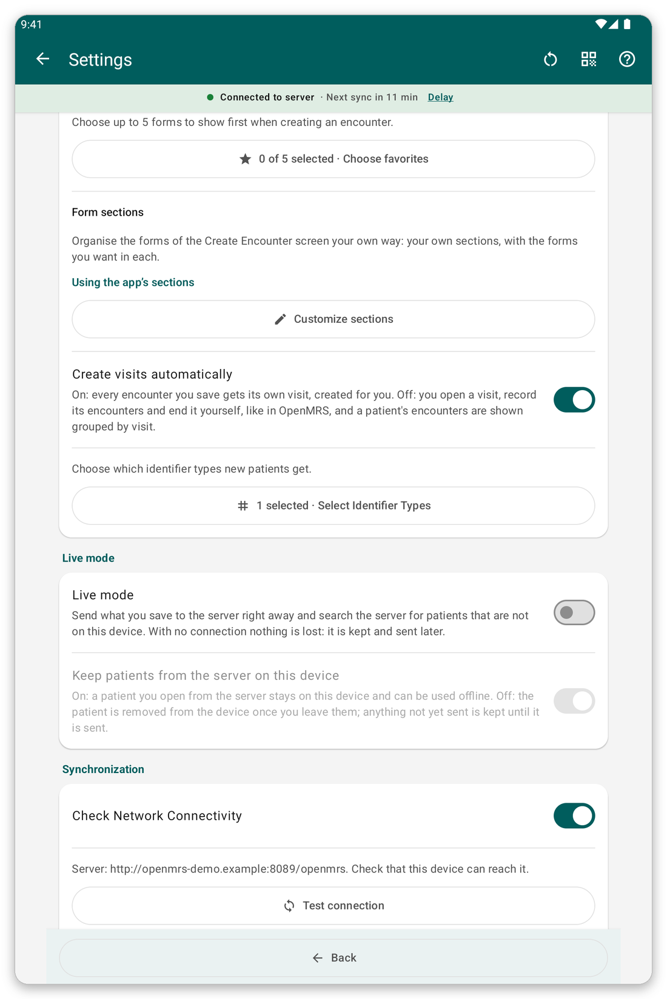
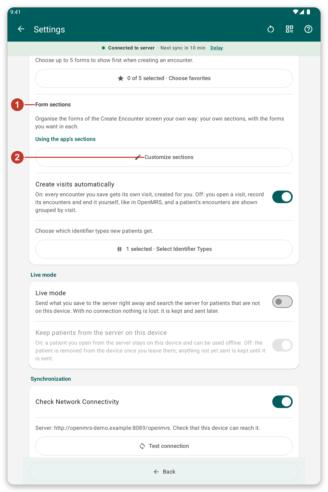
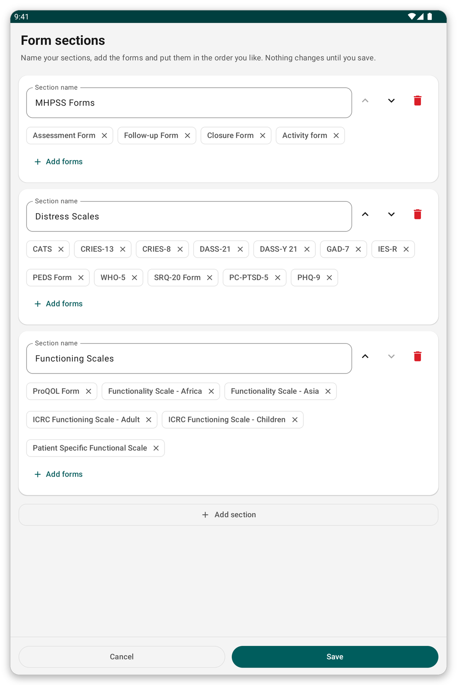

# Settings {#settings}

Open the menu and tap {{settings}}. Changes are saved as soon as you make them.

*Figure 1: The settings page. Type a word in the search box (1) to show only the sections that mention it.*

## Language and appearance {#settings-language}

- {{settings_language}}: English, French, Spanish, Russian or Arabic. The screens turn right to left in Arabic.
- {{settings_section_appearance}}: light, dark, or the system theme. A palette for colour blindness is also available.

## General and security {#settings-general}

- Notifications on or off.
- How many **recent patients** are listed at the top of the patient list (0 hides the section).
- Whether other users of this tablet can see the patients you registered (off by default).
- Whether the app remembers your last location after you log in.
- {{offline_login_title}}: unlock with fingerprint, face or screen lock, how long the app waits before asking again, hiding the app in the list of recent apps, and what happens to the data when you log out.

*Figure 2: The middle of the settings page, with the general and security options.*

## Forms, visits and identifiers {#settings-forms}

*Figure 3: The form sections (1) and the button to change them (2).*

- {{favorite_forms}}: choose up to five forms to show first.
- {{form_sections_title}}: the sections of the list of forms. Tap {{form_sections_customize}} to make your own.
- {{settings_automatic_visits}}: on, the app creates a visit for each encounter; off, you open and end visits yourself.
- **Identifier types:** which kinds of identifier new patients get.

### Make your own form sections {#own-sections}

*Figure 4: Name the sections and put forms in them. Nothing changes until you save.*

1. Tap {{form_sections_customize}}.
2. Change a section name, move it up or down, or delete it.
3. Tap {{form_section_add_forms}} to put forms in a section, and {{form_section_add}} for a new one.
4. Tap {{save}}.

## {{settings_section_live}} {#settings-live}

Send what you save to the server right away, and search the server for patients that are not on the tablet.

## {{settings_section_sync}} {#settings-sync}

- The server address and a button to test the connection.
- {{settings_auto_sync}}, what it does (upload only, or upload and download) and when it waits (Wi-Fi only, low battery).

## Share settings with another tablet {#share-settings}

The icon next to the title shows a QR code of your settings. On another tablet, choose to import and scan it. You see what would change and approve it. Patients, passwords and your account are never shared. <!-- TODO: verify the exact labels of the share and import buttons -->

> **Tip:** if you changed many settings and want to start again, use the reset button next to the title.
