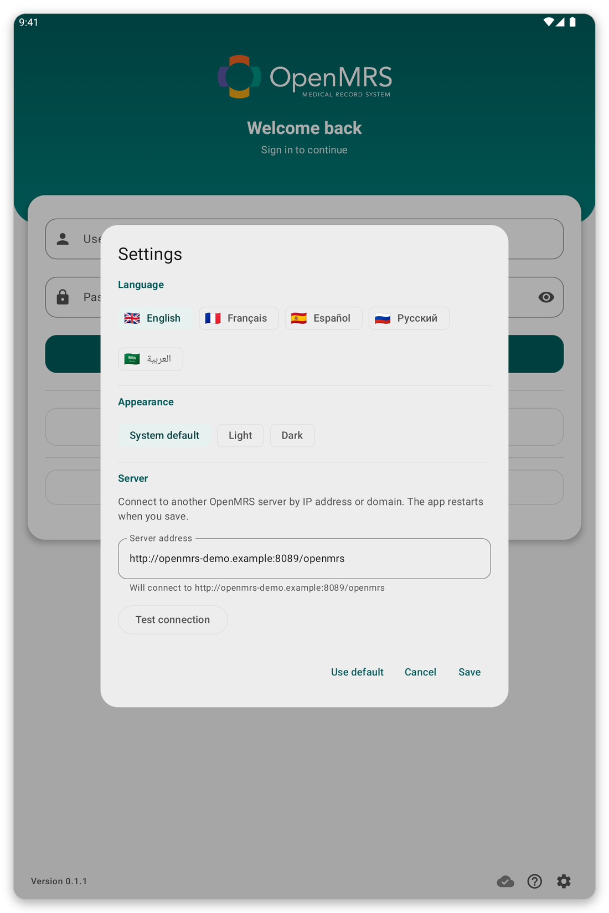

# Troubleshooting {#troubleshooting}

For each problem you find why it happens, and what to do.

## I cannot connect to the server {#cannot-connect}

**Why:** the tablet has no internet, the server is down, or the server address in the settings is wrong.

*Figure 1: The settings of the login page: language, appearance and the address of the server.*

**What to do:**

1. Check that Wi-Fi or mobile data is on, and open a web page to test.
2. In the settings of the login page, or in {{settings}}, tap {{test_connection}}.
3. If the test fails, ask your organisation if the server is working and if the address is right.

You can keep working offline: your work is kept and sent later.

## My password is refused {#password-refused}

**Why:** the password is wrong, or your account uses single sign-on only.

**What to do:** type it again, slowly. If the page offers {{sign_in_with_sso}}, try that. If it still fails, ask your organisation to reset it.

## The single sign-on page does not open or does not return to the app {#sso-fails}

**Why:** there is no connection, or the browser was closed before you finished.

**What to do:** tap {{sign_in_with_sso}} again and finish the sign-in without closing the browser tab.

## The patient lists do not load {#lists-fail}

**Why:** no connection, or no list is linked to your location.

**What to do:** tap {{patient_lists_try_again}}. Or tap {{patient_lists_continue_without}} and choose the lists later (see [Location and patient lists](#location-and-lists)).

## A patient is missing {#patient-missing}

**Why:** their patient list is not selected, or the patient was registered by another user of the tablet.

**What to do:** choose their list (see [Location and patient lists](#location-and-lists)). With live mode on, search the server (see [Sync and live mode](#sync)).

## The sync fails or does not finish {#sync-fails}

**Why:** the connection is weak or was lost, or the session expired.

**What to do:** open the sync page and the history to see how it ended. Move to where the signal is better and tap {{sync_now}}. If a strip asks you to sign in again, tap {{sign_in}}. Your work is never lost by a failed sync.

## The tablet asks for my fingerprint and fails {#unlock-fails}

**Why:** the fingerprint or screen lock changed, so offline login was turned off.

**What to do:** log in with your account, then turn offline login on again in {{settings}}.

## Something is wrong and support asks for details {#send-report}

Open the menu, tap {{send_diagnostics}}, and follow the steps (see [Security, users and your data](#diagnostics)).
