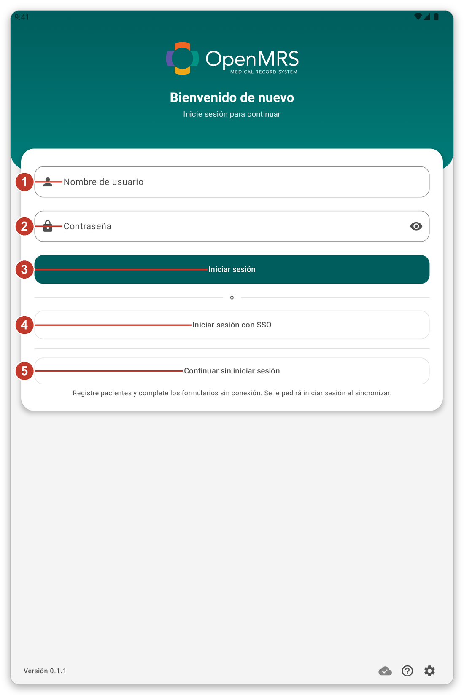
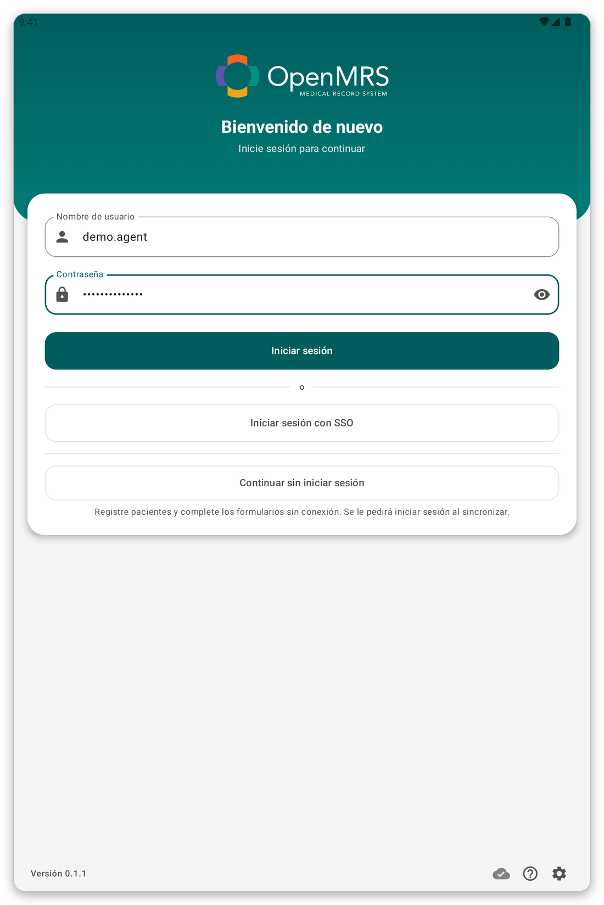
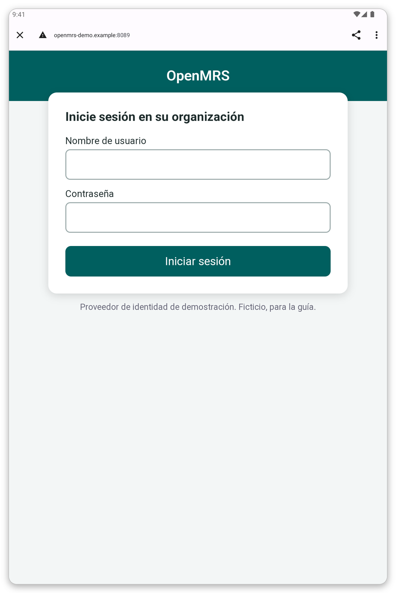
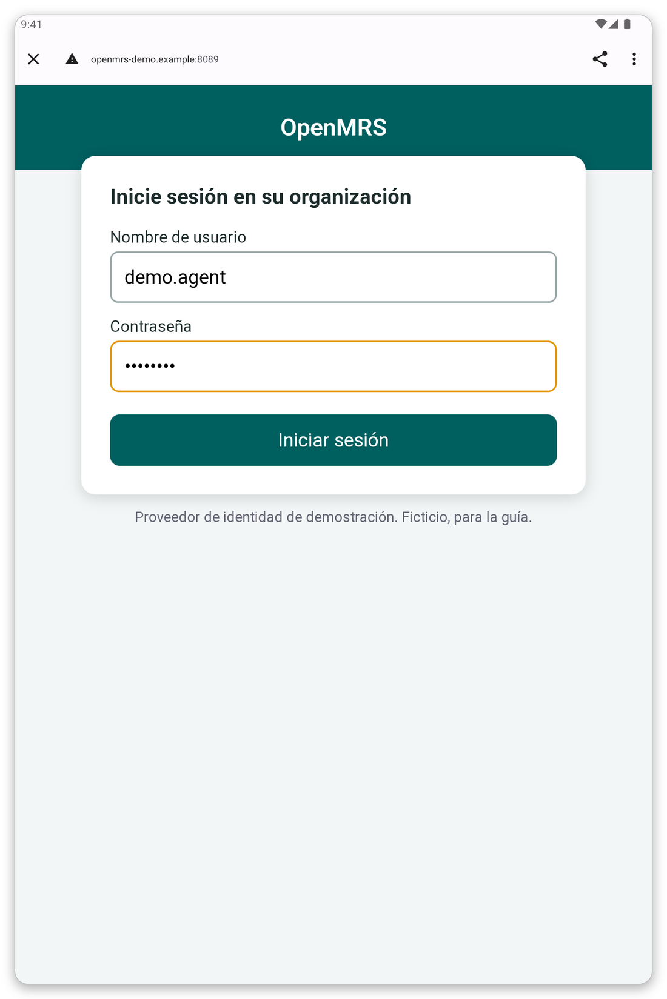
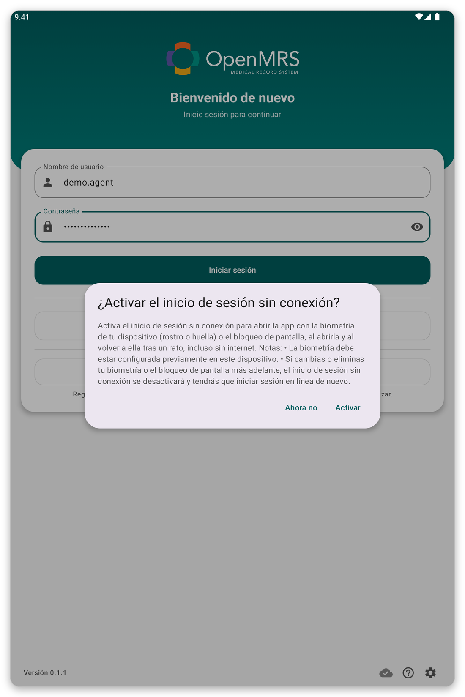
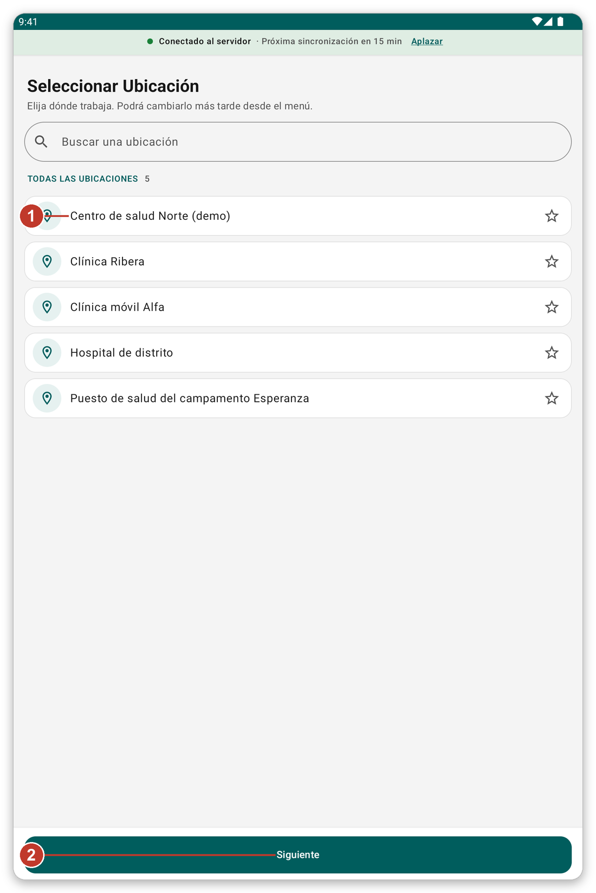
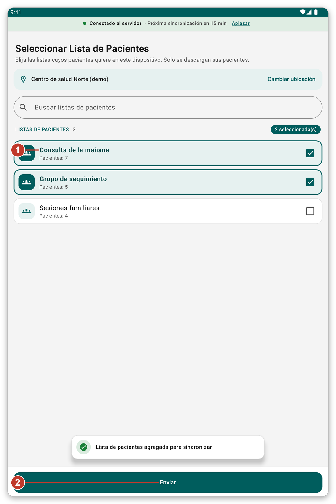
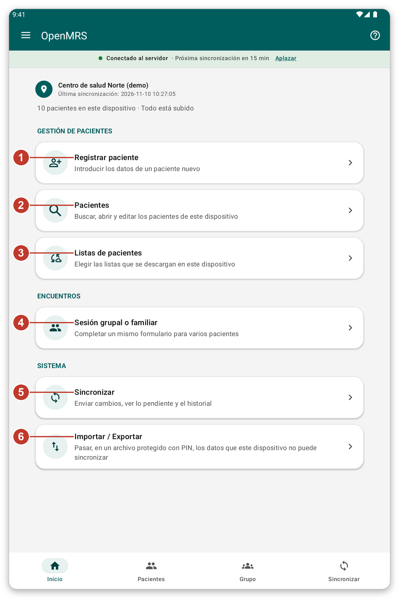

# Primeros pasos {#getting-started}

## Instalar y abrir la aplicación {#install}

**Para qué sirve:** poner la aplicación en la tableta y abrirla por primera vez.

**Antes de empezar:** su organización le da la aplicación. <!-- TODO: verify how the app is distributed (app file or store) -->

1. Instale la aplicación en la tableta, como le indicó su organización.
2. Abra la aplicación. Aparece una página de inicio de sesión.
3. Si Android pide permiso para enviar notificaciones, toque **Permitir**. La aplicación usa las notificaciones para avisarle de que se está sincronizando.

> **Consejo:** los iconos pequeños en la parte inferior de la página de inicio de sesión abren los ajustes de la página (idioma, aspecto y servidor) e inician un recorrido corto.

## Iniciar sesión {#sign-in}

**Para qué sirve:** demostrar quién es usted, para que la aplicación pueda descargar sus pacientes.

**Antes de empezar:** necesita conexión a internet.

*Figura 1: la página de inicio de sesión.*

1. Escriba su nombre de usuario en {{username}} (1).
2. Escriba su contraseña en {{password}} (2).
3. Toque {{button_login}} (3).

Si su organización usa el inicio de sesión único, o le permite trabajar sin cuenta, también verá {{sign_in_with_sso}} (4) y {{continue_without_login}} (5).

> **Advertencia:** si la contraseña es incorrecta, aparece un mensaje y usted se queda en la página. Compruebe la contraseña e inténtelo de nuevo. Tras varios intentos fallidos, pida a su organización que la restablezca.

*Figura 2: tras una contraseña incorrecta se queda en la página de inicio de sesión y puede intentarlo de nuevo.*

### Iniciar sesión con el inicio de sesión único {#sso}

El inicio de sesión único le permite usar la cuenta que su organización ya le dio.

1. Toque {{sign_in_with_sso}}. La página de inicio de sesión de su organización se abre en el navegador.
2. Escriba su nombre de usuario y su contraseña en esa página.
3. Toque **Iniciar sesión**. La aplicación se abre de nuevo sola.

*Figura 3: la página de inicio de sesión de su organización. Es distinta en cada organización.*

*Figura 4: escriba su nombre de usuario y su contraseña y toque el botón verde.*

> **Nota:** la página del navegador pertenece a su organización, no a la aplicación. Si no se abre, compruebe su conexión e inténtelo de nuevo.

### Trabajar sin cuenta {#guest}

Si su organización lo permite, toque {{continue_without_login}}. Puede registrar pacientes y rellenar formularios sin conexión. La aplicación le pide iniciar sesión cuando sincroniza y conserva lo que anotó.

## Inicio de sesión sin conexión {#offline-login-prompt}

Después del primer inicio de sesión, la aplicación le pregunta si quiere desbloquearla con su huella, su rostro o el bloqueo de pantalla, incluso sin conexión.

*Figura 5: pregunta sobre el inicio de sesión sin conexión.*

- Toque {{enable_offline_login_positive}} para activarlo. Su dispositivo ya debe tener una huella, un rostro o un bloqueo de pantalla.
- Toque {{enable_offline_login_negative}} para omitirlo. Puede cambiarlo más tarde en los ajustes.

## Elegir dónde trabaja {#choose-location}

*Figura 6: elija el lugar donde trabaja.*

1. Toque su lugar en la lista (1). La estrella permite mantener sus lugares favoritos arriba.
2. Toque {{next}} (2).

> **Nota:** lo que registra y anota se guarda en este lugar. Puede cambiarlo más tarde desde el menú.

## Elegir sus listas de pacientes {#choose-lists}

*Figura 7: marque las listas cuyos pacientes necesita.*

1. Marque las listas que necesita (1). El número indica cuántos pacientes tiene cada lista.
2. Toque {{submit}} (2).

La aplicación descarga entonces esos pacientes. **Espere a que termine.** Esta primera descarga no se puede omitir y puede tardar varios minutos. Manténgase conectado al Wi-Fi o a los datos y deje la tableta donde la señal sea buena.

## La pantalla de inicio {#first-home}

Cuando termina la descarga, aparece la pantalla de inicio. La primera vez, un recorrido corto le muestra la aplicación. Toque {{tutorial_skip}} si no lo quiere. Puede iniciar un recorrido de nuevo en cualquier momento con el botón **?**.

*Figura 8: la pantalla de inicio. Cada número se explica en el capítulo siguiente.*

## Si algo sale mal {#getting-started-problems}

- La página de inicio de sesión dice que no pudo conectarse: vea [Solución de problemas](#cannot-connect).
- Las listas de pacientes no cargan: toque {{patient_lists_try_again}}, o vea [Solución de problemas](#lists-fail).
