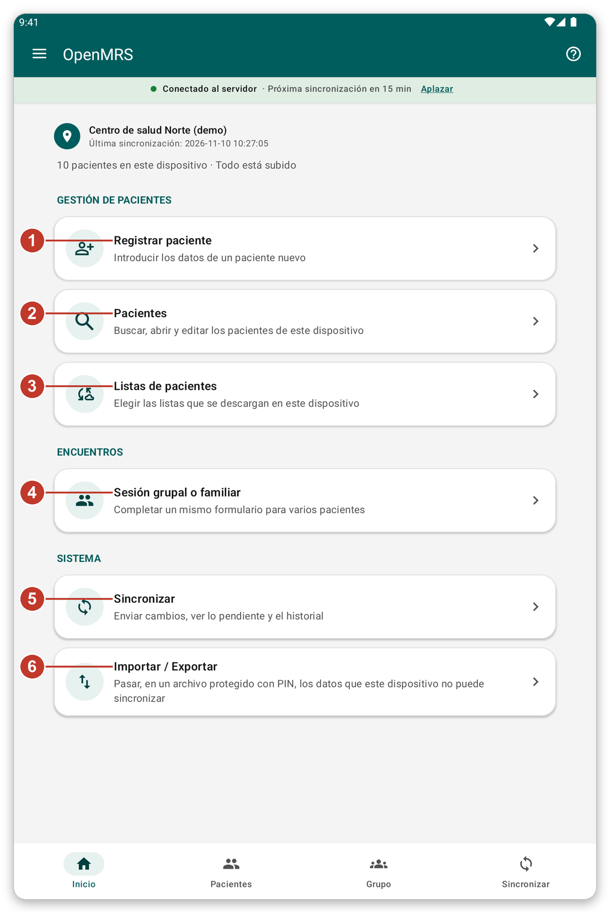
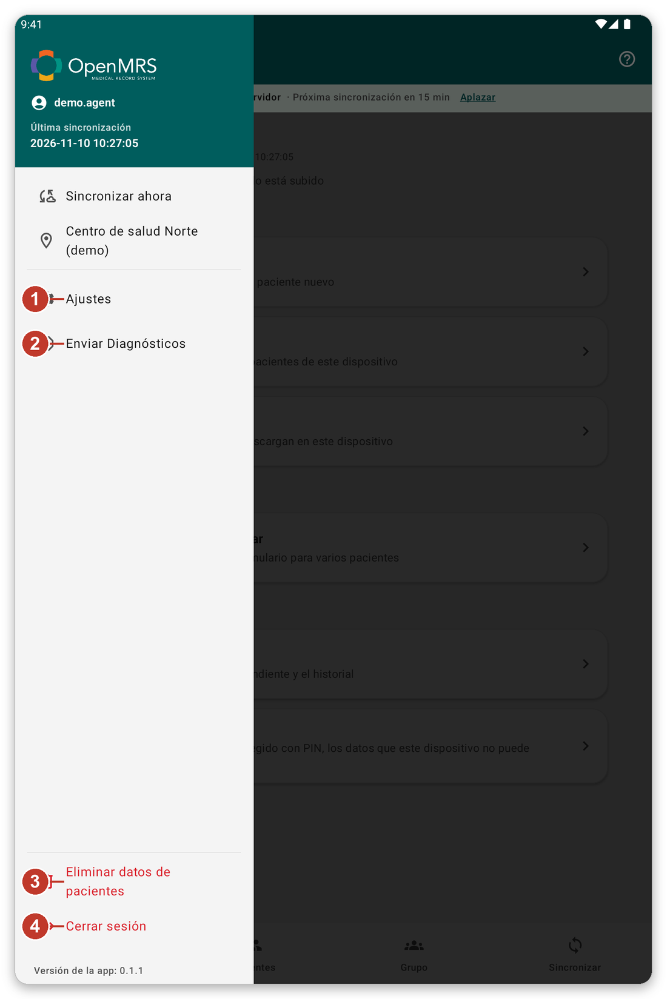

# Orientarse en la aplicación {#navigation}

## Para qué sirve {#nav-purpose}

Este capítulo muestra las partes principales de la pantalla, para que siempre sepa dónde está y cómo volver.

## La pantalla de inicio {#home-screen}

*Figura 1: la pantalla de inicio.*

Arriba verá dónde trabaja, cuándo se sincronizaron los datos por última vez y cuántos pacientes hay en la tableta. Debajo están los botones:

1. {{title_add_patient}}: introducir los datos de un paciente nuevo.
2. {{nav_patients}}: buscar, abrir y editar los pacientes de la tableta.
3. {{patient_lists_header}}: elegir qué listas de pacientes guardar en la tableta.
4. {{title_group_encounter}}: rellenar un formulario para varios pacientes.
5. {{nav_sync}}: enviar su trabajo y descargar los datos más recientes.
6. {{title_import_export}}: pasar, en un archivo protegido, datos que no se pueden sincronizar.

## La barra inferior {#bottom-bar}

Los cuatro botones de la parte inferior de las pantallas principales le llevan directamente a {{nav_home}}, {{nav_patients}}, {{nav_group_session}} y {{nav_sync}}. El que está activo aparece resaltado.

## El menú {#menu}

Toque las tres líneas de la parte superior izquierda para abrir el menú.

*Figura 2: el menú.*

1. {{settings}}: cambiar el idioma, el aspecto, la seguridad, los formularios y las opciones de sincronización.
2. {{send_diagnostics}}: preparar un informe para el equipo de soporte.
3. {{delete_patient_data_menu}}: quitar de la tableta los pacientes de su cuenta. Antes le pide confirmar.
4. {{logout}}: salir de su cuenta.

La ubicación donde trabaja también está en el menú. Tóquela para elegir otro lugar.

## La franja bajo el título {#connection-strip}

La franja de color bajo el título le informa sobre la conexión: {{network_status_connected_to_server}} significa que la tableta puede alcanzar el servidor. Si dice que no se puede alcanzar el servidor, usted puede seguir trabajando. Su trabajo se guarda en la tableta y se envía más tarde.

## Ayuda en cada pantalla {#help-tour}

El botón **?** de la parte superior derecha inicia un recorrido corto de la pantalla en la que está. Cada paso explica un botón. Toque {{tutorial_skip}} para detenerlo.

> **Consejo:** no puede iniciar un recorrido mientras se sincroniza. Espere a que termine la sincronización.

## Si algo sale mal {#nav-problems}

- Se ha perdido: toque la flecha de volver en la parte superior izquierda, o toque {{nav_home}} en la barra inferior.
- Un botón está en gris: no está disponible ahora. Por ejemplo, {{nav_sync}} en el menú está en gris cuando no se puede alcanzar el servidor.
