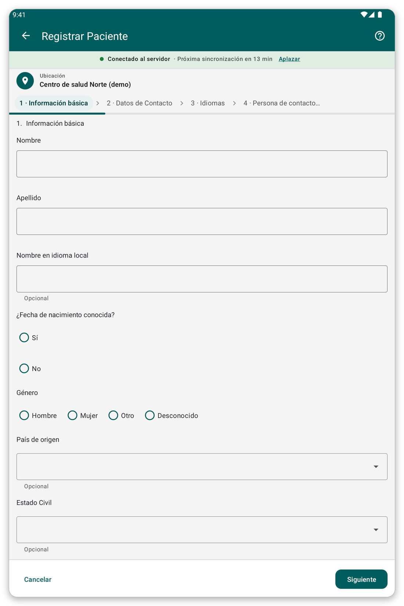

# Registrar un paciente {#register-patient}

## Para qué sirve {#register-purpose}

Añadir un paciente nuevo a la aplicación, con su nombre, edad, sexo y datos de contacto.

## Antes de empezar {#register-before}

- Compruebe que el paciente no esté ya en la aplicación: busque primero (vea [Buscar y abrir un paciente](#find-patient)).
- Elija primero su ubicación, porque el paciente se guarda en ella.

## Paso a paso {#register-steps}

*Figura 1: la primera página del formulario de registro.*

1. En la pantalla de inicio, toque {{title_add_patient}}.
2. Responda a las preguntas página por página. Las preguntas obligatorias deben responderse antes de continuar.
3. Toque {{button_pagination_next}} para ir a la página siguiente y {{button_pagination_previous}} para volver. También puede tocar el nombre de una página en la parte superior para ir directamente a ella.
4. Al final, toque {{button_review}} y compruebe sus respuestas.
5. Toque {{submit}} para guardar al paciente.

Después de guardar, la aplicación abre la ficha del paciente.

> **Advertencia:** un paciente no se puede guardar mientras falten respuestas obligatorias. Las respuestas que faltan aparecen marcadas en rojo.

## Consejos {#register-tips}

- Si no conoce la fecha de nacimiento, el formulario permite introducir una edad en su lugar.
- Sin conexión, el paciente se guarda en la tableta y se envía en la siguiente sincronización.
- Si el paciente probablemente ya está en el servidor pero no en su tableta, no lo registre otra vez: use {{identify_later_action}} (vea [Identificar después](#identify-later)).

## Si algo sale mal {#register-problems}

- No puede pasar a la página siguiente: falta una respuesta obligatoria. Busque la marca roja.
- Se equivocó después de guardar: abra el paciente y toque {{edit_patient}} (vea [La ficha del paciente](#patient-file)).
