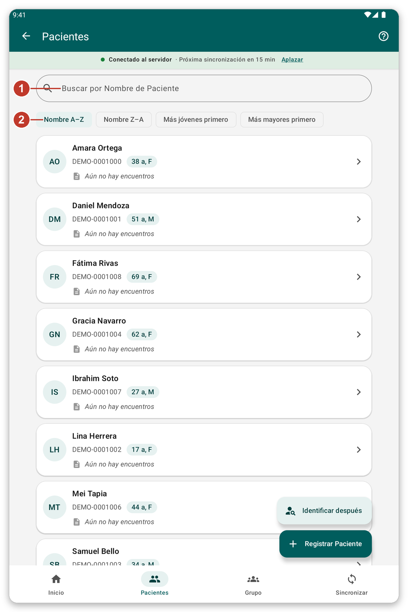
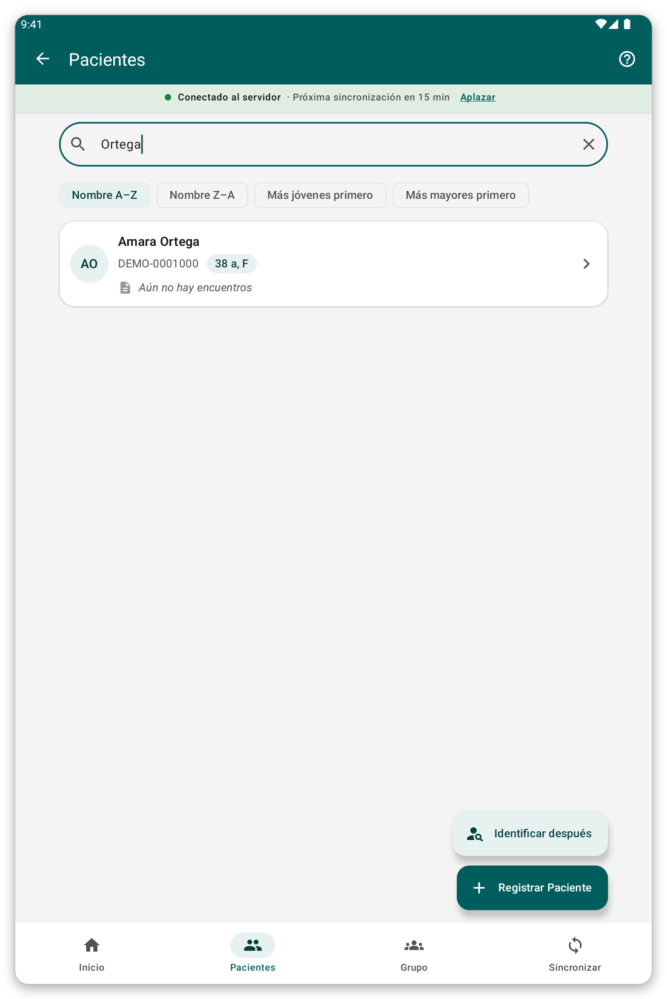
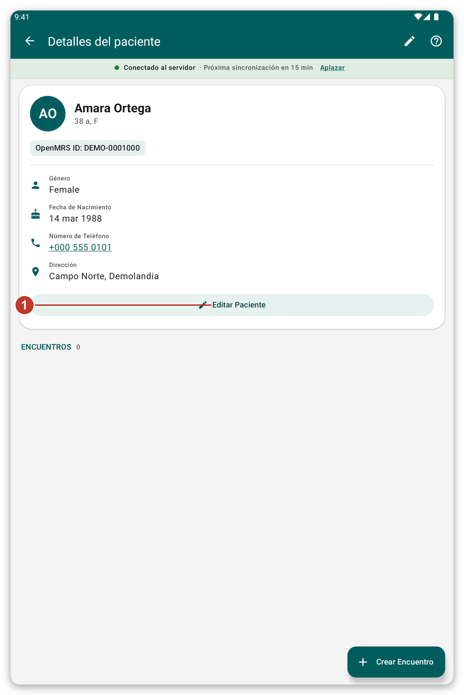

# Buscar y abrir un paciente {#find-patient}

## Para qué sirve {#find-purpose}

Buscar un paciente en la tableta, abrir su ficha y corregir sus datos.

## Antes de empezar {#find-before}

El paciente debe estar en una lista de pacientes que usted eligió, o usted debe haberlo registrado en esta tableta.

## Paso a paso {#find-steps}

*Figura 1: la lista de pacientes.*

1. Toque {{nav_patients}} en la barra inferior.
2. Escriba un nombre, un número de identificador o un número de teléfono en el cuadro de búsqueda (1).
3. Elija el orden con los botones de debajo (2): {{patient_sort_name_asc}}, {{patient_sort_name_desc}}, {{patient_sort_age_youngest}} o {{patient_sort_age_oldest}}.
4. Toque un paciente (3) para abrir su ficha.

*Figura 2: al escribir parte de un nombre solo se muestran los pacientes que coinciden.*

La lista muestra 100 pacientes a la vez. Toque el botón del final de la lista para ver más. Los pacientes con los que trabajó por última vez aparecen primero, en {{recent_patients_title}}.

## La ficha del paciente {#patient-file}

*Figura 3: la ficha de un paciente.*

La ficha muestra el nombre, la edad, el identificador y los datos de contacto. Debajo, {{header_encounters}} lista todo lo anotado para el paciente.

1. Toque {{edit_patient}} (1) para cambiar los datos del registro.
2. Tire de la página hacia abajo para volver a leer la ficha desde el servidor (cuando hay conexión).
3. Toque un número de teléfono para llamarlo.
4. Use el botón verde de abajo para anotar algo nuevo (vea [Anotar un encuentro](#record-encounter)).

## Identificar después {#identify-later}

A veces el paciente ya está en el servidor pero no en su tableta, y usted no tiene conexión. No lo registre otra vez: crearía un duplicado.

1. En la lista de pacientes, toque {{identify_later_action}}.
2. Escriba una nota que ayude a encontrar al paciente más tarde (nombre, aldea, teléfono).
3. Anote la visita como siempre.
4. Más tarde, con conexión, abra el paciente y toque {{identify_banner_identify}} para encontrar al paciente real en el servidor. Todo lo que anotó pasa a él.

> **Advertencia:** los datos de un paciente por identificar después no se envían al sincronizar, hasta que lo identifique. La aplicación le pregunta por ellos antes de sincronizar.

## Consejos {#find-tips}

- Una pequeña marca de nube en un paciente significa que sus últimos cambios aún no se han enviado.
- Con el modo en vivo activado, también puede buscar en el servidor (vea [Sincronización y modo en vivo](#live-mode)).

## Si algo sale mal {#find-problems}

- Falta un paciente: compruebe que su lista de pacientes esté seleccionada (vea [Listas de pacientes](#patient-lists)).
- Los datos están desactualizados: tire de la página hacia abajo para actualizar, o sincronice.
