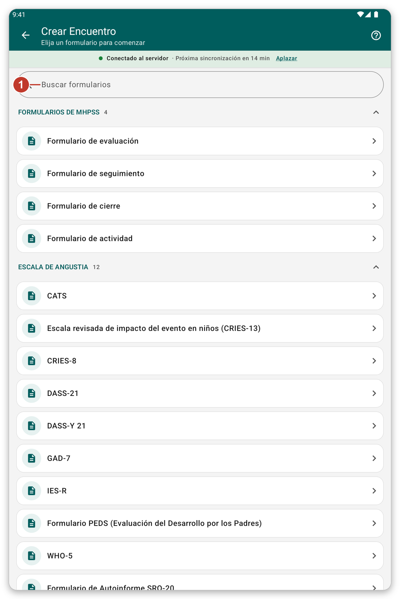

# Anotar un encuentro con un formulario {#record-encounter}

## Para qué sirve {#encounter-purpose}

Anotar lo que hizo por un paciente rellenando un formulario, por ejemplo una escala de detección o una evaluación.

## Antes de empezar {#encounter-before}

Abra la ficha del paciente (vea [Buscar y abrir un paciente](#find-patient)).

## Paso a paso {#encounter-steps}

1. En la ficha del paciente, toque {{create_encounter}} (el botón verde de abajo).
2. Se abre la lista de formularios. Los formularios están agrupados en **secciones**, por ejemplo **Formularios de MHPSS**, **Escala de angustia** y **Escala de funcionamiento**. Toque el nombre de una sección para plegarla o abrirla.
3. Para encontrar un formulario rápidamente, escriba parte de su nombre en {{search_forms}}.
4. Toque el formulario que quiere.

*Figura 1: elija un formulario. Las secciones son las definidas en los ajustes de la aplicación.*

5. Responda a las preguntas. Un formulario puede tener varias páginas. Use {{button_pagination_next}} y {{button_pagination_previous}}, o toque el nombre de una página en la parte superior.
6. Cuando termine, toque {{button_review}} y compruebe sus respuestas.
7. Toque {{submit}}.

Lo que guarda permanece en la tableta y se envía en la siguiente sincronización. Con el modo en vivo activado, se envía un momento después.

> **Advertencia:** las respuestas marcadas como **obligatorias** deben rellenarse antes de continuar.

## Ver o cambiar un encuentro {#edit-encounter}

En la ficha del paciente, toque el título de un encuentro para leerlo. Toque el lápiz para cambiarlo.

## Elegir qué secciones ve {#form-sections}

Las secciones vienen de los ajustes de su organización. Puede crear las suyas: abra {{settings}}, vaya a {{settings_section_forms_visits}} y toque {{form_sections_customize}} (vea [Ajustes](#settings)).

## Si algo sale mal {#encounter-problems}

- Un formulario que necesita no está en la lista: busque en las otras secciones, o búsquelo por nombre. Si sigue sin aparecer, pregunte a su organización.
- El formulario dice que una respuesta es obligatoria: desplácese hasta el mensaje en rojo y respóndala.
