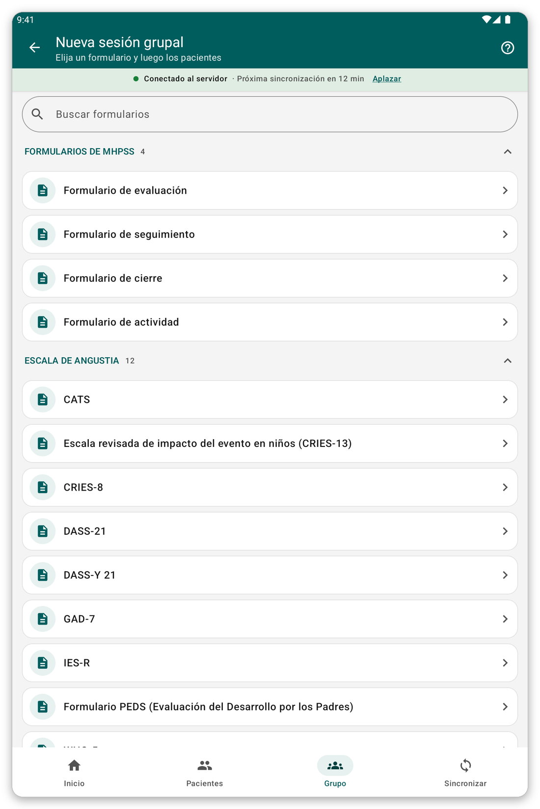

# Sesiones de grupo y visitas {#group-and-visits}

## Sesión de grupo o de familia {#group-session}

**Para qué sirve:** rellenar un solo formulario para varios pacientes a la vez, por ejemplo una familia o un grupo.

**Antes de empezar:** los pacientes deben estar en la tableta.

*Figura 1: inicie una sesión de grupo eligiendo el formulario.*

1. Toque {{title_group_encounter}} en la pantalla de inicio, o {{nav_group_session}} en la barra inferior.
2. Elija el formulario.
3. Elija los pacientes de la sesión.
4. Responda a las preguntas. Cada paciente tiene su propia pestaña arriba, con sus propias respuestas.
5. Revise y guarde.

> **Consejo:** una sesión que empezó y no terminó se conserva, para que pueda continuarla.

## Visitas {#visits}

Una visita es un período de atención que incluye uno o más encuentros.

Por defecto, la aplicación crea sola una visita para cada encuentro. Usted nunca ve las visitas, y la ficha del paciente es una lista sencilla de encuentros.

Si su organización prefiere que usted gestione las visitas (el ajuste {{settings_automatic_visits}} está desactivado):

1. En la ficha del paciente, toque {{start_visit}} para abrir una visita. La aplicación pregunta cuándo empezó.
2. Anote los encuentros de la visita.
3. Toque {{end_visit}} cuando termine la visita. Toque {{reopen_visit}} para abrirla de nuevo.

> **Nota:** solo puede haber una visita abierta a la vez. Un encuentro debe estar dentro de su visita.

## Si algo sale mal {#group-problems}

- Falta un paciente en la sesión: no está en la tableta. Elija primero su lista de pacientes (vea [Listas de pacientes](#patient-lists)).
- La aplicación se niega a guardar un encuentro en una visita: su fecha está fuera de la visita. Cambie la fecha o la visita.
