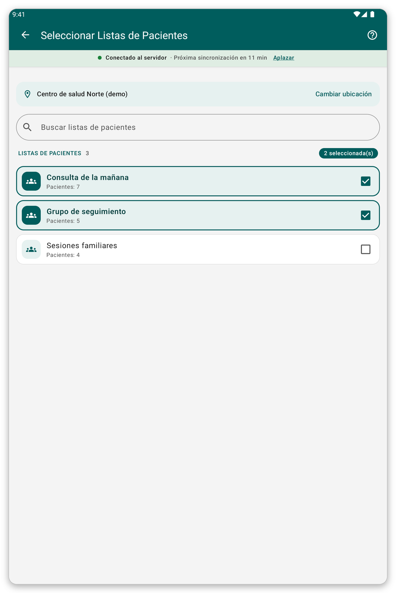

# Ubicación y listas de pacientes {#location-and-lists}

## Para qué sirve {#lists-purpose}

Elegir el lugar donde trabaja y las listas de pacientes cuyos pacientes guarda en la tableta.

## Cambiar la ubicación {#change-location}

1. Abra el menú y toque el nombre de su ubicación.
2. Escriba parte de un nombre en {{search_a_location}}, o desplácese.
3. Toque el lugar que quiere.

Los lugares marcados con una estrella van primero.

## Cambiar las listas de pacientes {#patient-lists}

*Figura 1: marque las listas que quiere en la tableta.*

1. En la pantalla de inicio, toque {{patient_lists_header}}.
2. Escriba parte de un nombre en {{search_patient_lists}} para encontrar una lista.
3. Marque las listas que quiere. Sus pacientes se descargan enseguida.
4. Toque {{submit}}.

> **Advertencia:** si no hay ninguna lista marcada, no se descarga ningún paciente.

## Si algo sale mal {#lists-load-problems}

- Las listas no cargan: compruebe la conexión y toque {{patient_lists_try_again}}. También puede tocar {{patient_lists_continue_without}} y elegir las listas más tarde.
- No ve lugares para elegir: su organización no ha vinculado lugares a su cuenta. Pregúnteles.
