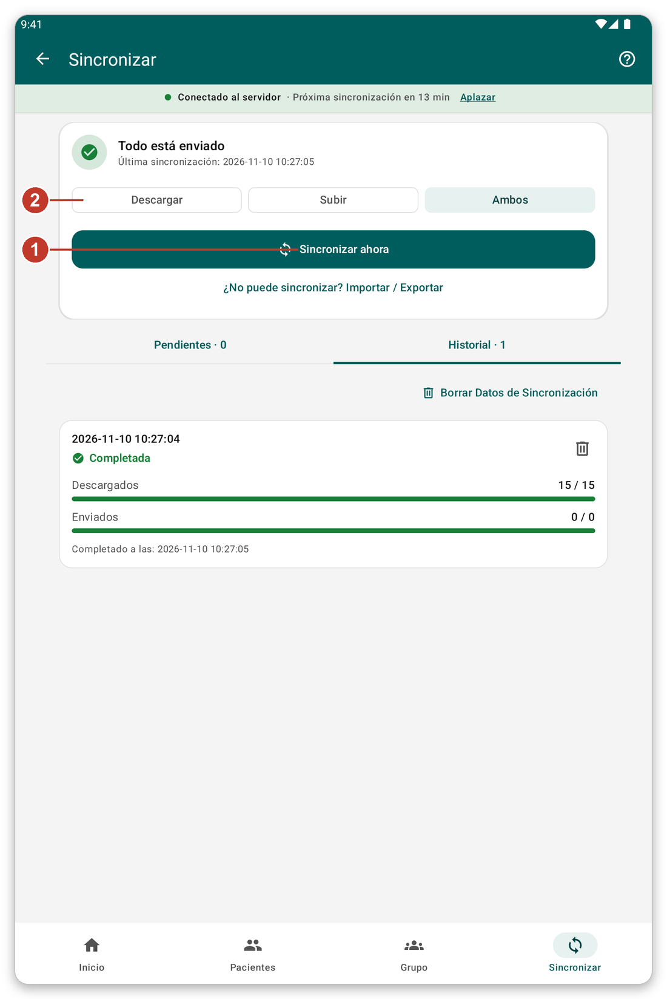

# Sincronización y modo en vivo {#sync}

## Para qué sirve {#sync-purpose}

La **sincronización** envía al servidor lo que usted anotó en la tableta y trae los datos más recientes. Mientras no sincronice, su trabajo permanece a salvo solo en la tableta.

## Antes de empezar {#sync-before}

Necesita conexión con el servidor. Si trabaja como invitado, la aplicación le pide primero iniciar sesión.

## Paso a paso {#sync-steps}

*Figura 1: la página de sincronización.*

1. Toque {{nav_sync}} en la barra inferior.
2. Arriba verá si hay algo pendiente de enviar y cuándo se sincronizaron los datos por última vez.
3. Elija qué hacer esta vez con los tres botones (2): {{sync_page_mode_download}}, {{sync_page_mode_upload}} o {{sync_page_mode_both}}. Esta elección vale solo para esta sincronización.
4. Toque {{sync_now}} (1). Puede seguir usando la aplicación mientras se ejecuta.
5. Para detenerla, toque {{sync_cancel}}.

Debajo, {{sync_tab_pending}} lista lo que aún no se ha enviado, y {{sync_tab_history}} lista las sincronizaciones pasadas y cómo terminaron.

> **Advertencia:** si puede evitarlo, no borre los datos de los pacientes ni cierre sesión antes de que todo esté enviado. Compruebe que la pantalla de inicio dice {{home_summary_uploaded}}.

## Sincronización automática {#automatic-sync}

La aplicación puede sincronizarse sola de vez en cuando. Espera un buen momento, por ejemplo cuando la tableta está en Wi-Fi y la batería no está baja. Puede cambiarlo en {{settings}} (vea [Ajustes](#settings)). La franja bajo el título muestra cuándo empezará la próxima sincronización. Toque {{auto_sync_delay_link}} para aplazarla.

## Modo en vivo {#live-mode}

Con {{settings_live_mode}} activado, lo que guarda se envía al servidor enseguida, y puede buscar en el servidor pacientes que no están en la tableta. Sin conexión no se pierde nada: su trabajo se conserva y se envía más tarde.

Actívelo en {{settings}}, en la sección {{settings_section_live}}.

## Sesión caducada {#session-expired}

Si el servidor ya no acepta su inicio de sesión, aparece una franja bajo el estado de la conexión. Toque {{sign_in}}. Lo que hizo mientras tanto se queda en la tableta y se envía después.

## Si algo sale mal {#sync-problems}

- La sincronización no empieza: no se puede alcanzar el servidor. Compruebe la conexión (vea [Solución de problemas](#cannot-connect)).
- La sincronización falla: abra {{sync_tab_history}} para ver cómo terminó y vuelva a intentarlo. Su trabajo no se pierde.
- La aplicación pregunta por pacientes por identificar: elija identificarlos ahora, o sincronizar de todos modos (vea [Identificar después](#identify-later)).
