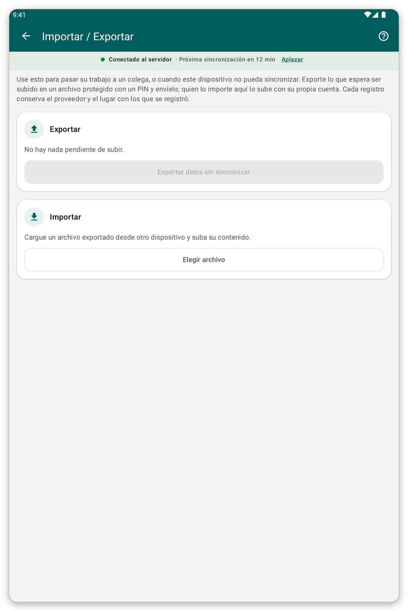

# Importar y exportar {#import-export}

## Para qué sirve {#ie-purpose}

Cuando una tableta no puede sincronizar, puede pasar sus datos sin enviar a un compañero en un archivo protegido por un PIN. El compañero importa el archivo y lo envía con su propia cuenta.

## Antes de empezar {#ie-before}

- La tableta que exporta debe tener datos pendientes de enviar.
- Las dos personas deben acordar un PIN de cuatro dígitos.

*Figura 1: la página de importar y exportar.*

## Exportar un archivo {#export}

1. En la pantalla de inicio, toque {{title_import_export}}.
2. Toque {{export_title}}.
3. Introduzca o elija el PIN de cuatro dígitos. <!-- TODO: verify whether the app asks for the PIN or generates it -->
4. Guarde o comparta el archivo, como sugiere la aplicación.

## Importar un archivo {#import}

1. En la pantalla de inicio, toque {{title_import_export}}.
2. Toque {{import_title}} y elija el archivo.
3. Escriba el PIN.
4. La aplicación guarda los registros. Después sincronice para enviarlos.

> **Advertencia:** importar el mismo archivo dos veces no hace nada, así que no se pueden crear duplicados. Si el modo en vivo está activado, el trabajo ya se envió, y puede que no haya nada que exportar.

## Si algo sale mal {#ie-problems}

- El PIN es rechazado: pida al remitente que confirme los cuatro dígitos.
- Algunos registros no se guardan: el informe dice cuáles y por qué. Un cambio en un paciente solo se puede guardar si ese paciente ya está en su tableta.
