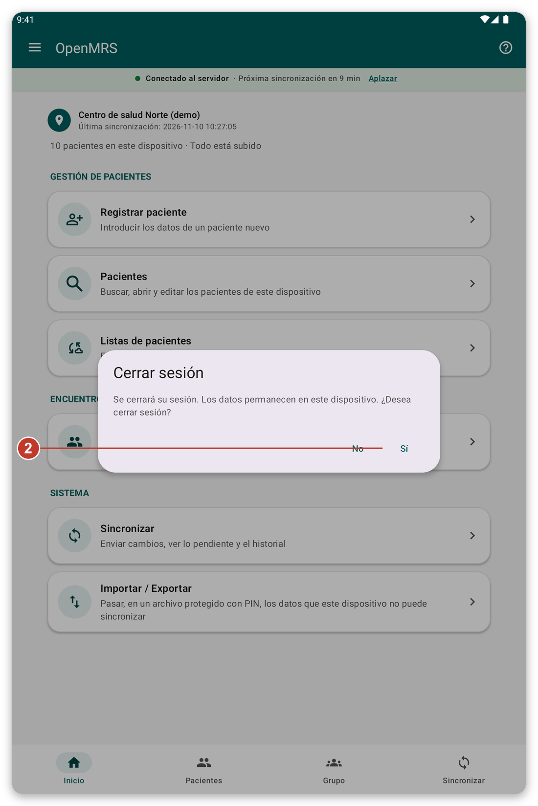
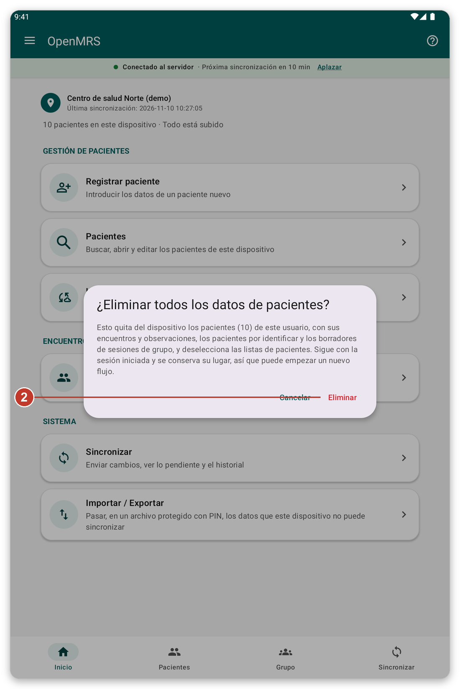
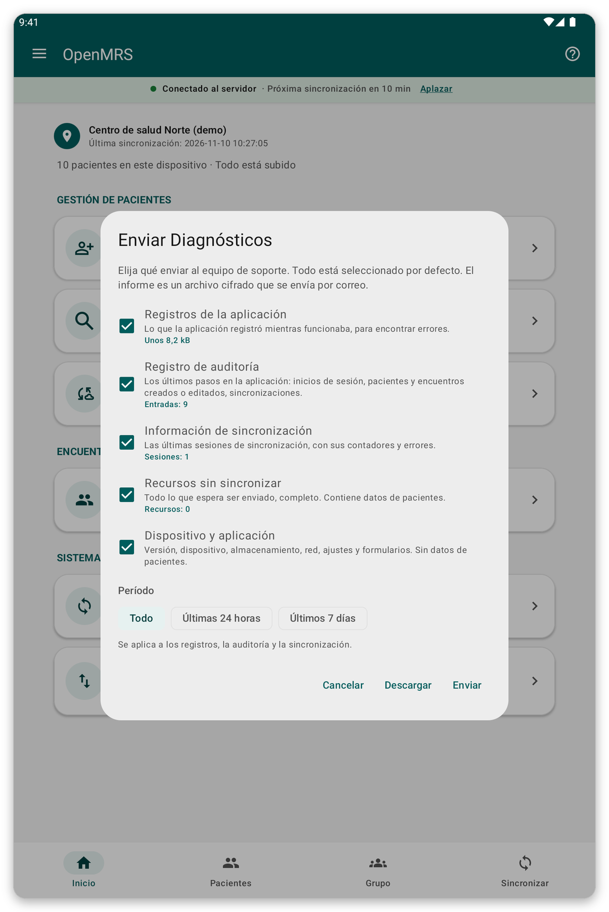

# Seguridad, usuarios y sus datos {#security}

## Inicio de sesión sin conexión y pantalla de bloqueo {#lock-screen}

Si activó {{offline_login_title}}, la aplicación se bloquea cuando vuelve a ella pasado un tiempo. La desbloquea con su huella, su rostro o el bloqueo de pantalla, incluso sin conexión. Puede elegir cuánto espera la aplicación antes de pedirlo de nuevo, en {{settings}}.

> **Advertencia:** si cambia o quita la huella o el bloqueo de pantalla de la tableta, el inicio de sesión sin conexión se desactiva y debe iniciar sesión con su cuenta otra vez.

## Varias personas en una tableta {#several-users}

Por defecto, sus datos permanecen en la tableta cuando cierra sesión, así que la siguiente persona los encuentra.

- Usted solo ve los pacientes que registró o descargó. Otros usuarios no los ven, salvo que usted lo permita en {{settings}} ({{settings_share_my_data}}).
- Cada usuario tiene sus propias listas de pacientes y su propia ubicación.
- En la página de inicio de sesión, el pequeño icono de nube indica si algunos usuarios aún tienen datos pendientes de enviar. Tóquelo para verlos y luego toque {{login_pending_use_user}} para rellenar el nombre de usuario.

## Cerrar sesión {#log-out}

*Figura 1: cerrar sesión pide confirmación.*

1. Abra el menú y toque {{logout}}.
2. Lea el mensaje. Le dice qué pasa con sus datos.
3. Toque {{yes}} para cerrar sesión, o {{no}} para quedarse.

## Eliminar datos de pacientes {#delete-data}

Esto quita de la tableta los pacientes de su cuenta, con sus encuentros, para que pueda empezar de nuevo. Usted sigue con la sesión iniciada y conserva su ubicación.

*Figura 2: el mensaje dice cuántos pacientes se eliminan y cuánto nunca se envió.*

> **Advertencia:** los datos que nunca se enviaron se pierden para siempre. Sincronice primero y compruebe que aparece {{home_summary_uploaded}}.

1. Abra el menú y toque {{delete_patient_data_menu}}.
2. Lea cuántos pacientes y cuántos datos sin enviar están afectados.
3. Toque {{delete}} para confirmar, o {{cancel}} para parar. Si el inicio de sesión sin conexión está activado, se le pide su huella o el bloqueo de pantalla.

## Enviar diagnósticos {#diagnostics}

Si el equipo de soporte se lo pide, la aplicación puede preparar un informe que ayuda a encontrar un problema. Usted elige qué incluye, y el informe está protegido.

*Figura 3: elija qué incluir en el informe.*

1. Abra el menú y toque {{send_diagnostics}}.
2. Elija qué incluir y desde cuándo.
3. Siga los pasos para enviar el informe por correo electrónico. <!-- TODO: verify the exact steps of the e-mail screen -->

> **Nota:** el informe no contiene contraseñas ni datos de pacientes.

## Si algo sale mal {#security-problems}

- No puede desbloquear la aplicación: toque el botón para iniciar sesión con su cuenta en su lugar.
- Olvidó su contraseña: pida a su organización que la restablezca.
