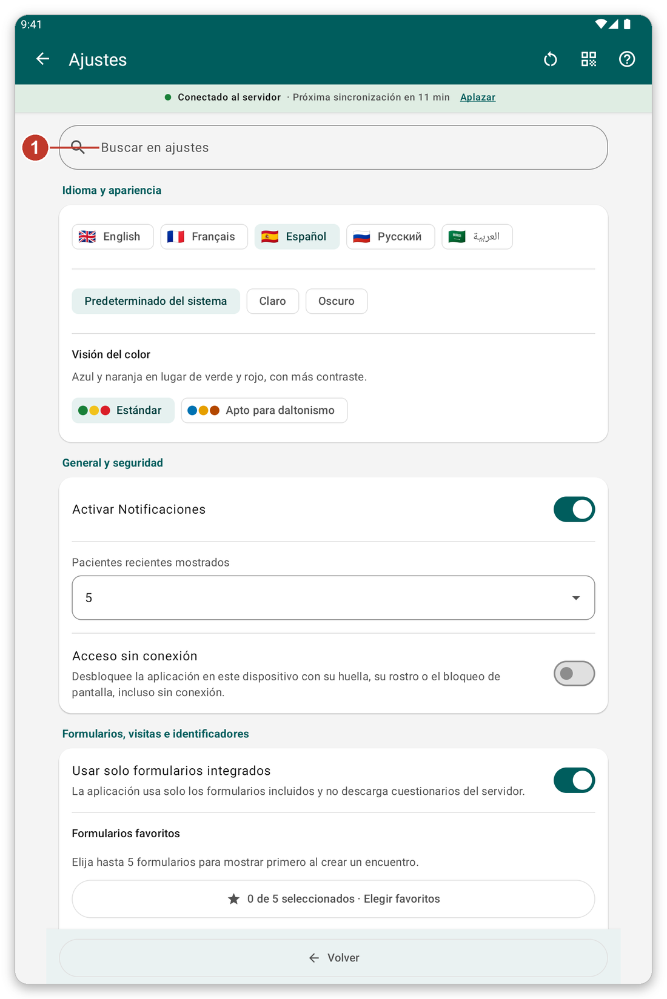
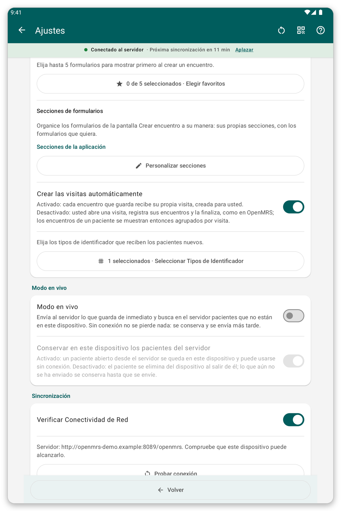
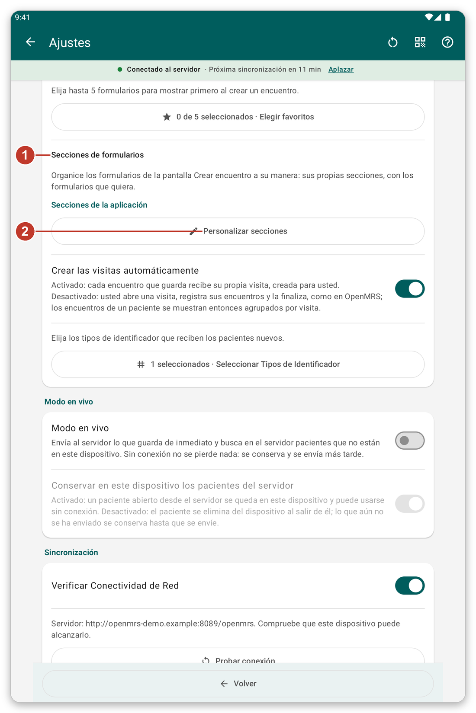
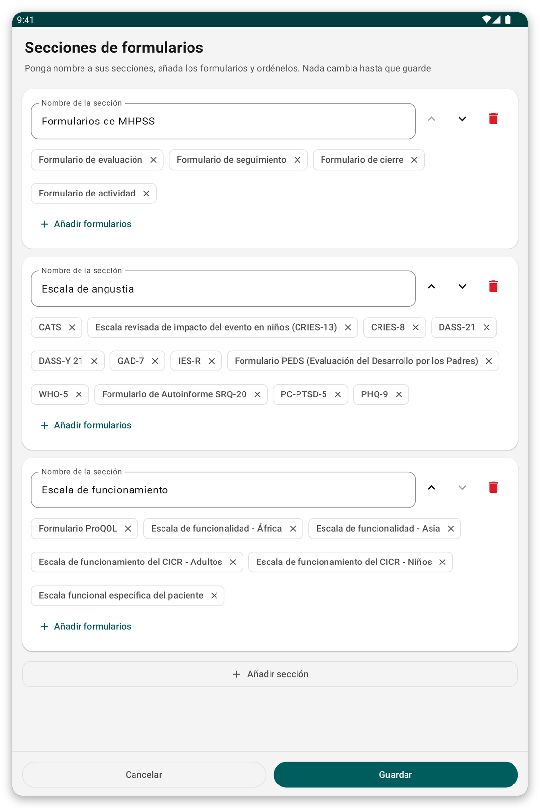

# Ajustes {#settings}

Abra el menú y toque {{settings}}. Los cambios se guardan en cuanto los hace.

*Figura 1: la página de ajustes. Escriba una palabra en el cuadro de búsqueda (1) para mostrar solo las secciones que la mencionan.*

## Idioma y aspecto {#settings-language}

- {{settings_language}}: inglés, francés, español, ruso o árabe. Las pantallas se giran de derecha a izquierda en árabe.
- {{settings_section_appearance}}: claro, oscuro, o el tema del sistema. También hay una paleta para el daltonismo.

## General y seguridad {#settings-general}

- Notificaciones activadas o no.
- Cuántos **pacientes recientes** se listan arriba en la lista de pacientes (0 oculta la sección).
- Si otros usuarios de esta tableta pueden ver los pacientes que usted registró (desactivado por defecto).
- Si la aplicación recuerda su última ubicación después de iniciar sesión.
- {{offline_login_title}}: desbloquear con huella, rostro o bloqueo de pantalla, cuánto espera la aplicación antes de pedirlo de nuevo, ocultar la aplicación en la lista de aplicaciones recientes, y qué pasa con los datos al cerrar sesión.

*Figura 2: La parte central de la página de ajustes, con las opciones generales y de seguridad.*

## Formularios, visitas e identificadores {#settings-forms}

*Figura 3: las secciones de formularios (1) y el botón para cambiarlas (2).*

- {{favorite_forms}}: elija hasta cinco formularios para mostrar primero.
- {{form_sections_title}}: las secciones de la lista de formularios. Toque {{form_sections_customize}} para crear las suyas.
- {{settings_automatic_visits}}: activado, la aplicación crea una visita para cada encuentro; desactivado, usted abre y termina las visitas.
- **Tipos de identificador:** qué clases de identificador reciben los pacientes nuevos.

### Crear sus propias secciones de formularios {#own-sections}

*Figura 4: ponga nombre a las secciones y meta formularios en ellas. Nada cambia hasta que guarde.*

1. Toque {{form_sections_customize}}.
2. Cambie el nombre de una sección, súbala o bájela, o elimínela.
3. Toque {{form_section_add_forms}} para poner formularios en una sección, y {{form_section_add}} para una sección nueva.
4. Toque {{save}}.

## {{settings_section_live}} {#settings-live}

Envíe al servidor lo que guarda enseguida, y busque en el servidor pacientes que no están en la tableta.

## {{settings_section_sync}} {#settings-sync}

- La dirección del servidor y un botón para probar la conexión.
- {{settings_auto_sync}}, qué hace (solo enviar, o enviar y descargar) y cuándo espera (solo Wi-Fi, batería baja).

## Compartir los ajustes con otra tableta {#share-settings}

El icono junto al título muestra un código QR de sus ajustes. En otra tableta, elija importar y escanéelo. Verá qué cambiaría y lo aprobará. Los pacientes, las contraseñas y su cuenta nunca se comparten. <!-- TODO: verify the exact labels of the share and import buttons -->

> **Consejo:** si cambió muchos ajustes y quiere empezar de nuevo, use el botón de restablecer junto al título.
