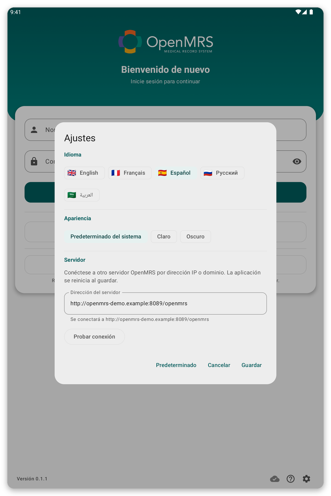

# Solución de problemas {#troubleshooting}

Para cada problema encontrará por qué ocurre y qué hacer.

## No puedo conectarme al servidor {#cannot-connect}

**Por qué:** la tableta no tiene internet, el servidor está caído, o la dirección del servidor en los ajustes es incorrecta.

*Figura 1: Los ajustes de la página de inicio de sesión: idioma, aspecto y dirección del servidor.*

**Qué hacer:**

1. Compruebe que el Wi-Fi o los datos móviles están activados, y abra una página web para probar.
2. En los ajustes de la página de inicio de sesión, o en {{settings}}, toque {{test_connection}}.
3. Si la prueba falla, pregunte a su organización si el servidor funciona y si la dirección es correcta.

Puede seguir trabajando sin conexión: su trabajo se conserva y se envía más tarde.

## Mi contraseña es rechazada {#password-refused}

**Por qué:** la contraseña es incorrecta, o su cuenta usa solo el inicio de sesión único.

**Qué hacer:** escríbala de nuevo, despacio. Si la página ofrece {{sign_in_with_sso}}, pruebe con eso. Si sigue fallando, pida a su organización que la restablezca.

## La página de inicio de sesión único no se abre o no vuelve a la aplicación {#sso-fails}

**Por qué:** no hay conexión, o se cerró el navegador antes de terminar.

**Qué hacer:** toque {{sign_in_with_sso}} de nuevo y termine el inicio de sesión sin cerrar la pestaña del navegador.

## Las listas de pacientes no cargan {#lists-fail}

**Por qué:** no hay conexión, o ninguna lista está vinculada a su ubicación.

**Qué hacer:** toque {{patient_lists_try_again}}. O toque {{patient_lists_continue_without}} y elija las listas más tarde (vea [Ubicación y listas de pacientes](#location-and-lists)).

## Falta un paciente {#patient-missing}

**Por qué:** su lista de pacientes no está seleccionada, o el paciente fue registrado por otro usuario de la tableta.

**Qué hacer:** elija su lista (vea [Ubicación y listas de pacientes](#location-and-lists)). Con el modo en vivo activado, busque en el servidor (vea [Sincronización y modo en vivo](#sync)).

## La sincronización falla o no termina {#sync-fails}

**Por qué:** la conexión es débil o se perdió, o la sesión caducó.

**Qué hacer:** abra la página de sincronización y el historial para ver cómo terminó. Vaya donde la señal sea mejor y toque {{sync_now}}. Si una franja le pide iniciar sesión de nuevo, toque {{sign_in}}. Su trabajo nunca se pierde por una sincronización fallida.

## La tableta pide mi huella y falla {#unlock-fails}

**Por qué:** la huella o el bloqueo de pantalla cambió, así que se desactivó el inicio de sesión sin conexión.

**Qué hacer:** inicie sesión con su cuenta y vuelva a activar el inicio de sesión sin conexión en {{settings}}.

## Algo va mal y soporte pide detalles {#send-report}

Abra el menú, toque {{send_diagnostics}} y siga los pasos (vea [Seguridad, usuarios y sus datos](#diagnostics)).
