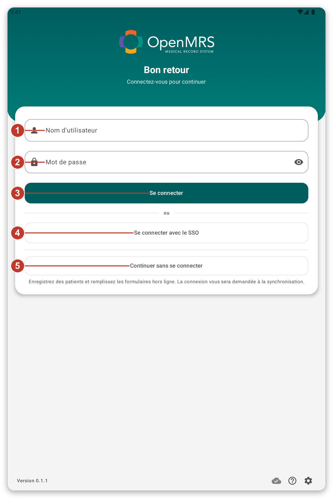
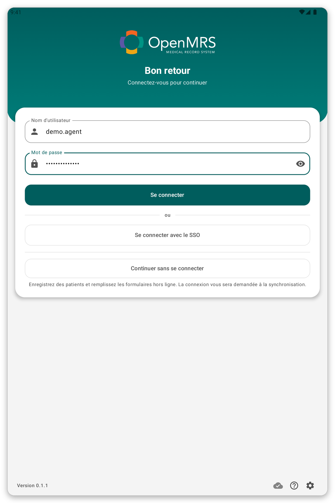
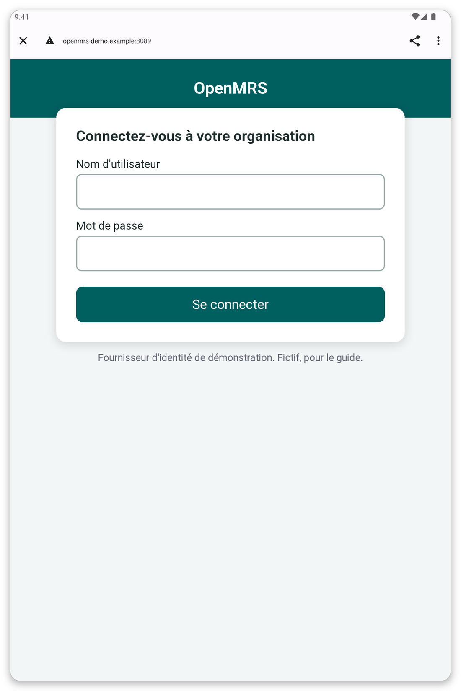
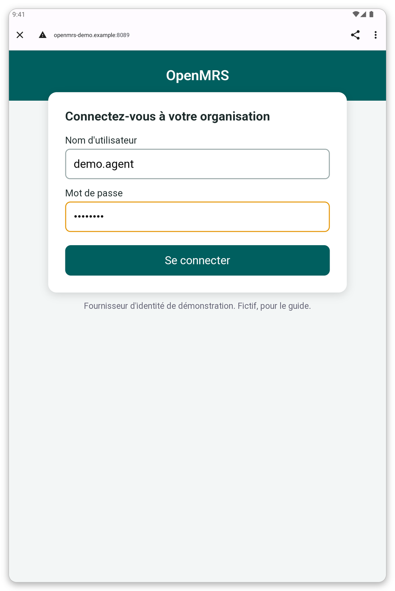
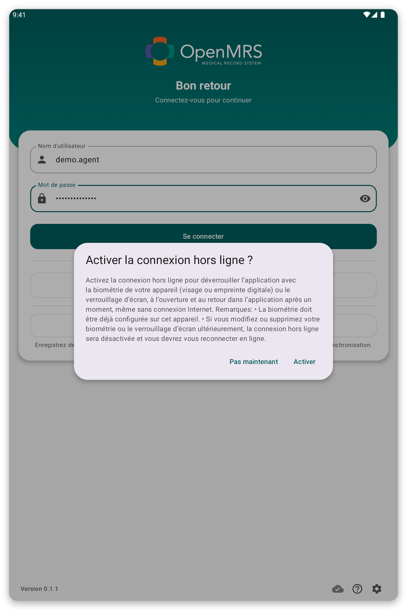
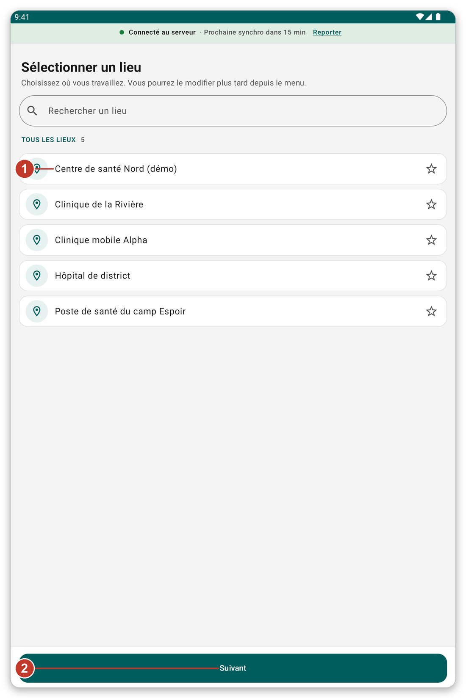
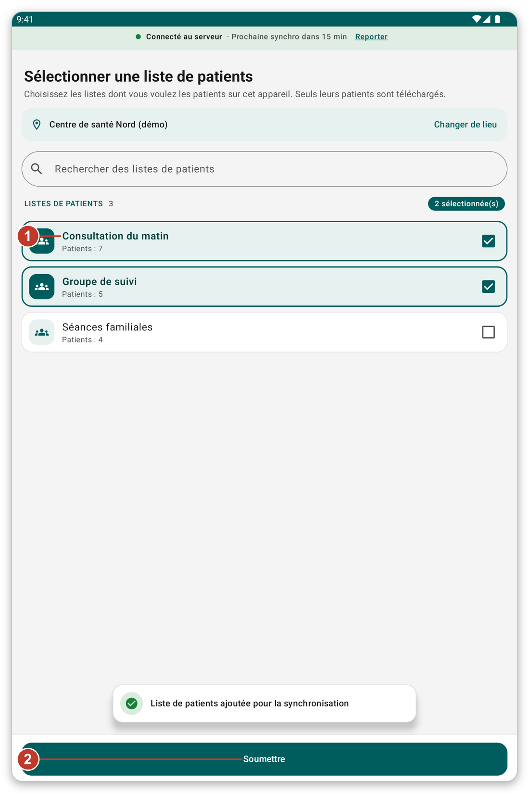
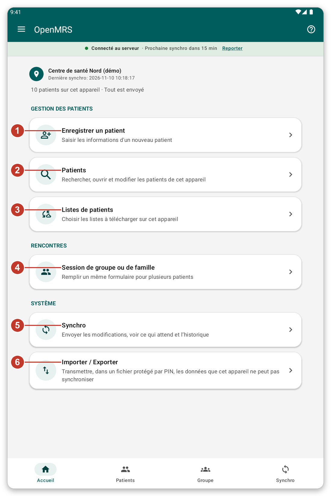

# Premiers pas {#getting-started}

## Installer et ouvrir l'application {#install}

**À quoi cela sert :** mettre l'application sur la tablette et l'ouvrir pour la première fois.

**Avant de commencer :** votre organisation vous fournit l'application. <!-- TODO: verify how the app is distributed (app file or store) -->

1. Installez l'application sur la tablette, comme votre organisation vous l'a indiqué.
2. Ouvrez l'application. Une page de connexion apparaît.
3. Si Android demande l'autorisation d'envoyer des notifications, touchez **Autoriser**. L'application utilise les notifications pour vous dire qu'une synchronisation est en cours.

> **Astuce :** les petites icônes en bas de la page de connexion ouvrent les paramètres de la page (langue, apparence et serveur) et lancent une courte visite guidée.

## Se connecter {#sign-in}

**À quoi cela sert :** prouver qui vous êtes, pour que l'application puisse télécharger vos patients.

**Avant de commencer :** vous avez besoin d'une connexion à internet.

*Figure 1 : la page de connexion.*

1. Écrivez votre nom d'utilisateur dans {{username}} (1).
2. Écrivez votre mot de passe dans {{password}} (2).
3. Touchez {{button_login}} (3).

Si votre organisation utilise l'authentification unique, ou vous laisse travailler sans compte, vous voyez aussi {{sign_in_with_sso}} (4) et {{continue_without_login}} (5).

> **Attention :** si le mot de passe est faux, un message apparaît et vous restez sur la page. Vérifiez le mot de passe et essayez encore. Après plusieurs essais ratés, demandez à votre organisation de le réinitialiser.

*Figure 2 : après un mot de passe incorrect, vous restez sur la page de connexion et pouvez réessayer.*

### Se connecter avec l'authentification unique {#sso}

L'authentification unique vous permet d'utiliser le compte que votre organisation vous a déjà donné.

1. Touchez {{sign_in_with_sso}}. La page de connexion de votre organisation s'ouvre dans le navigateur.
2. Écrivez votre nom d'utilisateur et votre mot de passe sur cette page.
3. Touchez **Se connecter**. L'application se rouvre toute seule.

*Figure 3 : la page de connexion de votre organisation. Elle est différente dans chaque organisation.*

*Figure 4 : écrivez votre nom d'utilisateur et votre mot de passe, puis touchez le bouton vert.*

> **Remarque :** la page du navigateur appartient à votre organisation, pas à l'application. Si elle ne s'ouvre pas, vérifiez votre connexion et réessayez.

### Travailler sans compte {#guest}

Si votre organisation l'autorise, touchez {{continue_without_login}}. Vous pouvez enregistrer des patients et remplir des formulaires hors connexion. L'application vous demande de vous connecter au moment de la synchronisation, et garde ce que vous avez noté.

## Connexion hors ligne {#offline-login-prompt}

Après la première connexion, l'application vous demande si vous voulez la déverrouiller avec votre empreinte, votre visage ou le verrouillage de l'écran, même sans connexion.

*Figure 5 : la question sur la connexion hors ligne.*

- Touchez {{enable_offline_login_positive}} pour l'activer. Votre appareil doit déjà avoir une empreinte, un visage ou un verrouillage d'écran.
- Touchez {{enable_offline_login_negative}} pour passer. Vous pourrez le changer plus tard dans les paramètres.

## Choisir où vous travaillez {#choose-location}

*Figure 6 : choisissez l'endroit où vous travaillez.*

1. Touchez votre lieu dans la liste (1). L'étoile permet de garder vos lieux favoris en haut.
2. Touchez {{next}} (2).

> **Remarque :** ce que vous enregistrez et notez est rattaché à ce lieu. Vous pourrez le changer plus tard depuis le menu.

## Choisir vos listes de patients {#choose-lists}

*Figure 7 : cochez les listes dont vous avez besoin.*

1. Cochez les listes dont vous avez besoin (1). Le nombre indique combien de patients contient chaque liste.
2. Touchez {{submit}} (2).

L'application télécharge alors ces patients. **Attendez la fin.** Ce premier téléchargement ne peut pas être ignoré et peut durer plusieurs minutes. Restez connecté au Wi-Fi ou aux données mobiles et gardez la tablette là où le signal est bon.

## L'écran d'accueil {#first-home}

Quand le téléchargement est terminé, l'écran d'accueil apparaît. La première fois, une courte visite guidée vous montre l'application. Touchez {{tutorial_skip}} si vous n'en voulez pas. Vous pouvez relancer une visite guidée à tout moment avec le bouton **?**.

*Figure 8 : l'écran d'accueil. Chaque numéro est expliqué dans le chapitre suivant.*

## Si quelque chose ne va pas {#getting-started-problems}

- La page de connexion dit qu'elle n'a pas pu se connecter : voir [Dépannage](#cannot-connect).
- Les listes de patients ne se chargent pas : touchez {{patient_lists_try_again}}, ou voir [Dépannage](#lists-fail).
