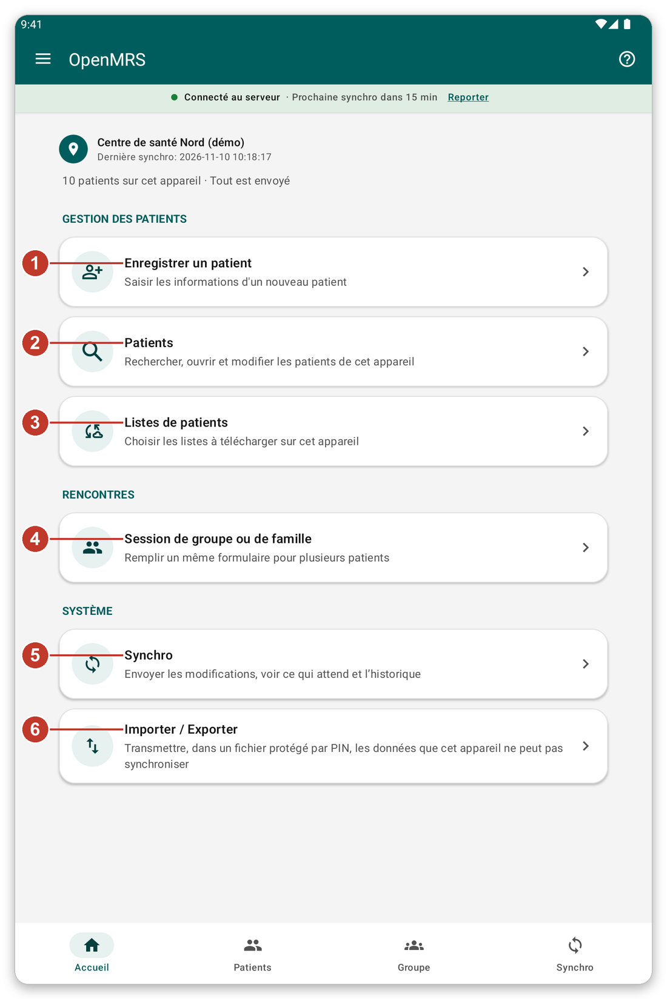
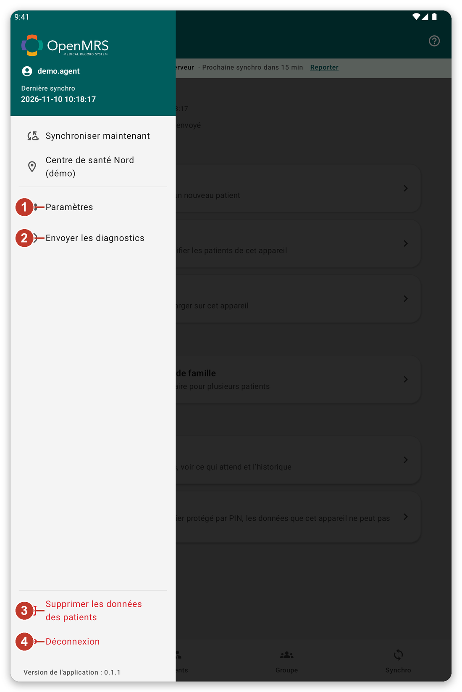

# S'orienter dans l'application {#navigation}

## À quoi cela sert {#nav-purpose}

Ce chapitre présente les parties principales de l'écran, pour que vous sachiez toujours où vous êtes et comment revenir en arrière.

## L'écran d'accueil {#home-screen}

*Figure 1 : l'écran d'accueil.*

En haut, vous voyez où vous travaillez, quand les données ont été synchronisées pour la dernière fois et combien de patients sont sur la tablette. Dessous se trouvent les boutons :

1. {{title_add_patient}} : saisir les informations d'un nouveau patient.
2. {{nav_patients}} : chercher, ouvrir et modifier les patients de la tablette.
3. {{patient_lists_header}} : choisir les listes de patients à garder sur la tablette.
4. {{title_group_encounter}} : remplir un formulaire pour plusieurs patients.
5. {{nav_sync}} : envoyer votre travail et télécharger les dernières données.
6. {{title_import_export}} : transmettre, dans un fichier protégé, des données qui ne peuvent pas être synchronisées.

## La barre du bas {#bottom-bar}

Les quatre boutons en bas des écrans principaux vous mènent directement à {{nav_home}}, {{nav_patients}}, {{nav_group_session}} et {{nav_sync}}. Celui où vous êtes est mis en évidence.

## Le menu {#menu}

Touchez les trois traits en haut à gauche pour ouvrir le menu.

*Figure 2 : le menu.*

1. {{settings}} : changer la langue, l'apparence, la sécurité, les formulaires et les options de synchronisation.
2. {{send_diagnostics}} : préparer un rapport pour l'équipe d'assistance.
3. {{delete_patient_data_menu}} : retirer de la tablette les patients de votre compte. Une confirmation est demandée d'abord.
4. {{logout}} : quitter votre compte.

Le lieu où vous travaillez est aussi dans le menu. Touchez-le pour choisir un autre lieu.

## La bande sous le titre {#connection-strip}

La bande colorée sous le titre vous renseigne sur la connexion : {{network_status_connected_to_server}} veut dire que la tablette peut joindre le serveur. Si elle indique que le serveur est injoignable, vous pouvez continuer à travailler. Votre travail est gardé sur la tablette et envoyé plus tard.

## De l'aide sur chaque écran {#help-tour}

Le bouton **?** en haut à droite lance une courte visite guidée de l'écran où vous êtes. Chaque étape explique un bouton. Touchez {{tutorial_skip}} pour arrêter.

> **Astuce :** vous ne pouvez pas lancer une visite guidée pendant une synchronisation. Attendez qu'elle soit terminée.

## Si quelque chose ne va pas {#nav-problems}

- Vous êtes perdu : touchez la flèche de retour en haut à gauche, ou touchez {{nav_home}} dans la barre du bas.
- Un bouton est grisé : il n'est pas disponible pour le moment. Par exemple, {{nav_sync}} dans le menu est grisé quand le serveur est injoignable.
