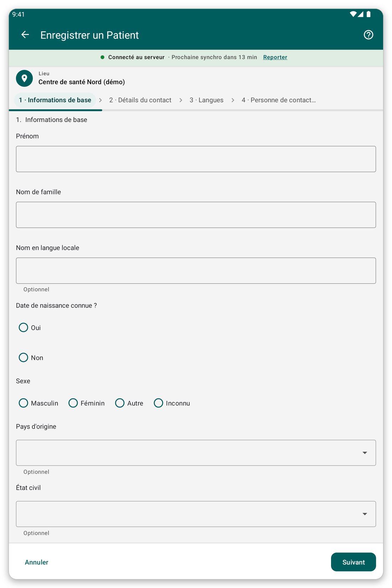

# Enregistrer un patient {#register-patient}

## À quoi cela sert {#register-purpose}

Ajouter un nouveau patient dans l'application, avec son nom, son âge, son sexe et ses coordonnées.

## Avant de commencer {#register-before}

- Vérifiez que le patient n'est pas déjà dans l'application : cherchez d'abord (voir [Trouver et ouvrir un patient](#find-patient)).
- Choisissez d'abord votre lieu, car le patient y est rattaché.

## Pas à pas {#register-steps}

*Figure 1 : la première page du formulaire d'enregistrement.*

1. Sur l'écran d'accueil, touchez {{title_add_patient}}.
2. Répondez aux questions page par page. Les questions obligatoires doivent avoir une réponse avant de continuer.
3. Touchez {{button_pagination_next}} pour aller à la page suivante et {{button_pagination_previous}} pour revenir. Vous pouvez aussi toucher le nom d'une page en haut pour y aller directement.
4. À la fin, touchez {{button_review}} et vérifiez vos réponses.
5. Touchez {{submit}} pour enregistrer le patient.

Après l'enregistrement, l'application ouvre le dossier du patient.

> **Attention :** un patient ne peut pas être enregistré tant qu'il manque des réponses obligatoires. Les réponses manquantes sont marquées en rouge.

## Astuces {#register-tips}

- Si vous ne connaissez pas la date de naissance, le formulaire permet de saisir un âge à la place.
- Hors connexion, le patient est enregistré sur la tablette et envoyé à la prochaine synchronisation.
- Si le patient est probablement déjà sur le serveur mais pas sur votre tablette, ne l'enregistrez pas de nouveau : utilisez {{identify_later_action}} (voir [Identifier plus tard](#identify-later)).

## Si quelque chose ne va pas {#register-problems}

- Vous ne pouvez pas passer à la page suivante : une réponse obligatoire manque. Cherchez la marque rouge.
- Vous avez fait une erreur après l'enregistrement : ouvrez le patient et touchez {{edit_patient}} (voir [Le dossier du patient](#patient-file)).
