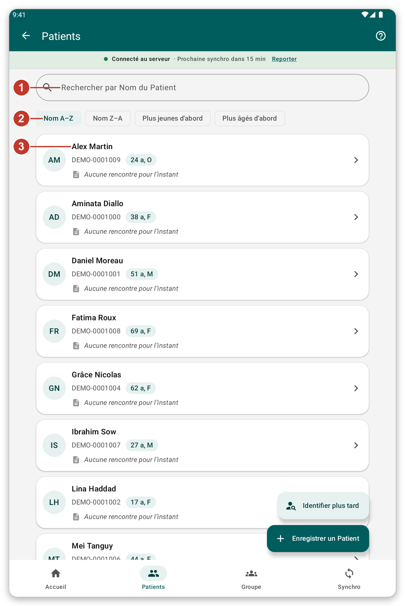
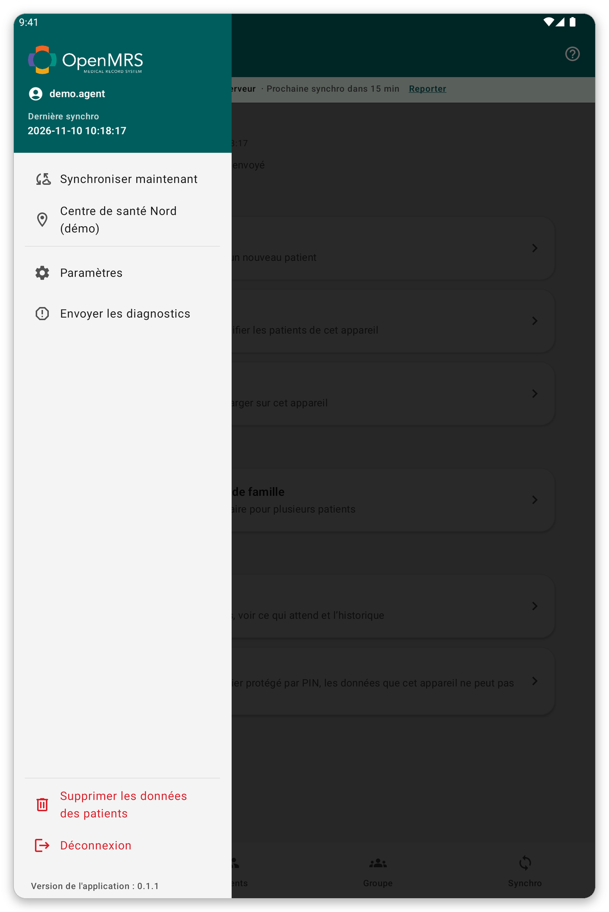
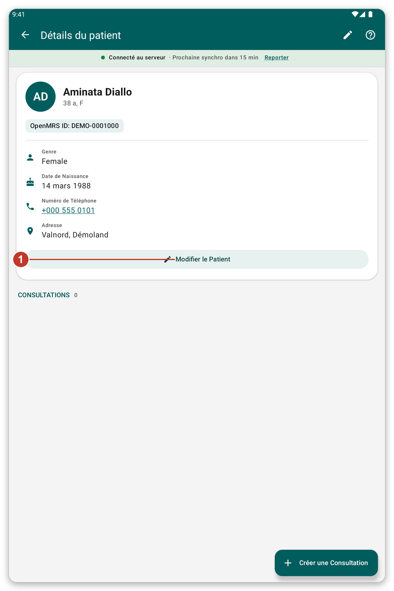

# Trouver et ouvrir un patient {#find-patient}

## À quoi cela sert {#find-purpose}

Chercher un patient sur la tablette, ouvrir son dossier et corriger ses informations.

## Avant de commencer {#find-before}

Le patient doit être dans une liste de patients que vous avez choisie, ou vous devez l'avoir enregistré sur cette tablette.

## Pas à pas {#find-steps}

*Figure 1 : la liste des patients.*

1. Touchez {{nav_patients}} dans la barre du bas.
2. Écrivez un nom, un numéro d'identifiant ou un numéro de téléphone dans la zone de recherche (1).
3. Choisissez l'ordre avec les boutons dessous (2) : {{patient_sort_name_asc}}, {{patient_sort_name_desc}}, {{patient_sort_age_youngest}} ou {{patient_sort_age_oldest}}.
4. Touchez un patient (3) pour ouvrir son dossier.

*Figure 2 : écrire une partie d'un nom n'affiche que les patients correspondants.*

La liste montre 100 patients à la fois. Touchez le bouton à la fin de la liste pour en voir plus. Les patients avec lesquels vous avez travaillé en dernier sont en tête, sous {{recent_patients_title}}.

## Le dossier du patient {#patient-file}

*Figure 3 : le dossier d'un patient.*

Le dossier montre le nom, l'âge, l'identifiant et les coordonnées. Dessous, {{header_encounters}} liste tout ce qui a été noté pour le patient.

1. Touchez {{edit_patient}} (1) pour changer les informations d'enregistrement.
2. Tirez la page vers le bas pour relire le dossier depuis le serveur (quand vous êtes connecté).
3. Touchez un numéro de téléphone pour l'appeler.
4. Utilisez le bouton vert en bas pour noter quelque chose de nouveau (voir [Noter une consultation](#record-encounter)).

## Identifier plus tard {#identify-later}

Parfois, le patient est déjà sur le serveur mais pas sur votre tablette, et vous n'avez pas de connexion. Ne l'enregistrez pas de nouveau : cela créerait un doublon.

1. Sur la liste des patients, touchez {{identify_later_action}}.
2. Écrivez une note qui aidera à retrouver le patient plus tard (nom, village, téléphone).
3. Notez la visite comme d'habitude.
4. Plus tard, une fois connecté, ouvrez le patient et touchez {{identify_banner_identify}} pour retrouver le vrai patient sur le serveur. Tout ce que vous avez noté passe à lui.

> **Attention :** les données d'un patient à identifier plus tard ne sont pas envoyées à la synchronisation, tant que vous ne l'avez pas identifié. L'application vous interroge à leur sujet avant une synchronisation.

## Astuces {#find-tips}

- Une petite marque de nuage sur un patient signifie que ses derniers changements ne sont pas encore envoyés.
- Avec le mode en direct activé, vous pouvez aussi chercher sur le serveur (voir [Synchronisation et mode en direct](#live-mode)).

## Si quelque chose ne va pas {#find-problems}

- Un patient manque : vérifiez que sa liste de patients est sélectionnée (voir [Listes de patients](#patient-lists)).
- Les informations sont périmées : tirez la page vers le bas pour actualiser, ou synchronisez.
