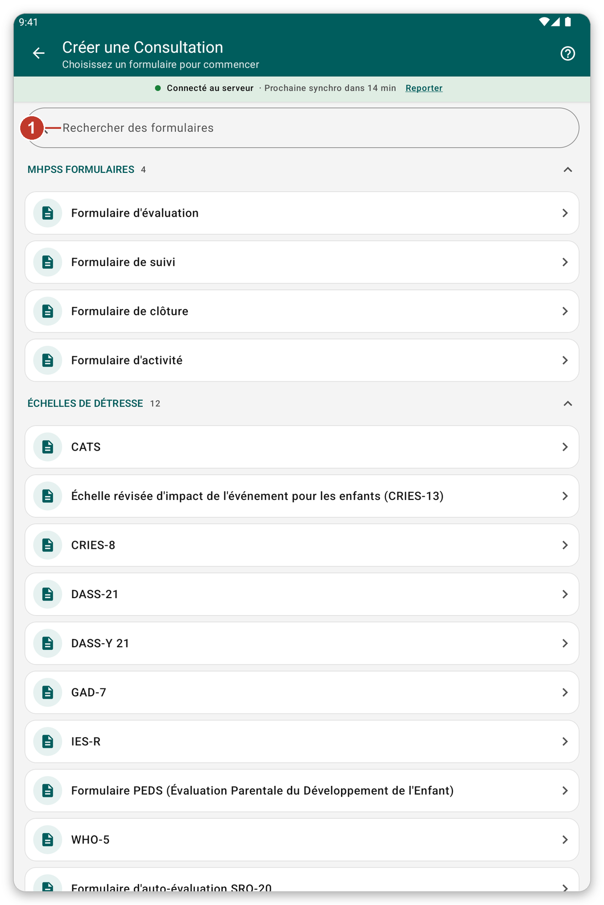

# Noter une consultation avec un formulaire {#record-encounter}

## À quoi cela sert {#encounter-purpose}

Noter ce que vous avez fait pour un patient en remplissant un formulaire, par exemple une échelle de dépistage ou une évaluation.

## Avant de commencer {#encounter-before}

Ouvrez le dossier du patient (voir [Trouver et ouvrir un patient](#find-patient)).

## Pas à pas {#encounter-steps}

1. Dans le dossier du patient, touchez {{create_encounter}} (le bouton vert en bas).
2. La liste des formulaires s'ouvre. Les formulaires sont regroupés en **sections**, par exemple **MHPSS Formulaires**, **Échelles de détresse** et **Échelles de fonctionnement**. Touchez le nom d'une section pour la replier ou l'ouvrir.
3. Pour trouver vite un formulaire, écrivez une partie de son nom dans {{search_forms}}.
4. Touchez le formulaire voulu.

*Figure 1 : choisissez un formulaire. Les sections sont celles définies dans les paramètres de l'application.*

5. Répondez aux questions. Un formulaire peut avoir plusieurs pages. Utilisez {{button_pagination_next}} et {{button_pagination_previous}}, ou touchez le nom d'une page en haut.
6. Quand vous avez fini, touchez {{button_review}} et vérifiez vos réponses.
7. Touchez {{submit}}.

Ce que vous enregistrez reste sur la tablette et est envoyé à la prochaine synchronisation. Avec le mode en direct activé, c'est envoyé un instant plus tard.

> **Attention :** les réponses marquées **obligatoires** doivent être remplies avant de continuer.

## Voir ou modifier une consultation {#edit-encounter}

Dans le dossier du patient, touchez le titre d'une consultation pour la lire. Touchez le crayon pour la modifier.

## Choisir les sections que vous voyez {#form-sections}

Les sections viennent des paramètres de votre organisation. Vous pouvez créer les vôtres : ouvrez {{settings}}, allez à {{settings_section_forms_visits}} et touchez {{form_sections_customize}} (voir [Paramètres](#settings)).

## Si quelque chose ne va pas {#encounter-problems}

- Un formulaire dont vous avez besoin n'est pas dans la liste : regardez dans les autres sections, ou cherchez-le. S'il manque toujours, demandez à votre organisation.
- Le formulaire dit qu'une réponse est obligatoire : faites défiler jusqu'au message rouge et répondez.
