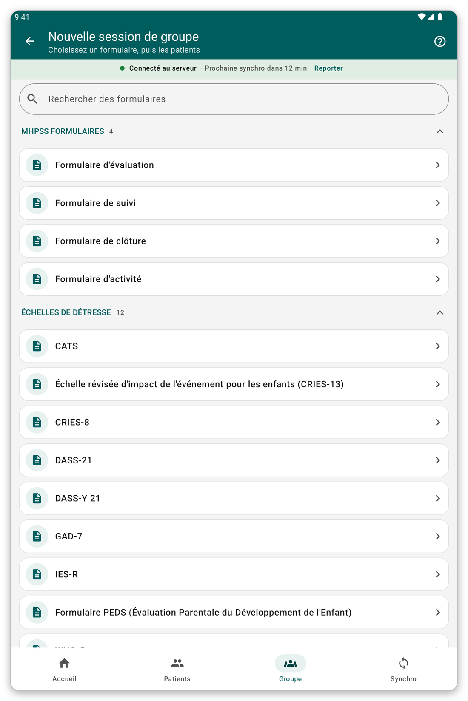

# Séances de groupe et visites {#group-and-visits}

## Séance de groupe ou de famille {#group-session}

**À quoi cela sert :** remplir un seul formulaire pour plusieurs patients à la fois, par exemple une famille ou un groupe.

**Avant de commencer :** les patients doivent être sur la tablette.

*Figure 1 : commencez une séance de groupe en choisissant le formulaire.*

1. Touchez {{title_group_encounter}} sur l'écran d'accueil, ou {{nav_group_session}} dans la barre du bas.
2. Choisissez le formulaire.
3. Choisissez les patients de la séance.
4. Répondez aux questions. Chaque patient a son propre onglet en haut, avec ses propres réponses.
5. Vérifiez et enregistrez.

> **Astuce :** une séance que vous avez commencée sans la terminer est gardée, pour que vous puissiez la continuer.

## Visites {#visits}

Une visite est une période de soins qui contient une ou plusieurs consultations.

Par défaut, l'application crée toute seule une visite pour chaque consultation. Vous ne voyez jamais les visites, et le dossier du patient est une simple liste de consultations.

Si votre organisation préfère que vous gériez vous-même les visites (le paramètre {{settings_automatic_visits}} est désactivé) :

1. Dans le dossier du patient, touchez {{start_visit}} pour ouvrir une visite. L'application demande quand elle a commencé.
2. Notez les consultations de la visite.
3. Touchez {{end_visit}} quand la visite est terminée. Touchez {{reopen_visit}} pour la rouvrir.

> **Remarque :** une seule visite peut être ouverte à la fois. Une consultation doit se situer dans sa visite.

## Si quelque chose ne va pas {#group-problems}

- Un patient manque dans la séance : il n'est pas sur la tablette. Choisissez d'abord sa liste de patients (voir [Listes de patients](#patient-lists)).
- L'application refuse d'enregistrer une consultation dans une visite : sa date est en dehors de la visite. Changez la date ou la visite.
