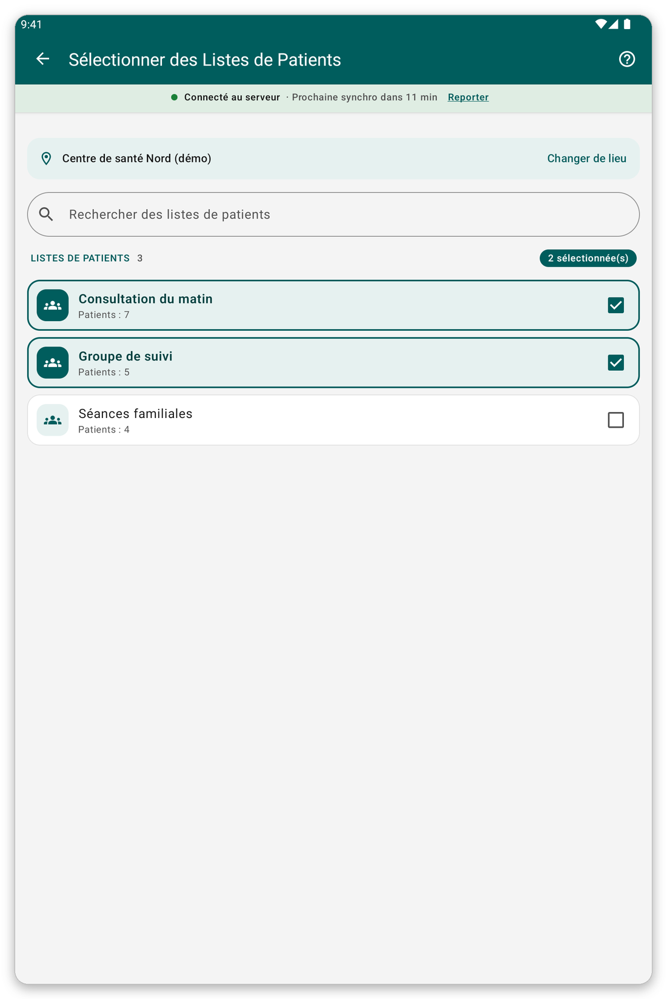

# Lieu et listes de patients {#location-and-lists}

## À quoi cela sert {#lists-purpose}

Choisir l'endroit où vous travaillez et les listes de patients dont vous gardez les patients sur la tablette.

## Changer de lieu {#change-location}

1. Ouvrez le menu et touchez le nom de votre lieu.
2. Écrivez une partie d'un nom dans {{search_a_location}}, ou faites défiler.
3. Touchez le lieu voulu.

Les lieux marqués d'une étoile passent en premier.

## Changer les listes de patients {#patient-lists}

*Figure 1 : cochez les listes que vous voulez sur la tablette.*

1. Sur l'écran d'accueil, touchez {{patient_lists_header}}.
2. Écrivez une partie d'un nom dans {{search_patient_lists}} pour trouver une liste.
3. Cochez les listes voulues. Leurs patients sont téléchargés tout de suite.
4. Touchez {{submit}}.

> **Attention :** si aucune liste n'est cochée, aucun patient n'est téléchargé.

## Si quelque chose ne va pas {#lists-load-problems}

- Les listes ne se chargent pas : vérifiez la connexion et touchez {{patient_lists_try_again}}. Vous pouvez aussi toucher {{patient_lists_continue_without}} et choisir les listes plus tard.
- Aucun lieu n'est proposé : votre organisation n'a pas relié de lieux à votre compte. Demandez-leur.
