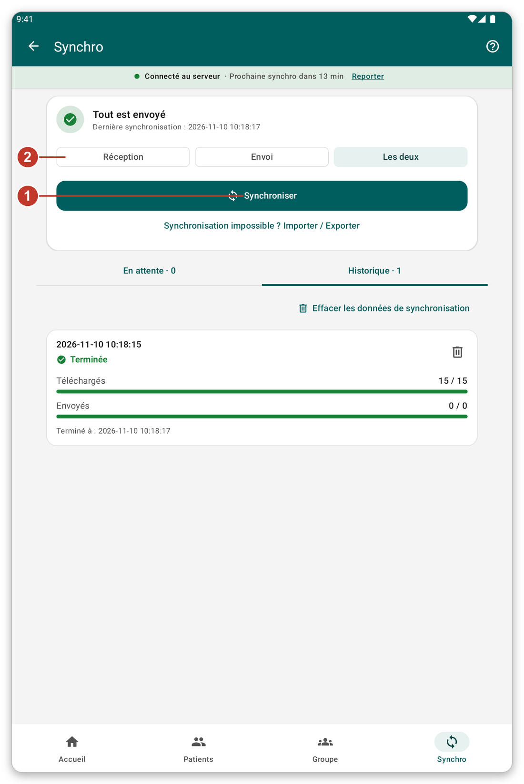

# Synchronisation et mode en direct {#sync}

## À quoi cela sert {#sync-purpose}

La **synchronisation** envoie au serveur ce que vous avez noté sur la tablette et récupère les dernières données. Tant que vous ne synchronisez pas, votre travail reste en sécurité sur la tablette seulement.

## Avant de commencer {#sync-before}

Vous avez besoin d'une connexion au serveur. Si vous travaillez en invité, l'application vous demande d'abord de vous connecter.

## Pas à pas {#sync-steps}

*Figure 1 : la page de synchronisation.*

1. Touchez {{nav_sync}} dans la barre du bas.
2. En haut, vous voyez si quelque chose attend d'être envoyé et quand les données ont été synchronisées pour la dernière fois.
3. Choisissez ce qu'il faut faire cette fois avec les trois boutons (2) : {{sync_page_mode_download}}, {{sync_page_mode_upload}} ou {{sync_page_mode_both}}. Ce choix ne vaut que pour cette synchronisation.
4. Touchez {{sync_now}} (1). Vous pouvez continuer à utiliser l'application pendant qu'elle s'exécute.
5. Pour l'arrêter, touchez {{sync_cancel}}.

Dessous, {{sync_tab_pending}} liste ce qui n'est pas encore envoyé, et {{sync_tab_history}} liste les synchronisations passées et leur résultat.

> **Attention :** évitez de supprimer les données des patients ou de vous déconnecter avant que tout soit envoyé. Vérifiez que l'écran d'accueil affiche {{home_summary_uploaded}}.

## Synchronisation automatique {#automatic-sync}

L'application peut se synchroniser toute seule de temps en temps. Elle attend un bon moment, par exemple quand la tablette est sur le Wi-Fi et que la batterie n'est pas faible. Vous pouvez le changer dans {{settings}} (voir [Paramètres](#settings)). La bande sous le titre indique quand la prochaine synchronisation commencera. Touchez {{auto_sync_delay_link}} pour la reporter.

## Mode en direct {#live-mode}

Avec {{settings_live_mode}} activé, ce que vous enregistrez est envoyé tout de suite au serveur, et vous pouvez chercher sur le serveur des patients qui ne sont pas sur la tablette. Sans connexion, rien n'est perdu : votre travail est gardé et envoyé plus tard.

Activez-le dans {{settings}}, dans la section {{settings_section_live}}.

## Session expirée {#session-expired}

Si le serveur n'accepte plus votre connexion, une bande apparaît sous l'état de la connexion. Touchez {{sign_in}}. Ce que vous avez fait entre-temps reste sur la tablette et est envoyé ensuite.

## Si quelque chose ne va pas {#sync-problems}

- La synchronisation ne démarre pas : le serveur est injoignable. Vérifiez la connexion (voir [Dépannage](#cannot-connect)).
- La synchronisation échoue : ouvrez {{sync_tab_history}} pour voir comment elle s'est terminée, puis réessayez. Votre travail n'est pas perdu.
- L'application vous interroge sur des patients à identifier : choisissez de les identifier maintenant, ou de synchroniser quand même (voir [Identifier plus tard](#identify-later)).
