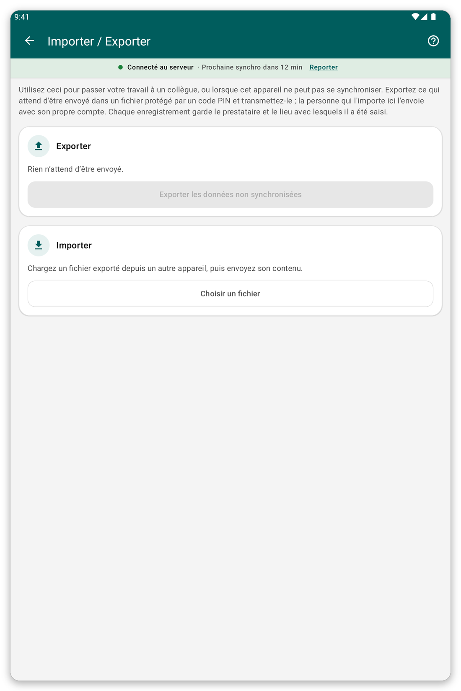

# Import et export {#import-export}

## À quoi cela sert {#ie-purpose}

Quand une tablette ne peut pas se synchroniser, vous pouvez transmettre ses données non envoyées à un collègue, dans un fichier protégé par un code PIN. Le collègue importe le fichier et l'envoie avec son propre compte.

## Avant de commencer {#ie-before}

- La tablette qui exporte doit avoir des données en attente d'envoi.
- Les deux personnes doivent se mettre d'accord sur un code PIN à quatre chiffres.

*Figure 1 : la page d'import et d'export.*

## Exporter un fichier {#export}

1. Sur l'écran d'accueil, touchez {{title_import_export}}.
2. Touchez {{export_title}}.
3. Saisissez ou choisissez le code PIN à quatre chiffres. <!-- TODO: verify whether the app asks for the PIN or generates it -->
4. Enregistrez ou partagez le fichier, comme l'application le propose.

## Importer un fichier {#import}

1. Sur l'écran d'accueil, touchez {{title_import_export}}.
2. Touchez {{import_title}} et choisissez le fichier.
3. Saisissez le code PIN.
4. L'application enregistre les données. Synchronisez ensuite pour les envoyer.

> **Attention :** importer deux fois le même fichier ne fait rien, vous ne pouvez donc pas créer de doublons. Si le mode en direct est activé, le travail est déjà envoyé : il peut n'y avoir rien à exporter.

## Si quelque chose ne va pas {#ie-problems}

- Le code PIN est refusé : demandez à l'expéditeur de confirmer les quatre chiffres.
- Certaines données ne sont pas enregistrées : le rapport dit lesquelles et pourquoi. Une modification d'un patient ne peut être enregistrée que si ce patient est déjà sur votre tablette.
