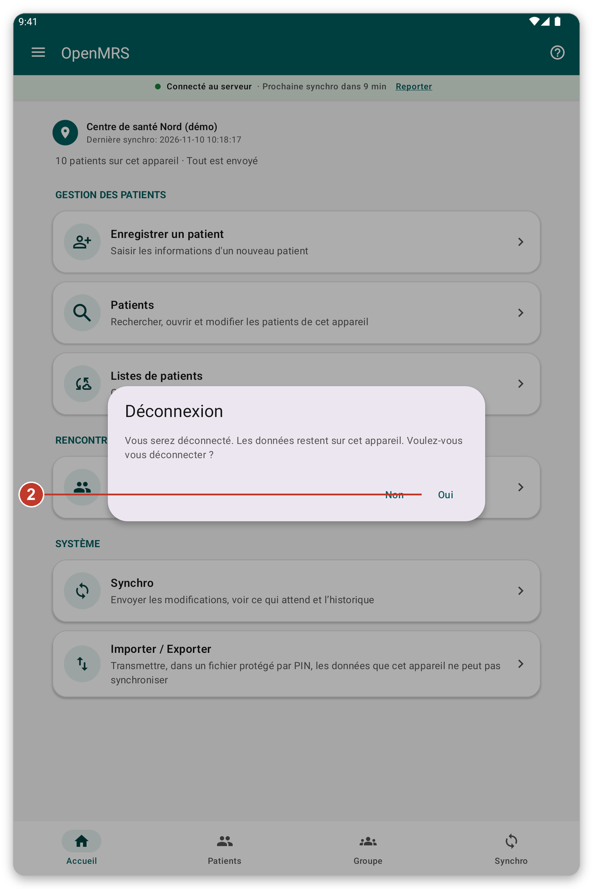
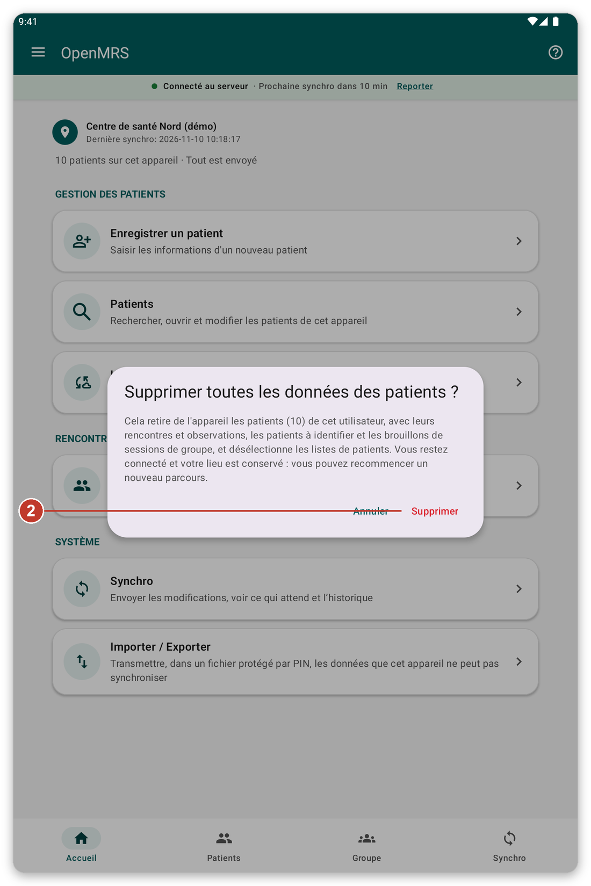
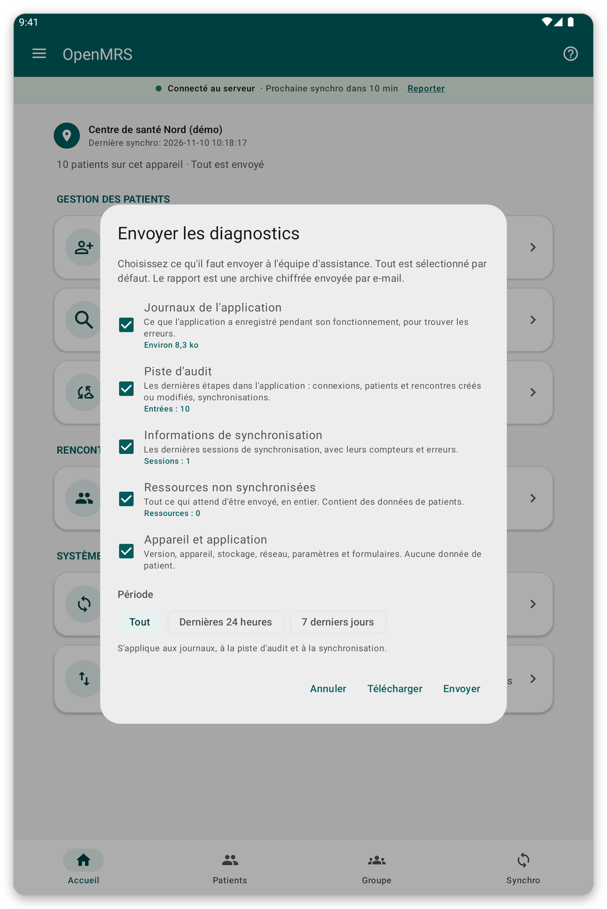

# Sécurité, utilisateurs et vos données {#security}

## Connexion hors ligne et écran de verrouillage {#lock-screen}

Si vous avez activé {{offline_login_title}}, l'application se verrouille quand vous y revenez après un moment. Vous la déverrouillez avec votre empreinte, votre visage ou le verrouillage de l'écran, même sans connexion. Vous pouvez choisir combien de temps l'application attend avant de redemander, dans {{settings}}.

> **Attention :** si vous changez ou retirez l'empreinte ou le verrouillage d'écran de la tablette, la connexion hors ligne est désactivée et vous devez vous reconnecter avec votre compte.

## Plusieurs personnes sur une même tablette {#several-users}

Par défaut, vos données restent sur la tablette quand vous vous déconnectez : la personne suivante les retrouve.

- Vous ne voyez que les patients que vous avez enregistrés ou téléchargés. Les autres utilisateurs ne les voient pas, sauf si vous l'autorisez dans {{settings}} ({{settings_share_my_data}}).
- Chaque utilisateur a ses propres listes de patients et son propre lieu.
- Sur la page de connexion, la petite icône de nuage indique si des utilisateurs ont encore des données en attente d'envoi. Touchez-la pour les voir, puis touchez {{login_pending_use_user}} pour remplir le nom d'utilisateur.

## Se déconnecter {#log-out}

*Figure 1 : la déconnexion demande une confirmation.*

1. Ouvrez le menu et touchez {{logout}}.
2. Lisez le message. Il dit ce qui arrive à vos données.
3. Touchez {{yes}} pour vous déconnecter, ou {{no}} pour rester.

## Supprimer les données des patients {#delete-data}

Cela retire de la tablette les patients de votre compte, avec leurs consultations, pour que vous puissiez repartir de zéro. Vous restez connecté et gardez votre lieu.

*Figure 2 : le message dit combien de patients sont concernés et quelle part n'a jamais été envoyée.*

> **Attention :** les données jamais envoyées sont perdues pour toujours. Synchronisez d'abord et vérifiez que {{home_summary_uploaded}} s'affiche.

1. Ouvrez le menu et touchez {{delete_patient_data_menu}}.
2. Lisez combien de patients et de données non envoyées sont concernés.
3. Touchez {{delete}} pour confirmer, ou {{cancel}} pour arrêter. Si la connexion hors ligne est activée, on vous demande votre empreinte ou le verrouillage de l'écran.

## Envoyer des diagnostics {#diagnostics}

Si l'équipe d'assistance le demande, l'application peut préparer un rapport qui aide à trouver un problème. Vous choisissez ce qu'il contient, et le rapport est protégé.

*Figure 3 : choisissez ce qu'il faut inclure dans le rapport.*

1. Ouvrez le menu et touchez {{send_diagnostics}}.
2. Choisissez ce qu'il faut inclure et sur quelle période.
3. Suivez les étapes pour envoyer le rapport par courriel. <!-- TODO: verify the exact steps of the e-mail screen -->

> **Remarque :** le rapport ne contient ni mots de passe ni informations sur les patients.

## Si quelque chose ne va pas {#security-problems}

- Vous n'arrivez pas à déverrouiller l'application : touchez le bouton pour vous connecter avec votre compte à la place.
- Vous avez oublié votre mot de passe : demandez à votre organisation de le réinitialiser.
