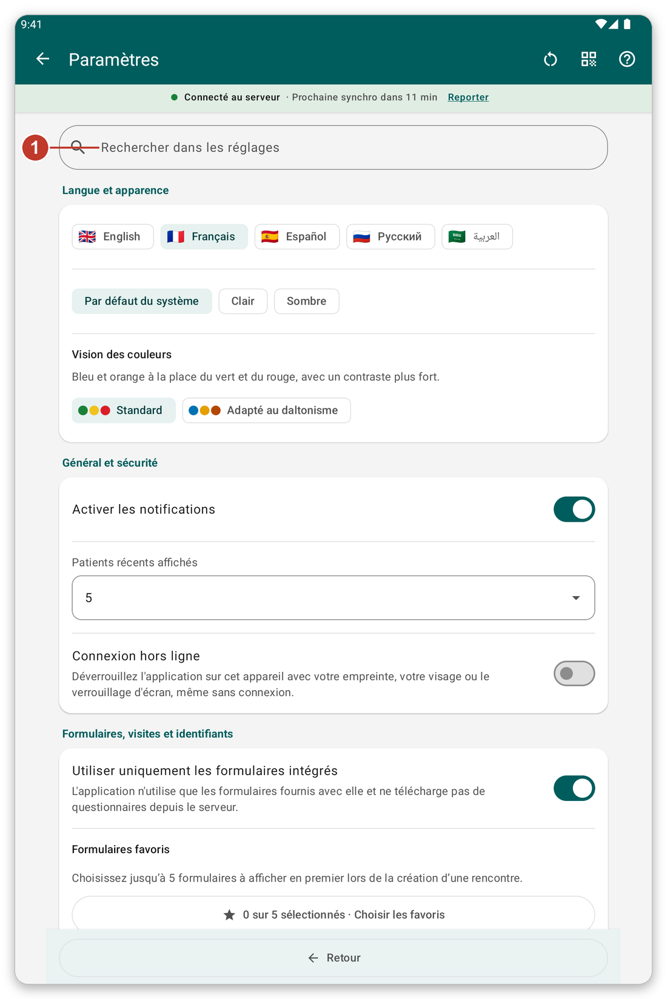
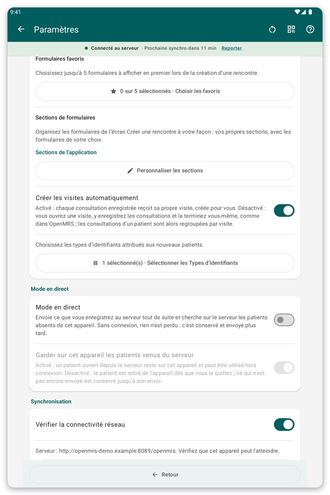
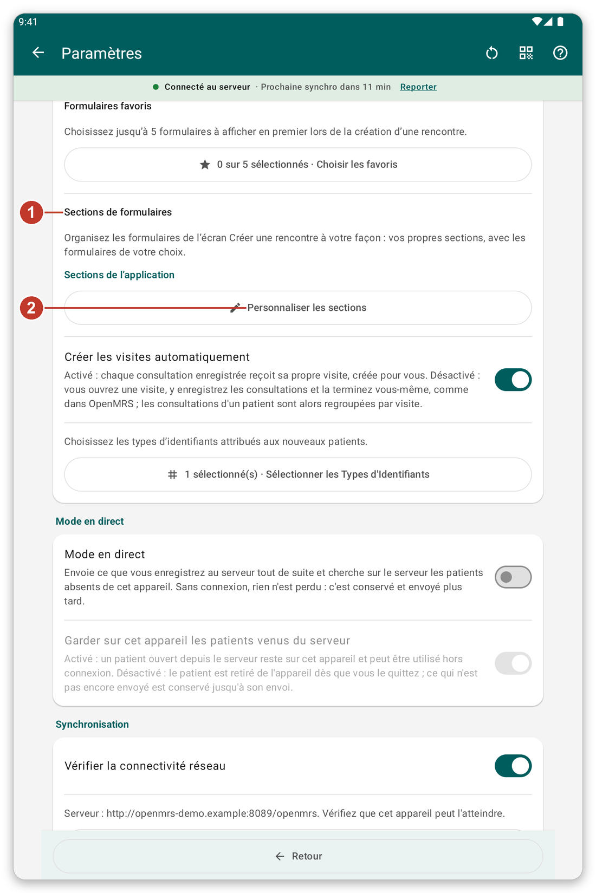
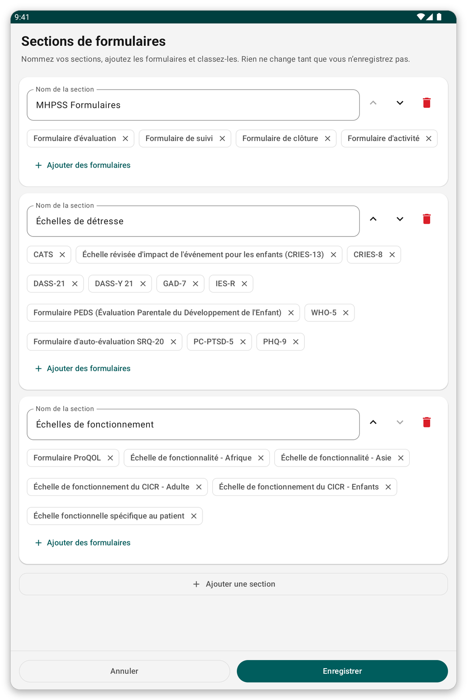

# Paramètres {#settings}

Ouvrez le menu et touchez {{settings}}. Les changements sont enregistrés dès que vous les faites.

*Figure 1 : la page des paramètres. Écrivez un mot dans la zone de recherche (1) pour n'afficher que les sections qui le mentionnent.*

## Langue et apparence {#settings-language}

- {{settings_language}} : anglais, français, espagnol, russe ou arabe. Les écrans passent de droite à gauche en arabe.
- {{settings_section_appearance}} : clair, sombre, ou le thème du système. Une palette pour le daltonisme est aussi disponible.

## Général et sécurité {#settings-general}

- Notifications activées ou non.
- Combien de **patients récents** sont listés en haut de la liste des patients (0 masque la section).
- Si les autres utilisateurs de cette tablette peuvent voir les patients que vous avez enregistrés (désactivé par défaut).
- Si l'application se souvient de votre dernier lieu après la connexion.
- {{offline_login_title}} : déverrouiller avec l'empreinte, le visage ou le verrouillage de l'écran, combien de temps l'application attend avant de redemander, masquer l'application dans la liste des applications récentes, et ce qui arrive aux données à la déconnexion.

*Figure 2 : Le milieu de la page des paramètres, avec les options générales et de sécurité.*

## Formulaires, visites et identifiants {#settings-forms}

*Figure 3 : les sections de formulaires (1) et le bouton pour les modifier (2).*

- {{favorite_forms}} : choisissez jusqu'à cinq formulaires à afficher en premier.
- {{form_sections_title}} : les sections de la liste des formulaires. Touchez {{form_sections_customize}} pour créer les vôtres.
- {{settings_automatic_visits}} : activé, l'application crée une visite pour chaque consultation ; désactivé, vous ouvrez et terminez les visites vous-même.
- **Types d'identifiants :** les sortes d'identifiants que reçoivent les nouveaux patients.

### Créer vos propres sections de formulaires {#own-sections}

*Figure 4 : nommez les sections et mettez-y des formulaires. Rien ne change avant d'enregistrer.*

1. Touchez {{form_sections_customize}}.
2. Changez le nom d'une section, montez-la ou descendez-la, ou supprimez-la.
3. Touchez {{form_section_add_forms}} pour mettre des formulaires dans une section, et {{form_section_add}} pour une nouvelle section.
4. Touchez {{save}}.

## {{settings_section_live}} {#settings-live}

Envoyez ce que vous enregistrez au serveur tout de suite, et cherchez sur le serveur des patients qui ne sont pas sur la tablette.

## {{settings_section_sync}} {#settings-sync}

- L'adresse du serveur et un bouton pour tester la connexion.
- {{settings_auto_sync}}, ce qu'elle fait (envoyer seulement, ou envoyer et télécharger) et quand elle attend (Wi-Fi seulement, batterie faible).

## Partager les paramètres avec une autre tablette {#share-settings}

L'icône à côté du titre affiche un code QR de vos paramètres. Sur une autre tablette, choisissez d'importer et scannez-le. Vous voyez ce qui changerait et vous l'approuvez. Les patients, les mots de passe et votre compte ne sont jamais partagés. <!-- TODO: verify the exact labels of the share and import buttons -->

> **Astuce :** si vous avez changé beaucoup de paramètres et voulez repartir de zéro, utilisez le bouton de réinitialisation à côté du titre.
